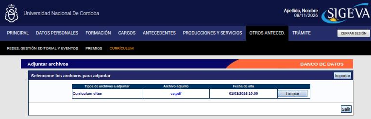
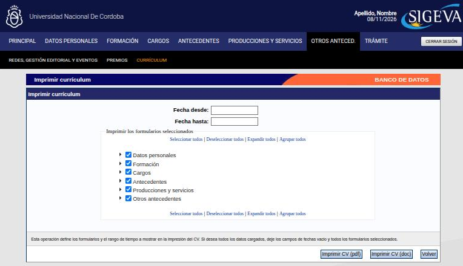

---
fuente:
  - "SIGEVA-UNC, sistema real (2026-11-08): Otros anteced. › Currículum (Adjuntar archivos) e Imprimir currículum"
  - "Manual del Investigador, UBA (7.ª ed.), 3.13.4 y 3.15"
  - "Guía Banco de Datos de Actividades CyT v4, CONICET (2017), Imprimir el CV"
  - "FAUD-UNC (2025), introducción"
  - "Taller sobre SIGEVA, UNC, 2026-08-06 (diap. 21 y grabación) y 2026-08-13 (grabación y demostración)"
verificado_contra: ambos
fecha_verificacion: 2026-11-08
estado: verificado
---

# CV adjunto e impresión

Son dos funciones distintas: **subir** un CV en archivo como complemento y **descargar** el CV que arma SIGEVA con lo que cargaste. Las dos están en **Otros anteced. › Currículum**, y también se llega a ellas desde el pie de la Principal.

## CV adjunto

Además de los datos estructurados, podés subir un **CV académico en archivo**. En la Principal es el ítem **Curriculum vitae**, dentro de Otros antecedentes, y su columna **Estado** indica si ya subiste uno.

Al entrar se abre la pantalla **Adjuntar archivos**. La tabla muestra el tipo de archivo (Curriculum vitae), el archivo adjunto, la fecha de alta y un botón **Limpiar**. Arriba a la derecha está **Importar** y abajo, **Salir**.

### Cómo se reemplaza

1. Presioná **Limpiar** para quitar el archivo actual.
2. Subí el nuevo.

!!! warning "Limpiar borra el archivo"
    Antes de presionar **Limpiar**, asegurate de tener a mano el archivo nuevo.

!!! note "Pendiente de verificar"
    Cómo se sube el archivo cuando el ítem está vacío y qué formatos acepta. No se pudo ver en el sistema porque la cuenta usada para verificar ya tenía un CV cargado y quitarlo habría modificado datos. Según el manual de la UBA, se elige el archivo con **Examinar** y se sube con **Adjuntar**, y los formatos son .pdf (preferido), .doc o .rtf.

!!! tip "Sugerencia"
    - El CV adjunto **es un complemento, no un reemplazo**. Sirve para lo que no encaja en las categorías del sistema o para presentar tu trayectoria con el formato de tu disciplina. En muchas convocatorias que se evalúan por SIGEVA, lo que no está cargado en el banco de datos no se considera, aunque figure en el CV adjunto.
    - Subí la **versión más actual** y la **más pertinente** para lo que vas a presentar.
    - Armalo siguiendo el **formulario de CV que publique tu unidad académica** (el área de concursos suele tenerlo) y borrá los apartados que no uses. Algunas comisiones evaluadoras lo usan para contrastarlo con el banco de datos.

## Imprimir el CV

**Imprimir CV**, al pie de la Principal, abre la pantalla **Imprimir currículum**. Desde ahí descargás un archivo con lo que tenés cargado en el banco de datos, en formato de currículum.

1. Si querés limitar el período, completá **Fecha desde** y **Fecha hasta**. Si los dejás vacíos, se imprime todo.
2. En **Imprimir los formularios seleccionados**, marcá las secciones que querés incluir. Por defecto vienen **todas** marcadas. Con la flecha de cada sección la desplegás para elegir ítems sueltos. Arriba y abajo de la lista tenés **Seleccionar todos**, **Deseleccionar todos**, **Expandir todos** y **Agrupar todos**.
3. Presioná **Imprimir CV (pdf)** o **Imprimir CV (doc)**, según el formato que necesites. **Volver** sale sin imprimir.

Usos frecuentes: concursos que piden el «CV SIGEVA» en PDF, controlar cómo se ve lo que cargaste o detectar duplicados.

!!! tip "Sugerencia"
    Imprimí el CV después de cada carga grande y revisalo como lo vería quien evalúa: caracteres raros en resúmenes y títulos, registros duplicados, campos vacíos.
