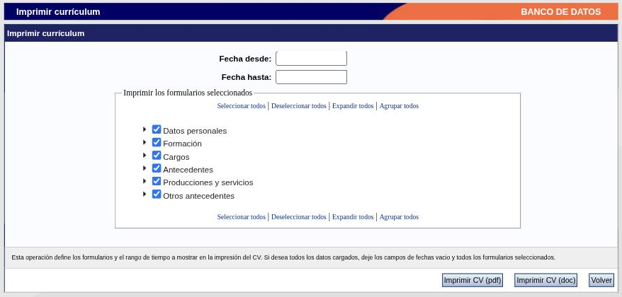

---
fuente:
  - "SIGEVA-UNC, Otros antecedentes → Currículum y pantalla Imprimir currículum"
  - "Manual del Investigador, UBA (7.ª ed.), 3.13.4 y 3.15; Manual del Usuario del Banco de Datos, UNC (2011), Archivos adjuntos e Imprimir CV"
  - "Guía Banco de Datos de Actividades CyT v4, CONICET (2017), impresión del CV"
verificado_contra: sistema real
fecha_verificacion: 2026-09-30
estado: pendiente_verificar
---

# Currículum adjunto e impresión del CV

Son dos cosas distintas: **adjuntar** un archivo con tu currículum al banco de datos, y **obtener** un currículum generado por el sistema a partir de lo que cargaste.

## Adjuntar el currículum

**Otros anteced. → Currículum** abre la pantalla **Adjuntar archivos**. Muestra una tabla de tipos de archivo a adjuntar, con las columnas **Archivo adjunto** y **Fecha de alta**, y los botones **Importar**, **Limpiar** y **Salir**. En la pantalla principal, el renglón **Curriculum vitae** indica **Con datos** cuando ya hay un archivo.

!!! note "Pendiente de verificar"
    Esta pantalla se relevó solo en su estructura, sin operar sobre ella. No se comprobó qué formatos acepta ni el tamaño máximo. El manual de la UBA ubica el currículum adjunto entre los datos mínimos que se piden para asociarse a un proyecto.

!!! tip "Sugerencia de la SeICyT"
    El archivo adjunto no reemplaza la carga en los formularios: las convocatorias toman los datos del banco. Mantenelo como respaldo y actualizalo cuando generes una versión nueva.

## Imprimir el CV

El sistema arma un currículum con lo que tenés cargado. Se llega desde el enlace **Imprimir currículum**, al pie de la pantalla principal.

### Paso a paso

1. Si querés limitar el período, completá **Fecha desde** y **Fecha hasta**. Para incluir todo, dejalas vacías.
2. En **Imprimir los formularios seleccionados**, marcá qué secciones incluir. El árbol reproduce la organización del banco de datos: Datos personales, Formación, Cargos, Antecedentes, Producciones y servicios y Otros antecedentes. La flecha de cada grupo lo despliega para elegir apartado por apartado.
3. Los enlaces **Seleccionar todos**, **Deseleccionar todos**, **Expandir todos** y **Agrupar todos** ayudan a marcar rápido.
4. Presioná **Imprimir CV (pdf)** o **Imprimir CV (doc)**, según el formato que necesites. **Volver** regresa a la pantalla principal.

La ayuda en pantalla lo resume así: la operación define los formularios y el rango de tiempo que se muestran; si querés todos los datos, dejá las fechas vacías y todos los formularios seleccionados.

!!! note "Pendiente de verificar"
    No se generó ningún currículum durante el relevamiento, así que no se revisó cómo queda el documento.

!!! tip "Sugerencia de la SeICyT"
    - Para una convocatoria que pide «los últimos cinco años», usá el rango de fechas en lugar de recortar el documento a mano.
    - Generá el PDF después de cada actualización importante y leelo de corrido: es la mejor forma de encontrar registros duplicados, fechas sin cerrar e instituciones mal elegidas.

## Fuentes

- SIGEVA-UNC, pantallas **Adjuntar archivos** e **Imprimir currículum**, relevadas el 2026-09-30.
- Manual UBA (7.ª ed.), 3.13.4, 3.15 y 5.2; manual UNC (2011): cobertura. Guía CONICET v4: selección de secciones y fechas en la impresión.
