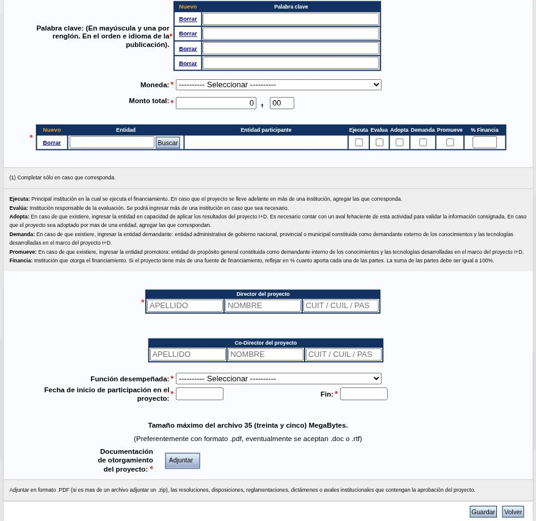

---
fuente:
  - "SIGEVA-UNC, Antecedentes: formularios de alta de Formación de recursos humanos, Financiamiento CyT, Extensión, Evaluación y Otras actividades CyT"
  - "Estructura: Manual del Investigador, UBA (7.ª ed.), 3.11; Manual del Usuario del Banco de Datos, UNC (2011), Antecedentes académicos"
verificado_contra: sistema real
fecha_verificacion: 2026-09-30
estado: pendiente_verificar
---

# Antecedentes

La solapa **Antecedentes** tiene cinco apartados: **Formación de recursos humanos**, **Financiamiento CyT**, **Extensión**, **Evaluación** y **Otras actividades CyT**.

## Formación de recursos humanos en CyT

Acá cargás a las personas que dirigiste o dirigís. Hay cinco tablas: **Becarios**, **Tesistas**, **Investigadores**, **Pasantes de I+D y/o formación académica** y **Personal técnico y de apoyo a la I+D**.

En las cinco se indica la **Función desempeñada \***: *Director o tutor* o *Co-director o co-tutor*.

### Becarios

| Campo | Opciones u observaciones |
|---|---|
| Año inicio \* · Fin \* | Si la beca sigue en curso, el año estimado de finalización |
| Nombre y apellido del becario \* | |
| Institución de trabajo del becario \* | Buscador |
| Institución financiadora de la beca \* | Buscador |
| Tipo de tareas \* | Tareas de investigación y desarrollo · Formación académica · Formación académica con tareas de I+D · Capacitación pre-profesional y/o profesional |
| Tipo de beca \* | Posdoctorado · Postgrado/Doctorado · Postgrado/Maestría · Postgrado/Especialización · Formación de grado · Iniciación a la investigación · Perfeccionamiento en la investigación · Especialización · Práctica profesional · Otro tipo de beca de investigación · Otro tipo de beca |
| Función desempeñada \* | |

### Tesistas

| Campo | Opciones u observaciones |
|---|---|
| Año inicio \* · Año defensa tesis \* | Si sigue en curso, el año estimado |
| Nombre y apellido del tesista \* | |
| Institución otorgante del título \* | Buscador |
| Tipo de trabajo dirigido \* | Tesis de Doctorado · Trabajo final, proyecto, obra o tesis de Maestría · Trabajo final de Especialización · Tesina o trabajo final de Grado |
| Calificación obtenida | Opcional |
| Función desempeñada \* | |

!!! tip "Sugerencia de la SeICyT"
    Una misma persona puede figurar en las dos tablas: como becaria (por la beca que dirigís) y como tesista (por la tesis). Son antecedentes distintos y conviene cargar ambos.

### Investigadores

Año inicio \*, Fin, nombre y apellido \*, institución de trabajo \*, Carrera \* (CONICET · CIC pcia. Bs. As. · Otra), Categoría \*, Otro cargo/función y Función desempeñada \*.

### Pasantes de I+D y/o formación académica

Año inicio \*, Fin, institución de trabajo del pasante \*, nombre y apellido \*, Tipo de tareas \*, Ámbito institucional \* (solo para capacitación pre-profesional o profesional), Tema del plan de trabajo \*, Nivel educativo del pasante \* (grado · especialización · maestría · doctorado · posdoctorado) y Función desempeñada \*.

!!! tip "Sugerencia de la SeICyT"
    Las ayudantías de investigación y las adscripciones a proyectos que dirigís pueden cargarse en esta tabla.

### Personal técnico y de apoyo a la I+D

Año inicio \*, Fin, institución de trabajo \*, nombre y apellido \*, Carrera \* (Carrera del personal de apoyo de CONICET · de CIC pcia. Bs. As. · Otra), Categoría \*, Otro cargo/función y Función desempeñada \*.

## Financiamiento CyT

Seis tablas: **Proyectos de I+D**, **Proyectos de extensión, vinculación y transferencia**, **Proyectos de comunicación pública de CyT**, **Subsidios para eventos CyT**, **Subsidios para infraestructura y equipamiento** y **Becas recibidas**.

### Proyectos

Las tres tablas de proyectos abren un mismo formulario, con el tipo ya definido. Es el más largo de la solapa.

!!! note "Pendiente de verificar"
    Se abrió el formulario de **Proyecto de I+D**. Los de extensión y de comunicación pública no se abrieron.

**Datos del proyecto**

| Campo | Opciones u observaciones |
|---|---|
| Tipo de actividad de I+D \* | Investigación básica · Investigación aplicada · Desarrollo experimental o tecnológico |
| Denominación del proyecto \* | |
| Tipo de proyecto · Código de identificación | Opcionales |
| Fecha desde \* · Hasta \* | |
| Breve descripción del proyecto \* | |
| Campo de aplicación \* | Lista de unas 280 opciones |
| Área del conocimiento \* · Especialidad \* | |
| Palabras clave \* | En mayúscula, una por renglón |
| Moneda \* · Monto total \* | Dólares · Euros · Libras · Pesos |

**Entidades participantes \*.** Una tabla donde buscás cada institución y marcás qué papel cumple:

| Columna | Qué significa, según la ayuda en pantalla |
|---|---|
| Ejecuta | Institución principal donde se ejecuta el financiamiento |
| Evalúa | Institución responsable de la evaluación |
| Adopta | Entidad en condiciones de aplicar los resultados, si existe |
| Demanda | Entidad de gobierno que demanda externamente los conocimientos, si existe |
| Promueve | Entidad promotora, si existe |
| % Financia | Porcentaje que aporta cada institución; la suma debe dar 100 % |

**Dirección y participación**

- **Director del proyecto \*** y **Co-Director del proyecto:** apellido, nombre y CUIT/CUIL o pasaporte.
- **Función desempeñada \*:** Becario de I+D · Co-director · Director · Estudiante · Investigador · Personal técnico de apoyo.
- **Fecha de inicio de participación en el proyecto \*** y **Fin \***: tus fechas en el proyecto, que pueden no coincidir con las del proyecto.

**Documentación de otorgamiento del proyecto \*.** Con el botón **Adjuntar** se sube un archivo, de hasta 35 MB y preferentemente en PDF. La ayuda pide las resoluciones, disposiciones, dictámenes o avales que contengan la aprobación del proyecto; si son varios, en un `.zip`.

!!! tip "Sugerencia de la SeICyT"
    - Tené a mano la resolución de aprobación antes de empezar: el archivo está marcado como obligatorio.
    - Pedile a quien dirige el proyecto la denominación y el código exactos, para que todo el equipo los cargue igual.

### Subsidios para eventos CyT

Tipo de subsidio \* (para organización de eventos · para asistencia a eventos), Actividad objeto del financiamiento \*, Fecha desde \* y Hasta \*, Breve descripción \*, Moneda \*, Monto total \* y una tabla de instituciones \* con las columnas Ejecuta, Evalúa y % Financia.

La tabla **Subsidios para infraestructura y equipamiento** abre un formulario del mismo tipo, que no se relevó.

### Becas recibidas

Acá cargás las becas que **obtuviste**.

| Campo | Opciones u observaciones |
|---|---|
| Fecha inicio \* · Fin \* | Si está en curso, la fecha estimada de finalización |
| Tipo de beca \* | Los mismos once tipos que en Becarios |
| Denominación de la beca \* | |
| Tipo de tareas \* | Las mismas cuatro opciones |
| Institución de trabajo del becario \* | Buscador |
| Institución financiadora de la beca \* | Buscador |
| Nombre y apellido del director \* | Y del codirector, opcional |
| Descripción | Tema, plan de trabajo, tareas; hasta 2000 caracteres |
| ¿Financia o financió un posgrado con esta beca? \* | No / Sí |
| Porcentaje de financiamiento \* | Solo si financia un posgrado: 25 % · 50 % · 75 % · 100 % |

## Extensión

Cinco tablas.

### Comunicación pública de la ciencia y la tecnología

| Campo | Opciones u observaciones |
|---|---|
| Denominación de la actividad \* | |
| Fecha inicio \* · Fin | |
| Función desempeñada \* | Organizador o coordinador · Co-organizador o co-coordinador · Conferencista/expositor/entrevistado individual · Integrante de equipo · Otra |
| Descripción de la actividad \* | Hasta 2500 caracteres |
| Medios de divulgación \* | Tabla: tipo de medio, nombre del medio, lugar de realización y una casilla que indica si la participación es periódica |
| Tipo de destinatario \* | Casillas: Público en general · Comunidad científica · Organizaciones sociales · Comunidad educativa · Sector productivo · Otros |
| Fuente de financiamiento \* | Casillas: Ninguna · Fondos de la propia institución · Beneficiarios/destinatarios · Fondos externos · Otra |
| Adjuntar archivo | Opcional; hasta 35 MB |

Los tipos de medio incluyen conferencia o debate público, exposición, prensa escrita, radio, televisión, internet, libro, videos, museos y ferias, y encuentros, entre otros.

!!! tip "Sugerencia de la SeICyT"
    Entrevistas en medios, charlas abiertas, notas de divulgación y participaciones en ferias o muestras van acá. Son justamente las actividades que interesa relevar para la visibilización de las investigaciones de la Facultad.

### Extensión rural o industrial

Denominación \*, fechas, Tipo de extensión \* (Rural / Industrial), Ámbito \* (Rural / Periurbano / Urbano), Función desempeñada \*, Descripción \* (hasta 2500 caracteres), institución de trabajo \*, una tabla de acciones comprendidas \*, Tipo de destinatario \* y Fuente de financiamiento \*.

### Prestación de servicios sociales y/o comunitarios

Fecha inicio \*, Fin, Denominación de la actividad \*, Función desempeñada \* (Organizador o coordinador · Co-organizador o co-coordinador · Integrante de equipo · Prestador individual del servicio · Otra), Descripción \* (hasta 1000 caracteres), institución de trabajo \* y Fuente de financiamiento \*.

### Producción y/o divulgación artística o cultural

Fecha inicio \*, Fin, Denominación de la actividad \*, Función desempeñada \* (Organizador o coordinador · Co-organizador o co-coordinador · Integrante de equipo · Actor/expositor individual · Otra), Descripción \* (hasta 1000 caracteres) e institución de trabajo \*.

### Otro tipo de actividad de extensión

Los mismos campos, con las funciones Organizador o coordinador · Co-organizador o co-coordinador · Integrante de equipo · Otra.

## Evaluación

Cinco tablas. Comparten estos campos: **Año inicio \***, **Fin** (solo si ya no desarrollás la actividad), **Institución convocante \***, **País** y **Ciudad**. Además, cuando la institución convocante es el CONICET, se indica el **Rol evaluador** (Par consultor · Miembro de comisión asesora · Coordinador de comisión asesora · Coordinador alterno · Miembro de comité de evaluación).

### Evaluación de personal CyT y jurado de tesis y/o premios

**Tipo de personal evaluado \***:

- Categorización docentes investigadores (Incentivos)
- Evaluación de becarios
- Evaluación de investigadores
- Evaluación de personal de apoyo a la I+D
- Jurado de concursos docentes
- Jurado de premios
- Jurado de tesinas, trabajos finales y/o tesis

**Descripción \*** (hasta 500 caracteres): la ayuda sugiere precisar el caso; por ejemplo, para un concurso docente, la carrera, el cargo y la cátedra.

### Evaluación de programas/proyectos de I+D y/o extensión

Se marcan los tipos de programas o proyectos evaluados (investigación básica, aplicada, desarrollo, divulgación, producción artística o cultural, servicios sociales, extensionismo, programas de CTI o de extensión, otro) y se pueden agregar observaciones (hasta 500 caracteres).

### Evaluación de trabajos en revistas CyT

El formulario se titula «Gestión editorial y evaluación de trabajos en revistas CyT» y es el mismo que abre **Gestión editorial** en [Otros antecedentes](otros.md). Pide la revista \* con el [buscador de revistas](campos-comunes.md#revistas), País \*, Ciudad, URL, Año inicio \*, Fin y Observaciones.

### Evaluación institucional

Tipo de evaluación institucional \* (Actividades curriculares para instituciones universitarias · Evaluación de planes y/o políticas · Evaluación y/o acreditación de carreras de grado y postgrado · Proyectos institucionales o evaluación institucional externa), más los campos comunes. Según el tipo, pide el ámbito del plan o política evaluado o la institución evaluada.

### Otro tipo de evaluación

Tipo de evaluación \* (texto libre), campos comunes y Observaciones \* (hasta 500 caracteres).

## Otras actividades CyT

Cuatro tablas, de uso menos frecuente en humanidades y ciencias sociales:

- **Operación y mantenimiento de sistemas de alta complejidad:** fechas, función, tipo de sistema, descripción de tareas, institución y vinculación con redes o sistemas de información.
- **Normalización:** fechas, función, tipo de tareas, descripción e institución.
- **Ejercicio de la profesión en el ámbito no académico:** fechas, Área de ejercicio de la profesión \* (quince opciones, entre ellas *Ciencias sociales y humanas*, *Bibliotecología y afines* y *Artes*), Función/Cargo \*, descripción (hasta 1000 caracteres) y Ámbito de desempeño \* (Institucional · Trabajador independiente).
- **Otra actividad CyT:** fechas, Tipo de actividad \* (texto libre), función, descripción (hasta 2000 caracteres) e institución \*.

!!! note "Rarezas del sistema"
    Al abrir **Otra actividad CyT**, el título de la pantalla dice «Producción de bienes». En varios de estos formularios la lista «Función desempeñada» muestra opciones que corresponden a «Tipo de tareas». Son detalles del sistema, no errores tuyos.

## Fuentes

- SIGEVA-UNC, formularios de alta de **Antecedentes**, relevados el 2026-09-30 (vacíos, sin guardar).
- Manual UBA (7.ª ed.), 3.11, y manual UNC (2011): cobertura y orden.
