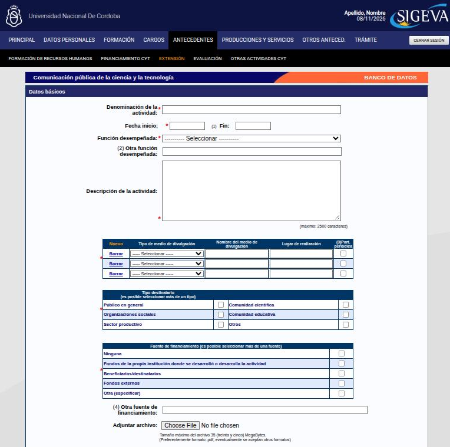

---
fuente:
  - "SIGEVA-UNC, sistema real (2026-11-08): formularios Nuevo de Formación de RR. HH. (becarios, tesistas, pasantes), Proyecto de I+D, Beca recibida, Comunicación pública de la CyT y Evaluación (personal CyT, otro tipo)"
  - "Manual del Investigador, UBA (7.ª ed.), 3.11"
  - "FAUD-UNC (2025), p. 4"
  - "Taller sobre SIGEVA, UNC, 2026-08-06 (diap. 12–13 y grabación) y 2026-08-13 (diap. 8–12, grabación y demostración)"
verificado_contra: ambos
fecha_verificacion: 2026-11-08
estado: verificado
---

# Antecedentes

La solapa **Antecedentes** reúne lo que hiciste además de cargos y publicaciones. Tiene cinco pantallas en la barra negra: **Formación de recursos humanos**, **Financiamiento CyT** (que incluye las becas), **Extensión**, **Evaluación** y **Otras actividades CyT**.

## Formación de recursos humanos

Son las personas que formaste. Hay cinco tablas: **becarios**, **tesistas**, **investigadores**, **pasantes de I+D y/o formación académica** y **personal técnico y de apoyo a la I+D**.

En becarios, tesistas y pasantes, la **función desempeñada** solo puede ser **Director o tutor** o **Co-director o co-tutor**. Por eso **solo cargás a las personas de cuya formación sos responsable**, como director/a o codirector/a de la tesis, la beca o el trabajo, o como tutor/a. Si estás en una cátedra con adscriptos que dirige otra persona, no los cargás vos.

- Los períodos se indican en **años**: año de inicio y, si ya terminó, año de fin. Si sigue en curso, el **año de fin queda vacío**.
- **Becarios**: nombre y apellido, institución, tipo de tareas, tipo de beca y tu función.
- **Tesistas**: nombre y apellido, institución, tipo de trabajo dirigido (tesis de doctorado; trabajo final, obra o tesis de maestría; trabajo final de especialización; tesina o trabajo final de grado), año de defensa, calificación (si ya se defendió) y tu función.
- **Pasantes**: nombre y apellido, tipo de tareas, tema del plan de trabajo, nivel educativo del pasante y tu función.
- No se pide número de resolución.

!!! tip "Sugerencia"
    - Si dirigís un equipo de investigación, cargá a cada integrante con sus fechas y registrá **altas y bajas** cuando ocurran.
    - La formación de recursos humanos en **extensión** también se carga acá, porque la solapa Extensión no tiene un lugar para eso.

## Financiamiento CyT

Acá van las actividades que tuvieron **financiamiento obtenido en una convocatoria**. Hay seis tablas:

- proyectos de I+D;
- proyectos de extensión, vinculación y transferencia;
- proyectos de comunicación pública de CyT;
- subsidios para eventos CyT;
- subsidios para infraestructura y equipamiento;
- **becas recibidas**.

No estás duplicando el proyecto: registrás el **apoyo económico** que lo hizo posible. Las publicaciones, los tesistas y los informes que salieron del proyecto van cada uno en su lugar.

### Proyectos de I+D

El formulario pide:

- tipo de actividad de I+D (básica, aplicada o desarrollo experimental o tecnológico);
- denominación y tipo de proyecto, y código de identificación;
- fechas del proyecto y una breve descripción;
- campo de aplicación, área del conocimiento, especialidad y palabras clave;
- moneda y **monto total**;
- **entidades participantes**, indicando si cada una ejecuta, evalúa, adopta, demanda o promueve, y su porcentaje;
- director/a y codirector/a;
- **tu función** (director, co-director, investigador, becario de I+D, estudiante o personal técnico de apoyo) y las fechas de tu participación.

También se puede adjuntar la **documentación de otorgamiento** del proyecto, de hasta 35 MB.

!!! tip "Sugerencia"
    Tené a mano la resolución de aprobación del proyecto: de ahí salen el código, las fechas, el monto y la dirección. Si integrás un proyecto de la SeCyT-UNC, revisá que el título coincida exactamente con el aprobado.

### Becas recibidas

Van todas las becas obtenidas en procesos competitivos. El formulario pide:

- **fecha de inicio** y **fecha de fin**, las dos obligatorias. Si la beca sigue en curso, poné la **fecha estimada de finalización**;
- **tipo de beca**: posdoctorado; postgrado (doctorado, maestría o especialización); formación de grado; iniciación o perfeccionamiento en la investigación; especialización; práctica profesional; otro tipo de beca de investigación, u otro tipo de beca;
- denominación de la beca y tipo de tareas;
- institución, director/a (obligatorio) y codirector/a;
- una descripción (tema, plan de trabajo, tareas);
- si la beca financió un posgrado y, en ese caso, en qué porcentaje (25, 50, 75 o 100 %).

!!! tip "Sugerencia"
    Distinguí las becas de formación en investigación de las de ayuda económica (como Progresar): pesan distinto en una evaluación, y el criterio depende de cada comité evaluador.

!!! danger "DECIDIR: ¿dónde va una beca de extensión?"
    - **Qué muestra el sistema.** Ningún tipo de beca ni tipo de tareas menciona la extensión. Los más cercanos son «Otro tipo de beca» y «Capacitación pre-profesional y/o profesional».
    - **Qué dice cada fuente.** Según el taller sobre SIGEVA del 13/8/2026, una beca de extensión (por ejemplo, de la Secretaría de Extensión de la UNC) se carga en **Becas recibidas**, aclarando en la denominación o en la descripción que es de extensión.
    - **Qué hay que decidir.** Si se adopta ese criterio y qué tipo de beca y de tareas se recomienda elegir.

## Extensión

Son las actividades de extensión, divulgación y transferencia. Hay cinco tablas:

| Tabla | Qué va | Ejemplos |
|---|---|---|
| **Comunicación pública de la ciencia y la tecnología** | Llevar el conocimiento a un público no especializado, sin intervención en territorio | Noche de los Museos, talleres en escuelas, notas de divulgación en diarios o portales, columnas de radio o TV, podcasts, muestras |
| **Extensión rural o industrial** | Transferencia, asesoramiento o construcción conjunta de saberes con sectores productivos | Capacitaciones para productores o cooperativas, asesoramiento a pymes o fábricas recuperadas, desarrollo local |
| **Prestación de servicios sociales y/o comunitarios** | Intervención junto a comunidades, organizaciones sociales o instituciones públicas | Proyectos de becas de extensión en barrios, talleres en contextos de encierro, apoyo escolar, programas de compromiso social |
| **Producción y/o divulgación artística o cultural** | La expresión artística o la gestión cultural como herramienta de transformación social | Talleres de teatro, murga o artes en centros culturales, festivales comunitarios, cine-debate, muralismo colectivo |
| **Otro tipo de actividad de extensión** | Lo que no entra en las anteriores | Comisiones mixtas universidad–Estado, cursos abiertos a la comunidad, coordinación de foros o redes de extensión, asesoramiento a un municipio |

Por ejemplo, el formulario de **comunicación pública** pide:

- denominación de la actividad, fechas y **tu función** (organizador/a o coordinador/a, co-organizador/a, conferencista o entrevistado/a, integrante de equipo u otra);
- una **descripción**, de hasta 2500 caracteres;
- los **medios de divulgación**, con tipo, nombre y lugar, y si la participación es periódica;
- el **tipo de destinatario** (podés marcar varios);
- la **fuente de financiamiento**, obligatoria (podés marcar varias): ninguna, fondos de la propia institución, beneficiarios o destinatarios, fondos externos u otra;
- opcionalmente, un **archivo adjunto** de hasta 35 MB, por ejemplo un certificado.

Para decidir en qué tabla va algo, preguntate **con quién dialogás** y **cuál fue la finalidad** de la actividad. Cada actividad va en **una sola tabla**: elegí la más adecuada.

!!! warning "No todo trabajo con la comunidad es extensión"
    - **Dar clase**, aunque sea en otra facultad o en el programa universitario en cárceles, es **docencia**.
    - Una **asesoría propia de tu profesión** (por ejemplo, una columna paga como especialista) es **ejercicio de la profesión** y va en Otras actividades CyT.
    - Para los concursos, en general se considera extensión la actividad **acreditada por la universidad**, la facultad o sus escuelas y departamentos. Las actividades sin acreditación pueden cargarse como **comunicación pública de la ciencia**.

!!! danger "DECIDIR: extensión con financiamiento"
    - **Qué dice cada fuente.** Una diapositiva del taller sobre SIGEVA del 6/8/2026 dice que en Extensión van solo las actividades **sin financiamiento**.
    - **Qué muestra el sistema.** El formulario de extensión pide obligatoriamente la **fuente de financiamiento**, con opciones como «Fondos externos», además de «Ninguna». Financiamiento CyT, por su parte, tiene una tabla de **proyectos de extensión, vinculación y transferencia**.
    - **Criterio propuesto, a confirmar.** Si la actividad tuvo un **subsidio obtenido en una convocatoria**, el subsidio va en Financiamiento CyT. La actividad se carga además en Extensión, indicando esa fuente.

!!! tip "Sugerencia"
    Si de un proyecto de extensión surgió un producto que no estaba previsto (por ejemplo, una muestra), se puede cargar aparte. Lo que ya describe el proyecto no se repite.

## Evaluación

Son tus actuaciones como evaluador o evaluadora. Hay cinco tablas:

- **Evaluación de personal CyT y jurado de tesis y/o premios.** Tiene un tipo de personal evaluado para cada caso: categorización de docentes investigadores (Incentivos), evaluación de becarios, de investigadores o de personal de apoyo, **jurado de concursos docentes**, jurado de premios, y jurado de tesinas, trabajos finales y/o tesis.
- **Evaluación de programas o proyectos** de I+D y/o de extensión.
- **Evaluación de trabajos en revistas CyT** (referato).
- **Evaluación institucional**: por ejemplo, la comisión que revisó un plan de estudios.
- **Otro tipo de evaluación**: lo que no entra en las anteriores. Pide el tipo de evaluación, los años, la institución y observaciones.

!!! danger "DECIDIR: tribunales de concursos y de selecciones docentes"
    - **Qué dice cada fuente.** El borrador anterior de esta guía, a partir del taller sobre SIGEVA del 13/8/2026, ubicaba el **tribunal de concursos o de selecciones docentes** en «Otro tipo de evaluación».
    - **Qué muestra el sistema.** «Evaluación de personal CyT» tiene un tipo específico, **«Jurado de concursos docentes»**. Este manual lo adopta para los concursos.
    - **Qué hay que decidir.** Si las **selecciones docentes** (interinatos, suplencias) también van como «Jurado de concursos docentes» o en «Otro tipo de evaluación».

## Otras actividades CyT

Es lo que no encaja en las secciones anteriores. Hay cuatro tablas:

- operación y mantenimiento de sistemas de alta complejidad;
- normalización;
- **ejercicio de la profesión en el ámbito no académico**;
- otra actividad CyT.

Las **estancias y pasantías** que hiciste vos no van acá, sino en [Formación complementaria](formacion.md#formacion-complementaria). Las **áreas de actuación** están dentro de la [Experticia en CyT](datos-personales.md#experticia-en-cyt).
