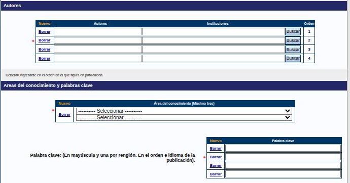
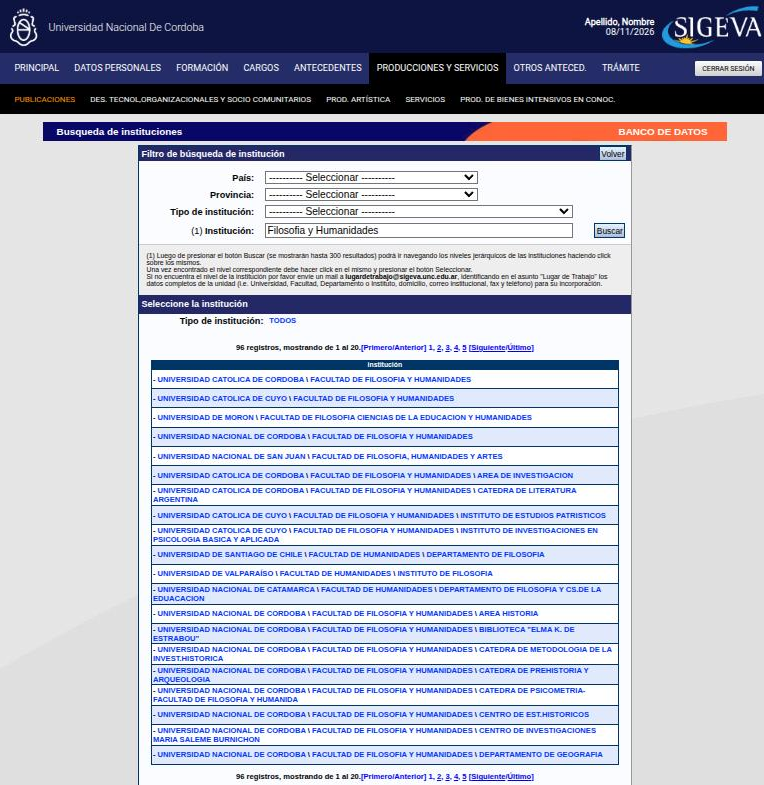
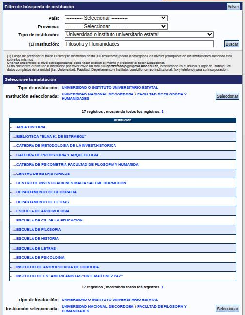

---
fuente:
  - "SIGEVA-UNC, sistema real (2026-11-08): formulario Nuevo de Libro (autores, áreas, palabras clave, resumen) y pantalla Búsqueda de instituciones"
  - "Manual del Investigador, UBA (7.ª ed.), 3.5–3.7"
  - "FCE-UNC, Barrera y Renny (2024), secciones Autores y Áreas del conocimiento y palabras clave"
  - "Biblioteca FCE-UNC, Pautas a tener en cuenta al cargar en SIGEVA, puntos 1–3"
  - "Biblioteca de la Facultad de Odontología, UNC, diap. 13–14"
  - "Taller sobre SIGEVA, UNC, 2026-08-13 (grabación y demostración)"
  - "Guía Banco de Datos de Actividades CyT v4, CONICET (2017), Preguntas frecuentes"
verificado_contra: ambos
fecha_verificacion: 2026-11-08
estado: verificado
---

# Autores, palabras clave e instituciones

Tres tipos de campo se repiten en casi todos los formularios de producción. Si los aprendés una vez, te sirven para todo.

## Autores

La tabla **Autores** tiene tres columnas: **Autores**, **Instituciones** y **Orden**. Trae cuatro filas vacías.

1. Escribí cada autor en su propia fila, en la columna **Autores**.
2. Cargá **a todas las personas autoras**, en el **orden en que figuran en la publicación**. Vos tenés que estar en la lista.
3. Si hacen falta más filas, presioná **Nuevo**, en el encabezado de la tabla. Para quitar una fila, presioná **Borrar**, a su izquierda.

La columna **Orden** solo numera las filas: no hay botones para mover un autor de lugar. Si te equivocaste en el orden, corregí los nombres en las filas.

!!! tip "Sugerencia"
    Escribí cada nombre como **Apellido, Nombre**, sin mayúsculas sostenidas, y siempre de la misma forma en todo tu CV.

!!! note "Pendiente de verificar"
    La guía de CONICET v4 advierte que, para que el sistema te reconozca como autor, tu nombre debe coincidir con el que tenés registrado. Por ejemplo, «Garcia, Juan Pedro» y no «JP Garcia». Falta confirmar si SIGEVA-UNC aplica la misma validación al guardar.

### Filiación de cada autor

En la columna **Instituciones** de cada fila, escribí la institución y presioná **Buscar** (ver [Instituciones](#instituciones), más abajo).

!!! note "Pendiente de verificar"
    Cómo se carga una segunda filiación para un mismo autor. En el formulario vacío hay un solo campo de institución por fila.

!!! tip "Sugerencia"
    Registrá siempre la filiación institucional de cada autor, con el mayor nivel de detalle que muestre la publicación (universidad, facultad, centro o instituto).

## Áreas del conocimiento

En el bloque **Áreas del conocimiento y palabras clave**, cada fila tiene dos selectores: el área (de «1 Ciencias naturales y exactas» a «6 Humanidades») y, debajo, la subárea. Se pueden cargar **hasta tres** áreas, con **Nuevo**. Es obligatorio cargar al menos una.

## Palabras clave

- Es obligatorio cargar **al menos una**. La tabla trae cuatro filas. Si necesitás más, presioná **Nuevo**.
- Una palabra clave por fila, **en el orden y en el idioma de la publicación**.
- Si la publicación no tiene palabras clave (pasa con muchos libros), elegí términos que describan el contenido.

!!! danger "DECIDIR: ¿palabras clave en mayúscula?"
    - **Qué muestra el sistema.** Junto a la tabla, el formulario indica: «En mayúscula y una por renglón. En el orden e idioma de la publicación».
    - **Qué dice cada fuente.** El instructivo de la Biblioteca de la FCE (Barrera y Renny, 2024) lo interpreta como **mayúsculas sostenidas** (todo el término en mayúscula). El borrador anterior de esta guía recomendaba copiarlas como figuran en la publicación, porque creía que el sistema no decía nada al respecto.
    - **Qué hay que decidir.** Si «en mayúscula» significa mayúscula sostenida o solo inicial, y qué recomienda este manual. Conviene consultarlo con el soporte de SIGEVA-UNC o con las bibliotecas de la UNC.

## Resumen

Es obligatorio. Puede ser el mismo que enviaste a la editorial, en el idioma de la publicación. Se copia y pega en el recuadro. **Limpiar resumen o abstract** lo vacía.

## Instituciones

Aparecen al cargar el lugar de trabajo, la formación, los cargos y la filiación de autores.

### Buscar

1. Escribí parte del nombre en el campo de institución y presioná **Buscar**.
2. Se abre la pantalla **Búsqueda de instituciones**, con el resultado: hasta 300 instituciones, de a 20 por página, cada una con su ruta completa (por ejemplo, «UNIVERSIDAD NACIONAL DE CORDOBA \ FACULTAD DE FILOSOFIA Y HUMANIDADES»).
3. Si hay demasiados resultados, afiná el **Filtro de búsqueda de institución**: país, provincia y tipo de institución (por ejemplo, «Universidad o instituto universitario estatal»). Después volvé a presionar **Buscar**.
4. Hacé clic en la institución. Queda como **Institución seleccionada** y abajo aparecen sus niveles inferiores (escuelas, departamentos, centros, institutos, cátedras). Seguí bajando hasta el nivel que corresponda.
5. Presioná **Seleccionar**. Volvés al formulario con la institución cargada.

**Volver** sale de la búsqueda sin elegir.

!!! tip "Sugerencia"
    Para dependencias de la UNC, buscá por el nombre de la **facultad** (por ejemplo, «Filosofia y Humanidades») y bajá desde ahí. Suele dar mejores resultados que buscar por el nombre del centro o del instituto.

### Si no aparece

Hay dos caminos:

- **Pedir que la incorporen.** La pantalla de búsqueda indica escribir a `lugardetrabajo@sigeva.unc.edu.ar` con el asunto «Lugar de Trabajo» y los datos completos de la unidad: universidad, facultad, departamento o instituto, domicilio, correo institucional, fax y teléfono.
- **Cargarla a mano.** Al pie de la pantalla de búsqueda está el apartado «Solo en caso de no encontrar la institución en la búsqueda, ingrese otra»:
    1. Elegí país, provincia (obligatoria solo si el país es Argentina) y tipo de institución.
    2. Escribí el nombre en **Nivel 1**. Admite **55 caracteres** como máximo.
    3. Presioná **Ingresar otra**.

En la carga a mano, el tipo de institución no incluye universidades ni organismos de ciencia y tecnología. Si lo que falta es un nivel dentro de una universidad (una cátedra, un centro), la pantalla de búsqueda indica pedir su incorporación por correo.

!!! warning "Lo cargado a mano no queda guardado para la próxima"
    Si cargás a mano una institución o una revista que no está en el sistema, la próxima vez tenés que volver a cargarla. El sistema no la incorpora a su listado.

!!! tip "Sugerencia"
    Si cargás seguido instituciones o revistas que no figuran, anotá en un archivo propio cómo las escribiste (nombre, tipo, ISSN) y usá siempre la misma forma. Así tu CV queda consistente.

## Caracteres especiales y texto pegado

!!! danger "DECIDIR: ¿pegar desde Word o desde texto plano?"
    - **Qué muestra el sistema.** En el resumen, el formulario recomienda: si el texto tiene caracteres especiales (como ∑, ξ o ∫), copialo desde tu editor original, por ejemplo Word.
    - **Qué dice cada fuente.** El borrador anterior de esta guía, a partir del taller del 13/8/2026, aconsejaba lo contrario: pegar desde un editor de texto plano, porque lo copiado de Word o de un PDF puede traer formato oculto o código HTML.
    - **Qué hay que decidir.** Si la recomendación se limita al resumen (que usa un editor de texto enriquecido) o se aplica a todos los campos, y qué se aconseja para los demás.

!!! note "Pendiente de verificar"
    En la demostración del taller del 13/8/2026, las comillas se convirtieron en signos de pregunta al guardar. No se comprobó en el sistema porque requiere guardar un registro. Hasta confirmarlo, revisá cómo quedan las comillas después de guardar.
