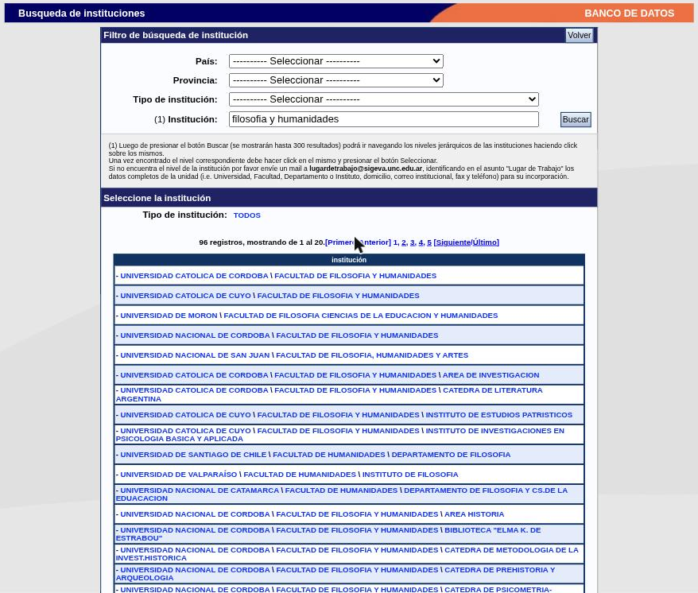
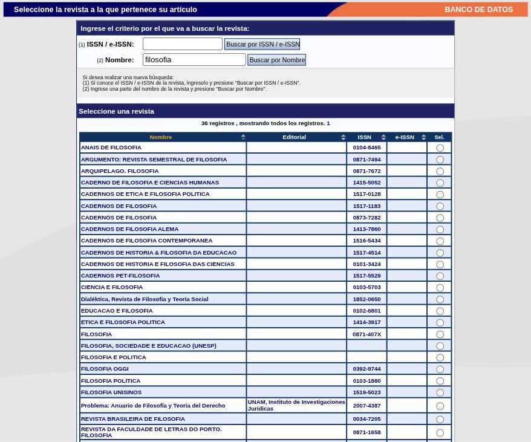

---
fuente:
  - "SIGEVA-UNC, buscadores de institución y de revista (búsquedas de prueba), tablas de autores, áreas y palabras clave"
  - "Manual del Investigador, UBA (7.ª ed.), 3.5–3.7; Manual del Usuario del Banco de Datos, UNC (2011), Instrucciones de carga de autores y de palabras clave"
  - "Guía Banco de Datos de Actividades CyT v4, CONICET (2017)"
verificado_contra: ambos
fecha_verificacion: 2026-09-30
estado: pendiente_verificar
---

# Instituciones, revistas, autores, áreas y palabras clave

Estos bloques se repiten en casi todos los formularios. Conviene conocerlos una vez y no volver a tropezar.

## Instituciones

Casi todos los registros piden una institución (donde tenés el cargo, la que otorgó el título, la que financió la beca). No se escribe a mano: se **busca** en un catálogo y se **selecciona**.

El bloque tiene un campo **Institución** con el botón **Buscar** y, debajo, **Institución seleccionada** (obligatoria) con el botón **Limpiar**.

### Paso a paso

1. En **Institución**, escribí una parte del nombre y presioná **Buscar**. El sistema sale del formulario y abre la pantalla **Búsqueda de instituciones**.

    

2. Si hace falta, afiná con los filtros **País**, **Provincia** y **Tipo de institución**, y volvé a presionar **Buscar**.
3. Mirá los resultados. Cada uno es una ruta con niveles separados por una barra invertida: universidad \ facultad \ unidad. Se muestran de a 20 por página y, según la ayuda en pantalla, hasta 300 en total.
4. Hacé clic en el resultado que corresponda. Ese nivel pasa a figurar como **Institución seleccionada** y debajo se listan sus dependencias, por si necesitás bajar un nivel más.
5. Cuando estés en el nivel correcto, presioná **Seleccionar**. Volvés al formulario con la institución cargada.

Para cambiar una institución ya elegida, usá **Limpiar** y buscá de nuevo.

En la búsqueda de prueba, el texto «filosofia y humanidades» —sin tilde— devolvió 96 resultados de varias universidades y países. Conviene agregar el nombre de la universidad o usar los filtros.

### Si la institución no está

Al pie de la pantalla de búsqueda hay un bloque **«Solo en caso de no encontrar la institución en la búsqueda, ingrese otra»**: pide país, provincia (obligatoria para Argentina), tipo de institución y el nombre del nivel que falta, y se confirma con **Ingresar otra**. Si ya seleccionaste un nivel superior, el sistema lo conserva y solo tenés que escribir el siguiente.

La ayuda de esa pantalla indica además una dirección de correo de la UNC para pedir que se incorpore al catálogo el nivel faltante, enviando los datos completos de la unidad.

!!! note "Pendiente de verificar"
    No se usó **Ingresar otra** ni se confirmó que la dirección de correo que muestra la pantalla siga activa. Tampoco se verificó si, al volver del buscador, el formulario conserva lo que ya habías escrito.

!!! tip "Sugerencia de la SeICyT"
    Agotá la búsqueda antes de ingresar una institución a mano: los nombres escritos de distintas maneras hacen que tu producción no se agrupe con la de tu unidad. Bajo «Universidad Nacional de Córdoba \ Facultad de Filosofía y Humanidades» el catálogo lista hoy 17 dependencias, y no todas coinciden con la estructura actual de la Facultad. Hasta que la SeICyT defina un criterio, elegí el nivel más específico que exista con seguridad en el catálogo; si no está tu unidad, seleccioná la Facultad.

## Revistas

Los artículos y las actividades de evaluación o gestión editorial en revistas usan un buscador propio.

1. En **ISSN / e-ISSN** escribí el ISSN y presioná **Buscar por ISSN / e-ISSN**, o en **Nombre** escribí una parte del título y presioná **Buscar por Nombre**.
2. El sistema muestra una tabla con **Nombre**, **Editorial**, **ISSN** y **e-ISSN**. Marcá la revista en la columna **Sel.** y presioná **Seleccionar**.

    

3. Si la revista no figura, al pie hay un bloque para ingresarla manualmente, con **Nombre revista** (obligatorio), **ISSN** y **e-ISSN**.

!!! tip "Sugerencia de la SeICyT"
    Buscá por ISSN siempre que lo tengas. En la búsqueda de prueba por nombre aparecieron títulos repetidos con distinto ISSN y varias filas sin editorial: por nombre es fácil elegir la revista equivocada.

## Autores

Las producciones piden la lista de autores en una tabla. Las ayudas en pantalla indican cargarlos **en el mismo orden en que figuran en la publicación**; vos tenés que estar entre ellos.

El sistema tiene dos variantes de esta tabla:

- **Completa** (artículos y desarrollos): columnas **Sel.**, **Autores**, **Instituciones** (con su botón **Buscar**), **Orden** y **Mover**. Empieza con una fila; **Nuevo** agrega más y **Borrar** quita. La columna **Mover** tiene flechas para cambiar el orden. La ayuda pide que marques tu propio nombre en la columna **Sel.**
- **Simple** (libros, partes de libros, trabajos en eventos, tesis y otras): columnas **Autores**, **Instituciones** y **Orden**, con cuatro filas visibles de entrada.

Podés ver la tabla completa en la segunda captura del [formulario de artículos](publicaciones.md#articulos-publicados-en-revistas).

!!! note "Pendiente de verificar"
    No se cargó ningún autor. La guía del CONICET (v4) advierte que el nombre con el que te cargás como autor tiene que coincidir con tu nombre registrado en el sistema; de lo contrario, el registro no se reconoce como propio. Falta comprobar cómo lo controla SIGEVA-UNC.

!!! tip "Sugerencia de la SeICyT"
    Escribí tu nombre de autor siempre igual, y el de tus coautores tal como aparece en la publicación.

## Áreas del conocimiento

Muchos formularios piden clasificar el registro. El bloque tiene dos listas encadenadas —gran área y disciplina primero, subdisciplina después— y, en algunos casos, un campo **Especialidad** de texto libre. En las producciones se admiten **hasta tres** áreas.

La clasificación es la misma que usa [Experticia en CyT](experticia.md#la-clasificacion-de-areas), donde está detallada.

Algunos formularios (proyectos, servicios, desarrollos, informes técnicos) piden además un **Campo de aplicación**, que es otra lista, de unas 280 opciones.

## Palabras clave

En las producciones, la tabla **Palabra clave** tiene cuatro filas de entrada; **Nuevo** agrega y **Borrar** quita. La indicación en pantalla es: **en mayúscula, una por renglón, en el orden y el idioma de la publicación**. Al menos una es obligatoria.

Las palabras clave de [Experticia en CyT](experticia.md) son distintas: describen tu perfil, no un trabajo en particular, y se cargan en español y en inglés.

## Archivos adjuntos

Varios formularios piden o admiten un archivo (texto completo de una publicación, resolución de un proyecto, convenio de un servicio). En todos, la pantalla indica un tamaño máximo de **35 MB** y preferencia por el formato **PDF**. Cuando hay más de un archivo, las ayudas piden reunirlos en un `.zip`.

## Fuentes

- SIGEVA-UNC: búsquedas de prueba de institución y de revista hechas el 2026-09-30 desde formularios vacíos, sin seleccionar ni guardar; tablas de autores y de palabras clave vistas en los formularios de alta.
- Manual UBA (7.ª ed.), 3.5–3.7, y manual UNC (2011): orden de la explicación.
- Guía CONICET v4 (2017): coincidencia entre nombre de autor y nombre registrado.
