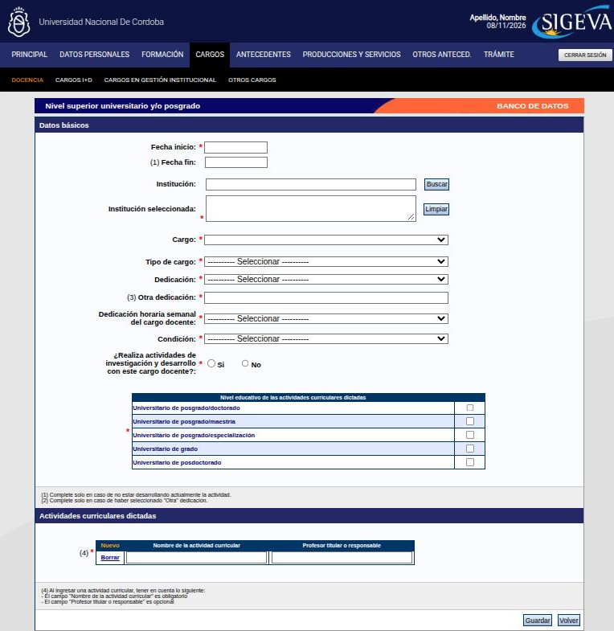

---
fuente:
  - "SIGEVA-UNC, sistema real (2026-11-08): formularios Nuevo de Docencia (nivel superior), Cargos I+D (tres), Gestión institucional y Otros cargos; lista de cargos docentes para la UNC"
  - "Manual del Investigador, UBA (7.ª ed.), 3.12"
  - "Manual del Usuario del Banco de Datos, UNC (2011), Cargos docentes, Otros cargos, Carrera de investigador"
  - "Taller sobre SIGEVA, UNC, 2026-08-06 (grabación) y 2026-08-13 (diap. 6–7, grabación y demostración)"
  - "FAUD-UNC (2025), p. 4"
verificado_contra: ambos
fecha_verificacion: 2026-11-08
estado: verificado
---

# Cargos (docencia, I+D, gestión)

La solapa **Cargos** tiene cuatro pantallas en la barra negra: **Docencia**, **Cargos I+D**, **Cargos en gestión institucional** y **Otros cargos**.

En todos los formularios de cargos, la **fecha de fin** se completa solo si ya no ejercés el cargo. Mientras siga activo, dejala vacía.

## Docencia

Hay una tabla por nivel, cada una con su **Nuevo**:

- nivel superior universitario y/o posgrado;
- nivel terciario no universitario;
- nivel básico y/o medio;
- cursos de posgrado y capacitaciones extracurriculares (como docente).

### Qué pide un cargo universitario

**Datos básicos** (todos obligatorios salvo la fecha de fin):

- **Fecha de inicio** y, si terminó, **fecha de fin**.
- **Institución** (ver [Instituciones](campos-comunes.md#instituciones)). La lista de cargos aparece recién después de elegirla.
- **Cargo**. Para la UNC, la lista incluye ayudante alumno, ayudante de primera y de segunda, jefe de trabajos prácticos, profesor ayudante A y B, profesor adjunto, asociado y titular, docente autorizado, docente libre, y profesor consulto, contratado, emérito, honorario, invitado, por convenio y visitante.
- **Tipo de cargo**: rentado o ad honorem.
- **Dedicación**: exclusiva, completa, semiexclusiva, simple, parcial u otra (en ese caso, se describe).
- **Dedicación horaria semanal**: 40 horas o más, de 20 a 39, o de 0 a 19.
- **Condición**: regular o por concurso, interino o por contrato.
- **¿Realiza actividades de investigación y desarrollo con este cargo docente?**: sí o no.
- **Nivel educativo de las actividades curriculares dictadas**: marcá al menos uno (doctorado, maestría, especialización, grado o posdoctorado).

**Actividades curriculares dictadas**: al menos una. Cada fila lleva el **nombre de la actividad curricular** (obligatorio) y el **profesor titular o responsable** (opcional). Con **Nuevo** agregás otra.

El formulario **no tiene** campo para el número de resolución de designación ni un campo de observaciones.

!!! info "Nomenclatura"
    La lista de cargos no incluye algunas denominaciones que hoy se usan en la UNC, como «profesor asistente». Cargá el **equivalente**: por ejemplo, un cargo de profesor asistente puede figurar como «jefe de trabajos prácticos».

### Criterios de carga

El sistema no da instrucciones para estos casos. Estos son los criterios que se usan en la UNC:

| Situación | Cómo se carga |
|---|---|
| Un cargo con varias materias | **Un solo registro.** Cada materia va como una actividad curricular dictada |
| Cargo por departamento, con materias que cambian | El mismo registro: agregás cada asignatura nueva como otra actividad curricular |
| Interinato renovado sin interrupción | El mismo registro: fecha de inicio de la primera designación y fecha de fin **vacía** mientras siga activo |
| Cambio de situación de revista (de ayudante a jefe de trabajos prácticos, de JTP a adjunto) | **Un registro nuevo** por cada cargo. El anterior lleva fecha de fin |
| Concursado en un cargo e interino en uno mayor | Los dos registros a la vez: el concursado sin fecha de fin y el interino con su período. Cuando termina el interinato, le ponés fecha de fin |
| Mismo cargo en dos instituciones | Un registro por institución |
| Carga anexa | En la actividad curricular, aclarando «carga anexa» junto al profesor responsable |
| Dictado por convenio (por ejemplo, en una sede del interior) | Como docente autorizado o profesor por convenio. Podés aclarar la sede entre paréntesis en el nombre de la actividad curricular |
| Profesor invitado en otra cátedra | Docencia (no es extensión) |
| Escuela de nivel medio que no figura | Cargala a mano, con tipo «Otra institución educativa no universitaria» y el nombre en **Nivel 1**. Ver [Instituciones](campos-comunes.md#si-no-aparece) |

!!! danger "DECIDIR: ¿cómo se registra un cambio de plan de estudios?"
    - **Qué dice cada fuente.** El taller sobre SIGEVA del 13/8/2026 indicó cargar la materia con el nombre nuevo como otra actividad curricular y explicar el cambio en **Observaciones** (por ejemplo, «Plan 1989 / Plan 2026»).
    - **Qué muestra el sistema.** El formulario de cargo docente de nivel superior **no tiene** un campo de observaciones ni de informaciones adicionales. Solo tiene el nombre de la actividad (150 caracteres) y el profesor responsable.
    - **Qué hay que decidir.** Dónde se deja constancia del cambio de plan. Una opción es aclararlo entre paréntesis en el nombre de la actividad, como en el dictado por convenio. Otra es no aclararlo.

### Ayudantías y adscripciones

!!! danger "DECIDIR: ayudantías alumno y adscripciones"
    - **Qué dice cada fuente.** Cada unidad académica usa estas figuras de manera distinta. En la FCE, la «adscripción estudiantil» equivale a una ayudantía y se carga como cargo docente (FCE-UNC, 2024). En los talleres sobre SIGEVA de 2026 se explicó que en la **FFyH** y en Ciencias Sociales las **adscripciones son de egresados y no generan antigüedad docente**.
    - **Qué muestra el sistema.** La lista de cargos docentes incluye «Ayudante alumno», pero no «adscripto/a». **Otros cargos** admite un cargo de texto libre.
    - **Criterio propuesto para la FFyH**, a confirmar:
        - **Ayudantía alumno** (rentada o ad honorem): Cargos › Docencia, con cargo «Ayudante alumno» y el tipo de cargo que corresponda.
        - **Adscripción**: Cargos › **Otros cargos**, indicando la cátedra. Si todavía está en curso, la fecha de fin queda vacía.
        - Si sos responsable de adscriptos, eso va además en [Formación de recursos humanos](antecedentes.md#formacion-de-recursos-humanos).

### Carrera docente

La aprobación de la carrera docente **no tiene un formulario propio**: se entiende que es una evaluación periódica de tu actividad docente, que ya está cargada.

!!! note "Pendiente de verificar"
    Una diapositiva del taller del 13/8/2026 dice que la resolución se adjunta «como antecedente», pero no indica dónde. En los formularios de cargos no hay campo para adjuntar archivos. A confirmar con la SeICyT.

## Cargos I+D

Tiene tres tablas:

| Tabla | Qué pide |
|---|---|
| **Cargos en organismos científico-tecnológicos** | Fechas; **carrera**: investigador científico y tecnológico del CONICET, de la CIC de la provincia de Buenos Aires u otra; **categoría**; institución; dedicación horaria semanal |
| **Categorización del programa de incentivos** | Fechas, **año de categorización**, **categoría** (I a V) e institución |
| **Cargos de I+D en otro tipo de instituciones** | Fechas, institución, **cargo para realizar I+D** y dedicación horaria semanal |

## Cargos en gestión institucional

Secretarías, direcciones (de escuela, departamento, centro o instituto), consejos, coordinaciones y representaciones. El formulario pide:

- fechas;
- institución;
- **cargo** (de una lista, o «otro» con su descripción);
- **tipo de función desempeñada**: ejecutiva, directiva, de coordinación, de asesoramiento especializado, de apoyatura técnica o administrativa;
- dedicación horaria semanal.

## Otros cargos

Son los cargos que no son docencia, I+D ni gestión. En la FFyH, por ejemplo, las **adscripciones** (ver arriba). El formulario pide fechas, institución, **cargo** (texto libre), dedicación horaria semanal y, opcionalmente, **categoría**.
