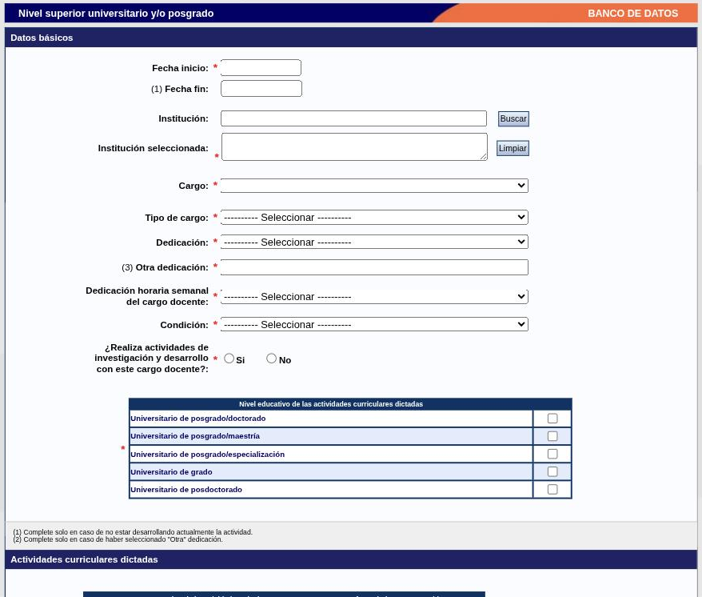
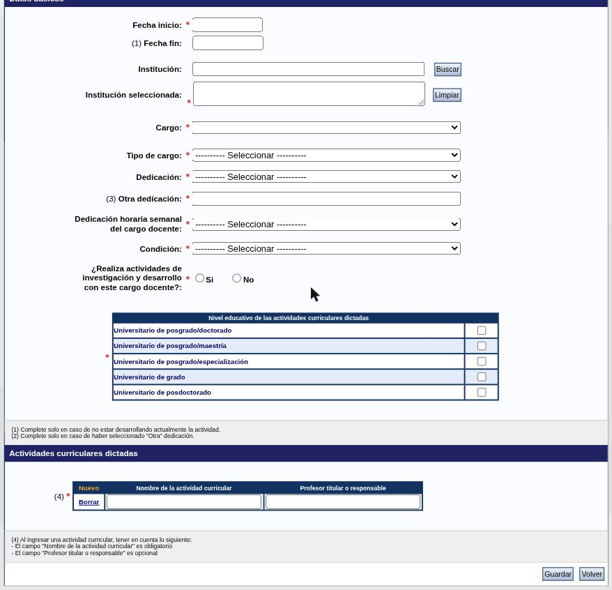

---
fuente:
  - "SIGEVA-UNC, Cargos: formularios de alta de Docencia (cuatro), Cargos I+D (tres), Cargos en gestión institucional y Otros cargos"
  - "Estructura: Manual del Investigador, UBA (7.ª ed.), 3.12; Manual del Usuario del Banco de Datos, UNC (2011), Cargos docentes, Otros cargos, Carrera de investigador"
verificado_contra: sistema real
fecha_verificacion: 2026-09-30
estado: pendiente_verificar
---

# Cargos

La solapa **Cargos** tiene cuatro apartados: **Docencia**, **Cargos I+D**, **Cargos en gestión institucional** y **Otros cargos**.

Todos los formularios comparten tres elementos:

- **Fecha inicio \*** y **Fecha fin**. La fecha de fin se deja vacía mientras el cargo esté vigente.
- **Institución \***, con el [buscador](campos-comunes.md#instituciones).
- **Dedicación horaria semanal**, con tres franjas: *40 horas o más*, *De 20 hasta 39 horas* y *De 0 hasta 19 horas*.

## Docencia

Cuatro tablas, con las columnas **Fecha inicio**, **Fecha fin** e **Institución**.

### Nivel superior universitario y/o posgrado

Es el formulario para tus cargos docentes universitarios.

| Campo | Opciones u observaciones |
|---|---|
| Fecha inicio \* · Fecha fin | |
| Institución \* | Buscador |
| Cargo \* | Lista desplegable |
| Tipo de cargo \* | Rentado · Ad Honorem |
| Dedicación \* | Exclusiva · Completa · Semi-exclusiva · Simple · Parcial · Otra |
| Otra dedicación | Solo si elegiste «Otra» |
| Dedicación horaria semanal del cargo docente \* | Las tres franjas |
| Condición \* | Regular o por concurso · Interino · Por contrato |
| ¿Realiza actividades de investigación y desarrollo con este cargo docente? \* | Sí / No |
| Nivel educativo de las actividades curriculares dictadas \* | Casillas: posgrado/doctorado · posgrado/maestría · posgrado/especialización · grado · posdoctorado |

Debajo está el bloque **Actividades curriculares dictadas \***: una tabla con **Nuevo** y **Borrar** donde cargás, fila por fila, el **Nombre de la actividad curricular** (obligatorio) y el **Profesor titular o responsable** (opcional).

!!! note "Pendiente de verificar"
    La lista **Cargo** aparece vacía al abrir el formulario. Se presume que se completa una vez elegida la institución; no se comprobó.

!!! tip "Sugerencia de la SeICyT"
    - Cargá **un registro por cargo**, no por materia: las materias van como filas de «Actividades curriculares dictadas».
    - Cuando cambies de categoría, dedicación o condición, cerrá el registro anterior con su fecha de fin y cargá uno nuevo. Así el currículum conserva tu trayectoria.
    - Este es el formulario que miran las comisiones en concursos y evaluaciones docentes: mantenelo completo.

### Nivel terciario no universitario

Fecha inicio \*, Fecha fin, institución \*, Cargo \*, Dedicación horaria semanal \*, Denominación de la carrera/tecnicatura \* y Tipo de formación \* (Docente · Técnico-profesional).

### Nivel básico y/o medio

Fecha inicio \*, Fecha fin, institución \*, Cargo \*, Dedicación horaria semanal \* y Tipo de sistema de educación básica/media \* (Educación general básica · Polimodal · Primario · Secundario · Otro, con campo para especificar).

### Cursos de posgrado y capacitaciones extracurriculares

Para los cursos, seminarios y talleres que **dictaste** fuera de un cargo regular.

| Campo | Opciones u observaciones |
|---|---|
| Fecha inicio \* · Fecha fin | |
| Institución \* | Buscador |
| Cargo · Dedicación horaria semanal | Opcionales |
| Nombre o temática del curso \* | |
| Tipo de curso \* | Curso · Seminario · Taller · Otro |
| Carga horaria total del curso \* | |

## Cargos I+D

Tres tablas.

### Cargos en organismos científico-tecnológicos

Para la carrera de investigador.

| Campo | Opciones u observaciones |
|---|---|
| Fecha inicio \* · Fecha fin | |
| Carrera \* | Carrera de investigador científico y tecnológico (CONICET) · Carrera de investigador científico y tecnológico (CIC pcia. Bs. As.) · Otra |
| Categoría \* | |
| Otro cargo/función \* | |
| Institución \* | Buscador |
| Dedicación horaria semanal \* | |

### Categorización del programa de incentivos

| Campo | Opciones u observaciones |
|---|---|
| Fecha inicio \* · Fecha fin | |
| Año de categorización \* | |
| Categoría en el Programa de Incentivos \* | Categoría I a V |
| Institución de categorización en el Programa \* | Buscador |

### Cargos de I+D en otro tipo de instituciones

Fecha inicio \*, Fecha fin, institución \*, Cargo para realizar I+D \* y Dedicación horaria semanal \*.

!!! info "Becas"
    Las **becas** no se cargan acá sino en [Antecedentes → Financiamiento CyT → Becas recibidas](antecedentes.md#becas-recibidas).

## Cargos en gestión institucional

| Campo | Opciones u observaciones |
|---|---|
| Fecha inicio \* · Fecha fin | |
| Institución \* | Buscador |
| Cargo \* | Lista cerrada de unas 38 opciones: Rector, Vicerrector, Decano, Vicedecano, Secretario, Subsecretario, Prosecretario, Director, Vicedirector, Coordinador, Consejero, Jefe de área, Jefe de departamento, Asesor, entre otras, y «Otro» |
| Otro cargo | Solo si elegiste «Otro» |
| Tipo de función desempeñada \* | Ejecutiva/Directiva · De coordinación · De asesoramiento especializado · De apoyatura técnica · Administrativa |
| Dedicación horaria semanal \* | |

!!! tip "Sugerencia de la SeICyT"
    La participación en consejos (directivo, de escuela, de departamento) se carga acá, como «Consejero».

## Otros cargos

Para lo que no entra en los apartados anteriores.

Fecha inicio \*, Fecha fin, institución \*, Cargo \* (texto libre), Dedicación horaria semanal \* y Categoría (opcional).

## Fuentes

- SIGEVA-UNC, formularios de alta de **Cargos**, relevados el 2026-09-30 (vacíos, sin guardar).
- Manual UBA (7.ª ed.), 3.12, y manual UNC (2011): cobertura y orden.
