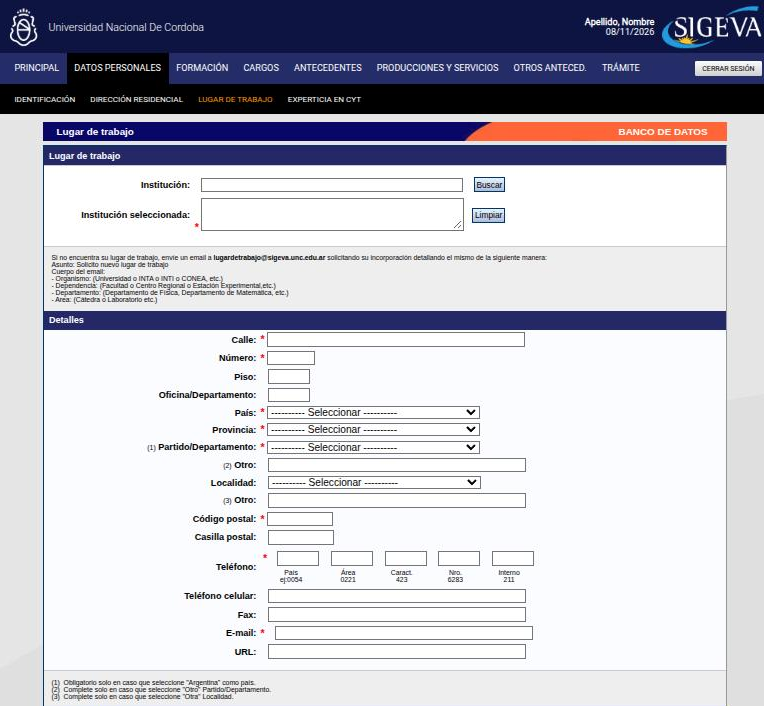
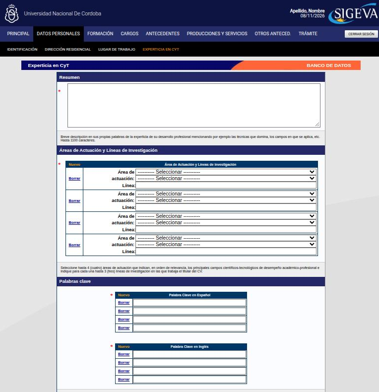

---
fuente:
  - "SIGEVA-UNC, sistema real (2026-11-08): Identificación, Dirección residencial, Lugar de trabajo, Experticia en CyT"
  - "Manual del Investigador, UBA (7.ª ed.), 3.8"
  - "Taller sobre SIGEVA, UNC, 2026-08-06 (diap. 6 y grabación) y 2026-08-13 (diap. 14 y grabación)"
  - "FAUD-UNC (2025), p. 4"
  - "FCE-UNC, Barrera y Renny (2024), p. 7"
verificado_contra: sistema real
fecha_verificacion: 2026-11-08
estado: verificado
---

# Datos personales

Esta sección parece la más sencilla, pero dos ítems tienen consecuencias en tus presentaciones: el **lugar de trabajo** y la **experticia en CyT**.

Tiene cuatro ítems: **Identificación**, **Dirección residencial**, **Lugar de trabajo** y **Experticia en CyT**. Cada uno es un formulario único (no una tabla). Se guarda con **Guardar** y se sale con **Salir**. En la Principal, la columna **Estado** te muestra si ya tiene datos.

## Identificación

Tiene tres bloques:

- **Datos básicos**: nombre/s, apellido/s, sexo, estado civil, nacionalidad y, si es argentina, condición de nacionalidad (nativo, naturalizado o por opción). Opcionales: apellido de casada y cantidad de hijos.
- **Documento de identidad**: tipo y número de documento y **CUIT/CUIL**. Escribí el CUIT/CUIL con guiones entre sus tres partes (por ejemplo, `20-12345678-0`). Si el documento es pasaporte, indicá el país de emisión y el CUIT/CUIL pasa a ser optativo.
- **Datos de nacimiento**: fecha, país y provincia. Opcionales: partido o departamento.

Al pie hay un campo de **informaciones adicionales**, de hasta 500 caracteres.

El correo y el usuario no se cambian acá, sino desde **Cambio de Datos** (ver [Crear usuario e ingresar](../primeros-pasos/usuario.md)).

!!! note "No hay campo para el legajo"
    SIGEVA no tiene un campo para el número de legajo docente de la UNC. Si te lo piden para un trámite, seguí las indicaciones de ese trámite.

## Dirección residencial

Es tu domicilio particular. Son obligatorios:

- calle y número;
- país y provincia;
- partido o departamento (si el país es Argentina);
- código postal;
- teléfono, con código de país, área, característica y número;
- correo electrónico.

Son opcionales el piso, el departamento, la localidad, la casilla postal, el celular, el fax, la URL y las informaciones adicionales.

## Lugar de trabajo

1. En **Institución**, escribí parte del nombre y presioná **Buscar**. Elegí la institución con el mayor nivel de detalle que corresponda (ver [Instituciones](campos-comunes.md#instituciones)). Queda en **Institución seleccionada**, que es obligatoria. **Limpiar** la borra para elegir otra.
2. En **Detalles**, completá la dirección del lugar de trabajo. Los obligatorios son los mismos que en la dirección residencial, incluido el **correo electrónico**. La URL es optativa: si no hay una página institucional propia, podés dejarla vacía.

### Si tu lugar de trabajo no aparece

El propio formulario indica cómo pedirlo. Escribí a `lugardetrabajo@sigeva.unc.edu.ar` con el asunto **Solicito nuevo lugar de trabajo** y detallá en el cuerpo del correo:

- **Organismo** (por ejemplo, la universidad);
- **Dependencia** (por ejemplo, la facultad);
- **Departamento**;
- **Área** (por ejemplo, la cátedra o el laboratorio).

### Qué lugar de trabajo poner

El sistema no define cuál elegir cuando trabajás en más de un lugar. Estos son los criterios que se usan en la UNC:

| Situación | Lugar de trabajo |
|---|---|
| Regla general | La dependencia académica donde tenés **mayor dedicación** |
| Postulación a una **beca** | El lugar donde se va a **radicar** la beca, que suele coincidir con el de tu director/a o con el del proyecto. Por ejemplo, un centro de investigación de la FFyH |
| **Concurso** en otra unidad académica | La unidad académica **del concurso** |
| Informe o plan anual en una de varias unidades donde trabajás | La unidad ante la que presentás el informe |
| Tenés también actividad profesional fuera de la universidad | Igual va la dependencia académica. Lo profesional se carga aparte (Antecedentes › Otras actividades CyT) |

!!! danger "DECIDIR: ¿lugar de trabajo detallado o abarcativo?"
    - **Qué dice cada fuente.** Para las becas, el taller sobre SIGEVA del 6/8/2026 recomendó, cuando hay alternativas, el lugar **más abarcativo** (por ejemplo, la Escuela de Historia de la FFyH antes que un área interna). Los manuales de la UBA (7.ª ed.) y de la UNC (2011) piden elegir la institución con el **mayor detalle posible**, y el borrador anterior de esta guía los seguía.
    - **Qué muestra el sistema.** El formulario no define el criterio. El aviso para pedir lugares nuevos admite hasta cuatro niveles, de organismo a área (cátedra o laboratorio).
    - **Qué hay que decidir.** El criterio general que va a recomendar este manual, y si las becas son una excepción. Algunas convocatorias exigen además compartir el lugar de trabajo con el director o codirector, y otras tienen cupos por unidad académica.

!!! warning "Revisalo antes de cada presentación"
    Las bases de cada convocatoria mandan. Si el lugar de trabajo no corresponde al que pide la convocatoria, la postulación puede no ser considerada. Como al presentar se guarda una «foto» del banco, ajustalo **antes** de enviar.

## Experticia en CyT

Es tu presentación como investigador o investigadora. Tiene tres bloques, todos obligatorios:

1. **Resumen**: una descripción en tus propias palabras de tu experticia, por ejemplo las técnicas que dominás y los campos en que las aplicás. El formulario indica un máximo de **1100 caracteres**.
2. **Áreas de actuación y líneas de investigación**: hasta **cuatro** áreas, en orden de relevancia. En cada fila elegís el área en dos selectores (gran área o disciplina y, luego, subdisciplina) y escribís la **línea** de investigación (hasta 150 caracteres). Con **Nuevo** agregás una fila y con **Borrar** la quitás.
3. **Palabras clave**, en dos listas: **en español** y **en inglés**. Cada palabra va en su propia fila, con **Nuevo** y **Borrar**.

!!! danger "DECIDIR: ¿cómo se cargan hasta tres líneas por área?"
    - **Qué muestra el sistema.** La indicación del formulario pide, para cada área, «hasta 3 (tres) líneas de investigación». Pero cada fila tiene un único campo **Línea**, de 150 caracteres.
    - **Qué no está claro.** Si las tres líneas van juntas en ese campo (separadas, por ejemplo, con punto y coma) o si hay que repetir la misma área en filas distintas, una por línea. En el segundo caso se consumen filas del máximo de cuatro.
    - **Ninguna fuente consultada lo aclara.** Conviene consultarlo con el soporte de SIGEVA-UNC antes de recomendar una forma.

!!! tip "Sugerencia"
    Revisá la experticia antes de cada postulación y adaptala a la especificidad de la convocatoria (beca, concurso, proyecto), sin desdibujar tu perfil.
