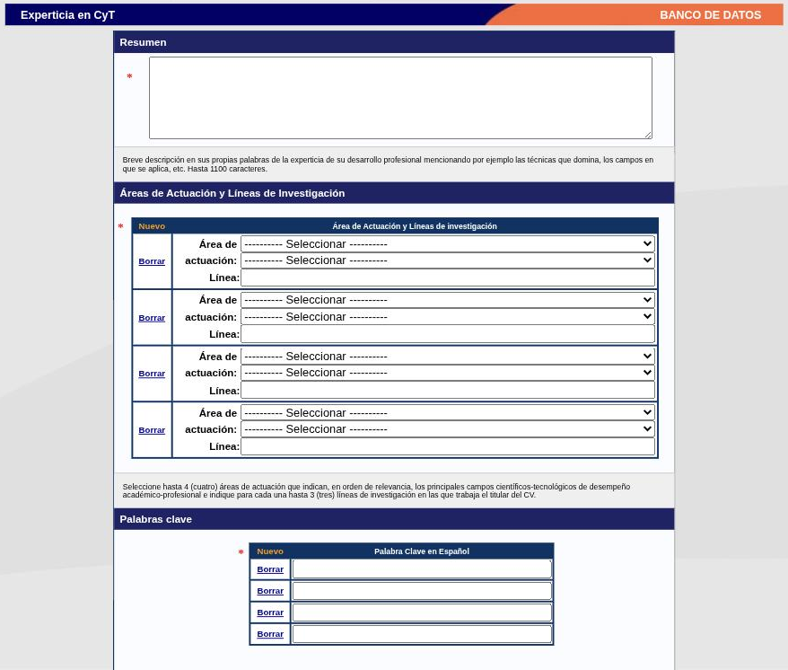

---
fuente:
  - "SIGEVA-UNC, Datos personales → Experticia en CyT"
  - "Manual del Investigador, UBA (7.ª ed.), 3.11.7 (Áreas de actuación), como antecedente del formulario"
verificado_contra: sistema real
fecha_verificacion: 2026-09-30
estado: pendiente_verificar
---

# Experticia en CyT

**Experticia en CyT** es el lugar donde decís, con tus palabras, a qué te dedicás: un resumen de tu perfil, tus áreas de actuación con sus líneas de investigación y tus palabras clave. No describe un trabajo en particular sino a vos como investigador o investigadora.

!!! tip "Sugerencia de la SeICyT"
    Este formulario es la base del proyecto de visibilización de las investigaciones de la Facultad que lleva adelante la SeICyT. Lo que escribas acá es lo que permite ubicarte por tema. Vale la pena dedicarle un rato y revisarlo una vez por año.

El manual de la UNC de 2011 no documenta esta sección. En el manual de la UBA figura un apartado «Áreas de actuación» dentro de Antecedentes; en SIGEVA-UNC esa información está hoy acá, dentro de **Datos personales**.

## Cómo llegar

**Datos personales → Experticia en CyT**, o el renglón **Experticia en CyT** de la pantalla principal.

Es un formulario único con tres bloques, todos obligatorios, y los botones **Guardar** y **Salir**.

## 1. Resumen

Un cuadro de texto libre. La ayuda en pantalla pide una descripción breve, en tus propias palabras, de la experticia de tu desarrollo profesional —por ejemplo, las técnicas que dominás y los campos en que se aplica—, de **hasta 1100 caracteres**.

!!! tip "Sugerencia de la SeICyT"
    - Escribilo pensando en alguien de otra disciplina: qué estudiás, con qué enfoque y sobre qué materiales o problemas.
    - Mil cien caracteres son alrededor de 170 palabras. Redactalo aparte, contá los caracteres y después pegalo.
    - Evitá siglas sin desarrollar y referencias que solo se entienden dentro de tu equipo.

## 2. Áreas de actuación y líneas de investigación

Una tabla donde cada fila tiene:

- **Área de actuación:** dos listas encadenadas. En la primera elegís la disciplina; la segunda se carga con las subdisciplinas de esa elección.
- **Línea:** texto libre, de hasta 150 caracteres, para nombrar la línea de investigación.

**Nuevo** agrega una fila y **Borrar** la quita. La ayuda en pantalla indica: **hasta cuatro áreas de actuación**, en orden de relevancia, que señalen tus principales campos de desempeño académico-profesional, y **hasta tres líneas de investigación por área**.

!!! tip "Sugerencia de la SeICyT"
    - Ordená las filas de la más a la menos importante: el sistema pide ese criterio.
    - Nombrá las líneas como las nombrarías en un proyecto, no con el título de un trabajo puntual.
    - Usá en lo posible las mismas denominaciones que tu equipo o proyecto, para que las búsquedas por línea agrupen a quienes trabajan juntos.

### La clasificación de áreas

La primera lista tiene seis grandes áreas, cada una con sus disciplinas:

| Gran área | Disciplinas |
|---|---|
| **1 Ciencias Naturales y Exactas** | 1.1 Matemáticas · 1.2 Ciencias de la Computación e Información · 1.3 Ciencias Físicas · 1.4 Ciencias Químicas · 1.5 Ciencias de la Tierra y relacionadas con el Medio Ambiente · 1.6 Ciencias Biológicas · 1.7 Otras Ciencias Naturales y Exactas |
| **2 Ingenierías y Tecnologías** | 2.1 Ingeniería Civil · 2.2 Ingeniería Eléctrica, Electrónica e Ingeniería de la Información · 2.3 Ingeniería Mecánica · 2.4 Ingeniería Química · 2.5 Ingeniería de los Materiales · 2.6 Ingeniería Médica · 2.7 Ingeniería del Medio Ambiente · 2.8 Biotecnología del Medio Ambiente · 2.9 Biotecnología Industrial · 2.10 Nanotecnología · 2.11 Otras Ingenierías y Tecnologías |
| **3 Ciencias Médicas y de la Salud** | 3.1 Medicina Básica · 3.2 Medicina Clínica · 3.3 Ciencias de la Salud · 3.4 Biotecnología de la Salud · 3.5 Otras Ciencias Médicas |
| **4 Ciencias Agrícolas** | 4.1 Agricultura, Silvicultura y Pesca · 4.2 Producción Animal y Lechería · 4.3 Ciencias Veterinarias · 4.4 Biotecnología Agropecuaria · 4.5 Otras Ciencias Agrícolas |
| **5 Ciencias Sociales** | 5.1 Psicología · 5.2 Economía y Negocios · 5.3 Ciencias de la Educación · 5.4 Sociología · 5.5 Derecho · 5.6 Ciencia Política · 5.7 Geografía Económica y Social · 5.8 Comunicación y Medios · 5.9 Otras Ciencias Sociales |
| **6 Humanidades** | 6.1 Historia y Arqueología · 6.2 Lengua y Literatura · 6.3 Filosofía, Ética y Religión · 6.4 Arte · 6.5 Otras Humanidades |

La segunda lista baja un nivel más. Las subdisciplinas relevadas hasta ahora son:

| Disciplina | Subdisciplinas |
|---|---|
| 5.3 Ciencias de la Educación | 5.3.1 Educación General (incluye capacitación, pedagogía y didáctica) · 5.3.2 Educación Especial · 5.3.3 Otras Ciencias de la Educación |
| 6.3 Filosofía, Ética y Religión | 6.3.1 Filosofía, Historia y Filosofía de la Ciencia y la Tecnología · 6.3.2 Ética (excepto ética relacionada con subáreas específicas) · 6.3.3 Teología · 6.3.4 Estudios Religiosos · 6.3.5 Otras |
| 6.5 Otras Humanidades | 6.5.1 Otras Humanidades |

!!! note "Pendiente de verificar"
    Faltan relevar las subdisciplinas de 6.1, 6.2, 6.4 y del resto de las Ciencias Sociales. Tampoco se comprobó si los topes (cuatro áreas, tres líneas, 1100 caracteres) los controla el sistema al guardar o son solo una indicación.

Esta misma clasificación aparece en los bloques de **Áreas del conocimiento** de formación, producciones, premios y otros formularios.

## 3. Palabras clave

Dos tablas, cada una con **Nuevo** y **Borrar**:

- **Palabra clave en español**
- **Palabra clave en inglés**

La ayuda en pantalla pide un **mínimo de tres** en cada idioma, **una por renglón**, que identifiquen o clasifiquen temáticamente tus principales campos de desempeño.

!!! tip "Sugerencia de la SeICyT"
    - Usá términos que alguien escribiría en un buscador para encontrar a una persona con tu perfil.
    - Mantené la correspondencia: cada palabra en español con su equivalente en inglés, en el mismo orden.
    - Preferí expresiones establecidas en tu campo antes que denominaciones propias.

## Dónde se usa

- **Imprimir CV:** *Experticia en CyT* figura entre los formularios que podés incluir en la [impresión del currículum](adjunto-impresion.md#imprimir-el-cv).

!!! note "Pendiente de verificar"
    No se comprobó si Experticia en CyT viaja al compartir e importar formularios con SIGEVA-CONICET.

## Fuentes

- SIGEVA-UNC, **Datos personales → Experticia en CyT**, relevada el 2026-09-30. La captura muestra el formulario con los campos en blanco.
- Manual UBA (7.ª ed.), 3.11.7: antecedente del formulario bajo otro nombre y ubicación.
