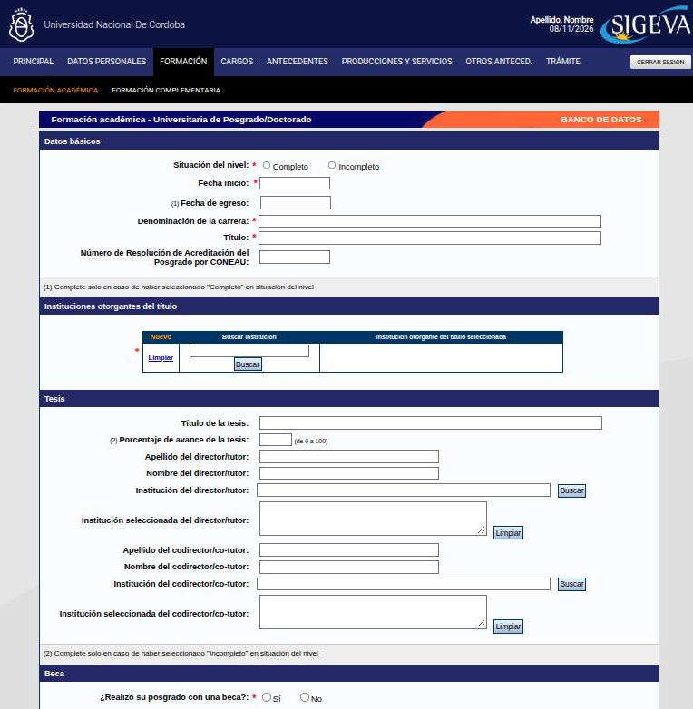

---
fuente:
  - "SIGEVA-UNC, sistema real (2026-11-08): formularios Nuevo de doctorado, maestría, grado y terciario; posdoctorado, cursos, idiomas y estancias"
  - "Manual del Investigador, UBA (7.ª ed.), 3.9"
  - "FAUD-UNC (2025), p. 4 y ejemplo de Formación académica, p. 6"
  - "Taller sobre SIGEVA, UNC, 2026-08-06 (grabación) y 2026-08-13 (grabación y demostración)"
  - "FCE-UNC, Barrera y Renny (2024), p. 69"
verificado_contra: ambos
fecha_verificacion: 2026-11-08
estado: verificado
---

# Formación

La solapa **Formación** tiene dos partes, cada una con su propia pantalla en la barra negra:

- **Formación académica**: carreras que otorgan título, desde el nivel básico hasta el doctorado.
- **Formación complementaria**: todo lo demás (posdoctorados, cursos, idiomas, estancias).

## Formación académica

Hay una tabla por nivel, cada una con su botón **Nuevo**:

- Nivel universitario de posgrado: **doctorado**, **maestría** y **especialización**.
- Nivel universitario de **grado**.
- Nivel **terciario** no universitario.
- Nivel **medio**.
- Nivel **básico**.

### Posgrado (doctorado, maestría, especialización)

- **Datos básicos**: situación del nivel (completo o incompleto), fecha de inicio, denominación de la carrera y título, todos obligatorios. La fecha de egreso se completa solo si el nivel está completo. Opcional: número de resolución de acreditación de la CONEAU.
- **Instituciones otorgantes del título**: al menos una, obligatoria (ver [Instituciones](campos-comunes.md#instituciones)). Con **Nuevo** agregás otra, por ejemplo si el título es conjunto.
- **Tesis** (en maestría: «trabajo final, obra o tesis»): título, director/a y codirector/a, cada uno con su institución. Si el nivel está **incompleto**, se informa el **porcentaje de avance de la tesis**, de 0 a 100.
- **Beca**: «¿Realizó su posgrado con una beca?», obligatoria. Si respondés que sí, buscá la institución que la financió.
- **Áreas de conocimiento**: área y subárea, y **especialidad** (obligatoria).
- **Informaciones adicionales**: hasta 1000 caracteres.

### Grado

Es igual al posgrado, con estas diferencias:

- Pregunta si obtuviste un **título intermedio** (obligatorio responder) y, si es así, su denominación.
- En lugar de tesis tiene **tesina**, con título, porcentaje de avance (si está incompleta) y director/a.
- No tiene bloque de beca ni número de la CONEAU.

### Terciario no universitario

Pide la situación, las fechas, la denominación de la carrera, el título, el **tipo de formación** (**Docente** o **Técnico-profesional**), la institución y la especialidad.

### Carreras en curso

Las carreras sin terminar **se cargan**: marcá la situación como **Incompleto** y completá el porcentaje de avance de la tesis o la tesina.

!!! danger "DECIDIR: ¿qué avance se informa en una carrera en curso?"
    - **Qué muestra el sistema.** El único dato de avance es el **porcentaje de avance de la tesis** (o de la tesina, o del trabajo final), de 0 a 100. No hay un campo de avance de la carrera ni de fecha estimada de finalización.
    - **Qué dice cada fuente.** El taller sobre SIGEVA del 6/8/2026 sugirió, para un doctorado no estructurado, actualizar el «grado de avance» a medida que se aprueban los cursos exigidos. El borrador anterior de esta guía, con base en ese taller, pedía indicar el grado de avance de la carrera y una fecha estimada de finalización.
    - **Qué hay que decidir.** Si el porcentaje debe reflejar solo el avance de la tesis (como dice la etiqueta) o el de toda la carrera (cursos más tesis), y cómo se lo explica a quien recién empieza un doctorado.

!!! warning "No dupliques la carrera con sus cursos"
    Los cursos, seminarios o módulos que forman parte del plan de una carrera **no se cargan aparte** como formación complementaria: ya están incluidos en la carrera, como lo están las materias de una licenciatura. Solo se cargan aparte los cursos **adicionales**, los que hiciste por fuera de lo que exige el título.

## Formación complementaria

| Ítem | Qué va | Qué pide |
|---|---|---|
| **Especialidad certificada por organismo/s de salud** | Especialidades del área de la salud (residencias, concurrencias, certificaciones de colegios o sociedades) | Situación, fechas, tipo de formación, especialidad, si tenés certificado de especialidad y año de la última certificación, institución y si fue con beca de residencia |
| **Posdoctorado** | Estancias posdoctorales | Fechas de inicio y de finalización (obligatorias), título del proyecto, investigador/a anfitrión/a y co-anfitrión/a, institución, si fue con beca (obligatorio) y especialidad |
| **Cursos de posgrado y/o capacitaciones extracurriculares** | Cursos, seminarios, talleres y asignaturas sueltas que no forman parte de una carrera ya cargada | Situación, fechas, tipo de curso, denominación, carga horaria, tipo de certificación, institución, área y especialidad |
| **Idiomas** | Idiomas que manejás | Idioma y nivel de dominio (**Básico**, **Intermedio** o **Avanzado**), obligatorios; certificado, institución emisora y año, opcionales |
| **Estancias y pasantías** | Estancias de investigación, formación o capacitación | Fechas, tipo de tareas (obligatorio), tema del plan de trabajo y una lista de aportes de la estancia para marcar |

En los **cursos**:

- **Tipo de curso**: Curso, Seminario, Taller u Otro.
- **Carga horaria**: se elige por **rango** («Hasta 24 horas», «Entre 25 y 50 horas», «Entre 51 y 100 horas», «Entre 101 y 200 horas», «Entre 201 y 359 horas» o «360 horas o más»). No hace falta el número exacto. El dato suele figurar en el certificado o en el programa del curso.
- **Tipo de certificación final**: certificado de asistencia o de aprobación. Se completa solo si el curso está completo.

## Casos dudosos

!!! danger "DECIDIR: profesorados, trayectos pedagógicos y diplomaturas"
    - **Qué muestra el sistema.** El nivel terciario tiene un tipo de formación **Docente**. El posgrado solo ofrece doctorado, maestría y especialización: no hay un nivel «diplomatura». En los cursos, el tipo puede ser Curso, Seminario, Taller u **Otro**: tampoco hay «diplomatura» ni «trayecto».
    - **Qué dice cada fuente.** En el taller sobre SIGEVA del 13/8/2026 se dieron respuestas distintas sobre el trayecto pedagógico y las diplomaturas. El borrador anterior de esta guía proponía:
        - **Profesorado** (otorga título): Formación académica, en el nivel que corresponda. Si es terciario, con tipo de formación «Docente».
        - **Trayecto pedagógico o curso sin título**: Formación complementaria, con su carga horaria.
        - **Diplomatura**: Formación académica de posgrado si otorga un título de posgrado acreditado; si no, Formación complementaria (tipo «Otro»).
    - **Qué hay que decidir.** Si se adopta ese criterio. En particular, dónde va una diplomatura universitaria, dado que el posgrado no tiene un nivel que le corresponda.

!!! note "Pendiente de verificar"
    Según el instructivo de la FCE (2024), el formulario de tesis recupera la institución de la formación académica ya cargada. Por eso conviene cargar primero la formación. Falta confirmarlo en el formulario de tesis.
