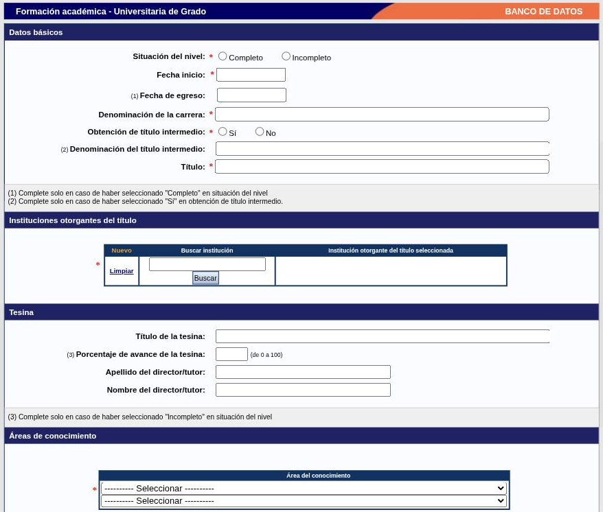

---
fuente:
  - "SIGEVA-UNC, Formación: formularios de alta de Formación académica (doctorado, grado y medio) y de Formación complementaria (los cinco)"
  - "Estructura: Manual del Investigador, UBA (7.ª ed.), 3.9; Manual del Usuario del Banco de Datos, UNC (2011), Formación académica"
verificado_contra: sistema real
fecha_verificacion: 2026-09-30
estado: pendiente_verificar
---

# Formación

La solapa **Formación** tiene dos apartados: **Formación académica** (tus títulos, por nivel) y **Formación complementaria** (especialidades de salud, posdoctorado, cursos, idiomas, estancias).

Para la mecánica general, ver [Tablas y formularios](mecanica.md); para institución y áreas del conocimiento, [los bloques comunes](campos-comunes.md).

## Formación académica

Hay siete tablas, una por nivel:

- Nivel universitario de posgrado/doctorado
- Nivel universitario de posgrado/maestría
- Nivel universitario de posgrado/especialización
- Nivel universitario de grado
- Nivel terciario no universitario
- Nivel medio
- Nivel básico

Las columnas de cada tabla son **Fecha ingreso**, **Fecha egreso**, **Institución** y **Carrera**. El enlace **Nuevo** de cada tabla abre el formulario del nivel correspondiente.

!!! note "Pendiente de verificar"
    Se abrieron los formularios de doctorado, grado y nivel medio. Los de maestría, especialización, terciario y básico no se abrieron; se presume que siguen el mismo esquema que el nivel más cercano.

### Posgrado (doctorado)

**Datos básicos**

| Campo | Observaciones |
|---|---|
| Situación del nivel \* | Completo / Incompleto |
| Fecha inicio \* | |
| Fecha de egreso | Solo si la situación es «Completo» |
| Denominación de la carrera \* | |
| Título \* | |
| Número de resolución de acreditación del posgrado por CONEAU | Opcional |

**Instituciones otorgantes del título \*.** Tabla con [buscador de institución](campos-comunes.md#instituciones); admite más de una (títulos conjuntos o en cotutela).

**Tesis**

- Título de la tesis.
- Porcentaje de avance, de 0 a 100: solo si la situación es «Incompleto».
- Apellido, nombre e institución del director o tutor, y los mismos datos del codirector o cotutor.

**Beca.** ¿Realizó su posgrado con una beca? \* (Sí / No). Si la respuesta es sí, se busca la institución que la financió.

**Áreas de conocimiento \*** y **Especialidad \***.

**Informaciones adicionales:** texto libre, hasta 1000 caracteres.

### Grado

| Campo | Observaciones |
|---|---|
| Situación del nivel \* | Completo / Incompleto |
| Fecha inicio \* | |
| Fecha de egreso | Solo si «Completo» |
| Denominación de la carrera \* | |
| Obtención de título intermedio \* | Sí / No |
| Denominación del título intermedio | Solo si respondiste «Sí» |
| Título \* | |

Siguen los bloques **Instituciones otorgantes del título \***, **Tesina** (título, porcentaje de avance si está incompleto, apellido y nombre del director o tutor), **Áreas de conocimiento \***, **Especialidad \*** e **Informaciones adicionales**.

### Nivel medio

Situación del nivel \*, Formación técnica \* (Sí / No), Fecha inicio \*, Fecha de egreso, Título \*, institución \* e informaciones adicionales.

!!! tip "Sugerencia de la SeICyT"
    Si tenés un posgrado en curso, cargalo como «Incompleto» con el porcentaje de avance y actualizalo cuando lo termines: no cargues un registro nuevo.

## Formación complementaria

Cinco tablas, cada una con su formulario.

### Especialidad certificada por organismo/s de salud

Para residencias, concurrencias y certificaciones de especialidad. Pide situación de la formación \*, fechas, tipo de formación \* (Residencia · Concurrencia · Acreditación de antigüedad en el ejercicio de la especialidad · Otro), especialidad \* (lista de especialidades médicas), si hay certificado y qué institución lo otorgó, año de la última certificación \*, institución donde se realiza la formación \*, si hubo beca de residencia \* y quién la financió, e informaciones adicionales.

### Posdoctorado

| Campo | Observaciones |
|---|---|
| Fecha de inicio \* · Fecha de finalización \* | |
| Título del trabajo o proyecto de investigación | |
| Apellido y nombre del investigador anfitrión | Y del coanfitrión, si hay |
| Institución en que se realiza o realizó \* | Buscador |
| ¿Realizó su posdoctorado con una beca? \* | Sí / No; si es sí, institución financiadora |
| Áreas de conocimiento \* · Especialidad \* | |
| Informaciones adicionales | Hasta 1000 caracteres |

### Cursos de posgrado y/o capacitaciones extracurriculares

| Campo | Observaciones |
|---|---|
| Situación del curso \* | Completo / Incompleto |
| Fecha de inicio \* | |
| Fecha de finalización | Solo si «Completo» |
| Tipo de curso | Curso · Seminario · Taller · Otro (con campo para especificar) |
| Denominación del curso \* | |
| Carga horaria \* | Hasta 24 horas · 25 a 50 · 51 a 100 · 101 a 200 · 201 a 359 · 360 o más |
| Tipo de certificación final | Solo si «Completo»: de asistencia / de aprobación |
| Institución en que se realiza o realizó \* | Buscador |
| Áreas de conocimiento \* · Especialidad \* | |
| Informaciones adicionales | Hasta 1000 caracteres |

Esta tabla es para los cursos que **tomaste**. Los que **dictaste** van en [Cargos → Docencia](cargos.md#cursos-de-posgrado-y-capacitaciones-extracurriculares).

### Idiomas

| Campo | Observaciones |
|---|---|
| Idioma \* | Español · Inglés · Portugués · Francés · Alemán · Italiano · Japonés · Chino · Ruso · Latín · Griego (moderno) · Otro (con campo para especificar) |
| Nivel de dominio del idioma \* | Básico · Intermedio · Avanzado |
| Certificado/s obtenido/s · Institución emisora · Año de obtención | Opcionales |
| Informaciones adicionales | Hasta 1000 caracteres |

Se carga un registro por idioma.

### Estancias y pasantías

| Campo | Observaciones |
|---|---|
| Fecha inicio \* · Fin | |
| Tipo de tareas \* | Tareas de investigación y desarrollo · Formación académica · Formación académica con tareas de I+D · Capacitación pre-profesional y/o profesional · Otro |
| Tema del plan de trabajo \* | No obligatorio para capacitación profesional ni para «Otro» |
| Actividades realizadas y/o logros alcanzados \* | Casillas; se puede marcar más de una |
| Descripción de la actividad \* | Hasta 2000 caracteres |
| Instituciones ejecutoras/financiadoras \* | Tabla con buscador; por cada una se indica si ejecuta y qué porcentaje financia |
| Director o tutor | Nombre, apellido e institución \* |
| Áreas del conocimiento \* | Hasta tres |

## Fuentes

- SIGEVA-UNC, formularios de alta de **Formación**, relevados el 2026-09-30 (vacíos, sin guardar).
- Manual UBA (7.ª ed.), 3.9, y manual UNC (2011): cobertura y orden.
