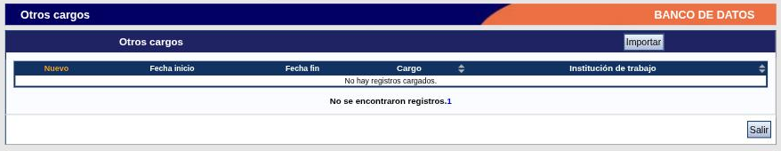
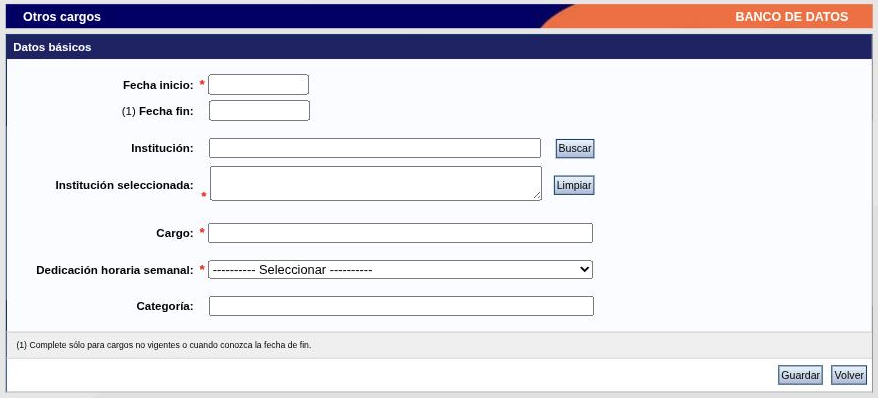

---
fuente:
  - "SIGEVA-UNC, pantallas de lista y formularios de alta"
  - "Manual del Investigador, UBA (7.ª ed.), 3.4; Manual del Usuario del Banco de Datos, UNC (2011), Instrucciones de navegación de tablas"
verificado_contra: ambos
fecha_verificacion: 2026-09-30
estado: pendiente_verificar
---

# Tablas y formularios

Casi todo el banco de datos funciona igual: una tabla con tus registros y un formulario para cargar cada uno. Si entendés esta mecánica, entendés el sistema entero.

## Dos tipos de sección

- **Formulario único.** Hay un solo juego de datos, que se completa y se guarda. Son: **Identificación**, **Dirección residencial**, **Lugar de trabajo** y **Experticia en CyT**. Tienen los botones **Guardar** y **Salir**.
- **Tabla de registros.** Podés cargar muchos registros del mismo tipo (cargos, publicaciones, becarios dirigidos…). Es el caso de todas las demás secciones.

## Cómo es una tabla

Al entrar a un apartado ves una o más tablas, una por tipo de registro. Por ejemplo, **Cargos → Docencia** tiene cuatro tablas, una por nivel educativo.

Cada tabla tiene:

- un título y, a su derecha, el botón **Importar** (ver [Compartir e importar datos](../sincronizacion/index.md));
- el enlace **Nuevo**, en el extremo izquierdo del encabezado, para cargar un registro;
- las columnas con los datos principales de cada registro; algunas tienen flechas para ordenar;
- por cada registro cargado, los enlaces **Editar** y **Borrar**;
- un contador de registros. Si la tabla está vacía, el sistema lo indica.

Al pie de la página, **Salir** vuelve a la pantalla principal.

## Cargar un registro nuevo

1. Hacé clic en **Nuevo** en la tabla que corresponda.
2. Completá el formulario. Los campos con asterisco rojo son obligatorios.
3. Presioná **Guardar**. Para salir sin guardar, **Volver**.

En los formularios vas a encontrar:

- **Notas numeradas.** Algunos campos llevan un número entre paréntesis, por ejemplo «(1) Fecha fin». Remite a una aclaración al pie del bloque, que casi siempre dice cuándo corresponde completar ese campo («solo si ya no desarrollás la actividad», «solo si elegiste *Otro*»).
- **Listas desplegables** con valores fijos. Cuando ninguna opción te representa suele haber un valor **Otro** y, al lado, un campo de texto para especificar.
- **Listas encadenadas:** la segunda lista se carga según lo que elegiste en la primera (por ejemplo, área y subárea del conocimiento).
- **Buscadores** de institución y de revista, que te sacan momentáneamente del formulario. Se explican en [Instituciones, revistas, autores, áreas y palabras clave](campos-comunes.md).
- **Tablas dentro del formulario** (autores, palabras clave, instituciones participantes), con sus propios **Nuevo** y **Borrar** para agregar o quitar filas.
- **Límites de caracteres** en los campos de texto largo, indicados debajo de cada uno.

!!! note "Pendiente de verificar"
    El relevamiento se hizo sin guardar registros. Los manuales de la UBA y de la UNC (2011) describen que, si falta un dato obligatorio o hay un error, el sistema vuelve a mostrar el formulario con el mensaje en la parte superior, y que hay que corregir y presionar **Guardar** otra vez. No se comprobó cómo se ven hoy esos mensajes.

## Modificar un registro

Hacé clic en **Editar**, a la izquierda del registro. Se abre el mismo formulario con los datos cargados.

!!! note "Pendiente de verificar"
    Según los manuales, el formulario de edición tiene los botones **Modificar** (guarda los cambios) y **Volver** (los descarta). No se abrió ningún registro en edición durante el relevamiento.

## Eliminar un registro

Hacé clic en **Borrar**, a la izquierda del registro.

!!! note "Pendiente de verificar"
    Según los manuales, el sistema muestra el registro completo y pide confirmar con **Eliminar**, o cancelar con **Volver**. La eliminación no se puede deshacer.

## Fechas vigentes

En cargos y actividades, la fecha de fin se deja vacía mientras la actividad sigue en curso: las notas de los formularios indican completarla solo cuando terminó. Hay excepciones en las que el sistema pide una fecha estimada (becarios y tesistas dirigidos, becas recibidas); están señaladas en cada sección.

## Problemas frecuentes

- **Aparece una «Página de errores».** Durante el relevamiento ocurrió al entrar a un formulario escribiendo su dirección a mano en lugar de usar el enlace **Nuevo**. No afecta tus datos: volvé a la tabla desde las solapas y entrá por el enlace.
- **El buscador de instituciones te sacó del formulario.** Es el comportamiento normal; ver [Instituciones](campos-comunes.md#instituciones).

!!! tip "Sugerencia de la SeICyT"
    Mientras no esté confirmado qué pasa con los datos ya escritos cuando el buscador de instituciones te lleva a otra pantalla, buscá la institución **antes** de completar el resto del formulario.

## Fuentes

- SIGEVA-UNC, tablas y formularios de alta de todas las solapas, relevados el 2026-09-30.
- Manual UBA (7.ª ed.), 3.4, y manual UNC (2011): edición, eliminación y mensajes de error.
