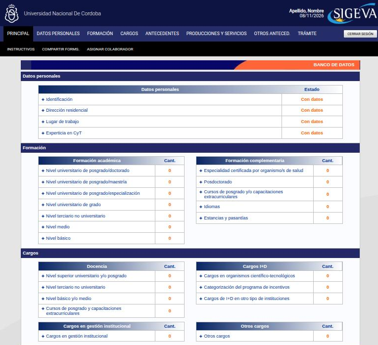
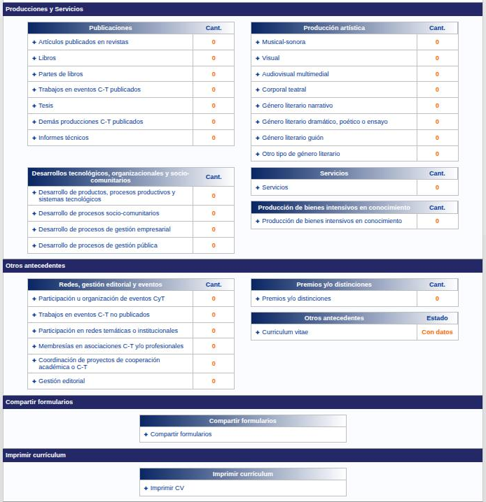
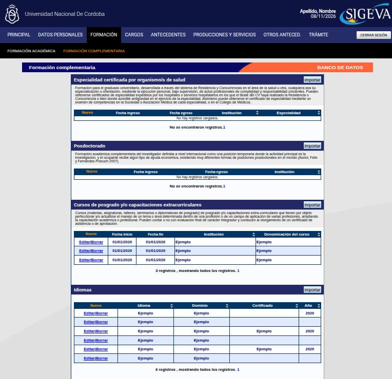
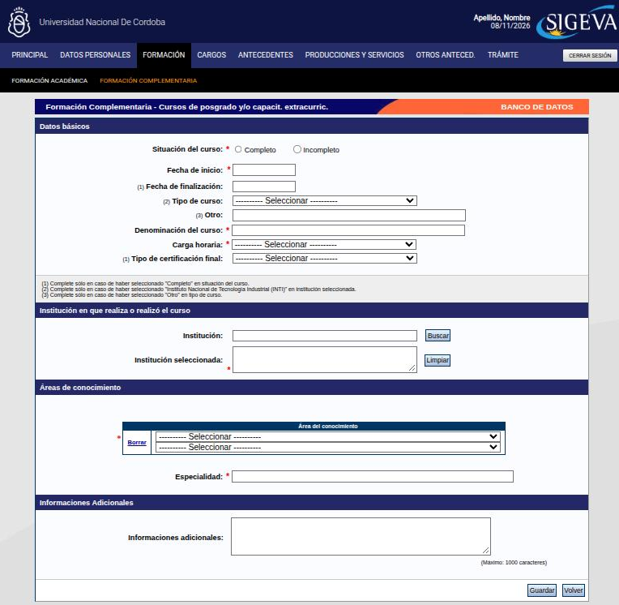

---
fuente:
  - "SIGEVA-UNC, sistema real (2026-11-08): Principal, Formación complementaria, formularios Nuevo y Editar"
  - "SIGEVA-UNC, Instructivos > Instructivo Navegación, interno del sistema (consultado 2026-11-08): borrado, validación, sesión"
  - "Manual del Investigador, UBA (7.ª ed.), 3.2.1 y 3.4"
  - "FAUD-UNC (2025), pp. 3–8"
  - "FCE-UNC, Barrera y Renny (2024), pp. 8–9"
  - "Taller sobre SIGEVA, UNC, 2026-08-13 (grabación y demostración)"
  - "Guía Banco de Datos de Actividades CyT v4, CONICET (2017), Características generales"
verificado_contra: sistema real
fecha_verificacion: 2026-11-08
estado: verificado
---

# Cómo funcionan las pantallas y los formularios

Al terminar esta página vas a poder moverte por el banco de datos y crear, editar y borrar registros.

## La pantalla Principal

Cuando entrás con el rol **Usuario banco de datos de actividades de CyT**, llegás a la pantalla **Principal**. Arriba hay un menú con las secciones del CV y, debajo, una barra negra con las opciones de la sección en la que estás. La Principal muestra todas las secciones y sus ítems en una sola pantalla: hacé clic en el nombre azul de cualquier ítem para entrar a su formulario.

Las secciones del menú son:

| Menú | Qué contiene |
|---|---|
| **Datos personales** | Identificación, dirección residencial, lugar de trabajo y experticia en CyT |
| **Formación** | Formación académica (de nivel básico a doctorado) y formación complementaria (especialidades de salud, posdoctorado, cursos, idiomas, estancias y pasantías) |
| **Cargos** | Docencia, cargos de I+D (incluye la categoría del Programa de Incentivos), cargos en gestión institucional y otros cargos |
| **Antecedentes** | Formación de recursos humanos, financiamiento CyT (proyectos, subsidios y becas recibidas), evaluación, otras actividades CyT y extensión |
| **Producciones y servicios** | Publicaciones; producción artística; desarrollos tecnológicos, organizacionales y socio-comunitarios; servicios; producción de bienes intensivos en conocimiento |
| **Otros anteced.** | Eventos, trabajos en eventos no publicados, redes, membresías, cooperación, gestión editorial, premios y el **Curriculum vitae** adjunto |
| **Trámite** | Incorporarte a un trámite o proyecto (ver [Proyectos y trámites](../proyectos-y-tramites/index.md)) |

En la barra negra de la Principal están **Instructivos**, **Compartir forms.** y **Asignar colaborador**. Arriba a la derecha, **Cerrar sesión**.

En las tablas de la Principal hay dos columnas que conviene mirar:

- **Estado**: «Con datos» o «Sin datos», en los ítems que tienen un solo registro (por ejemplo, Identificación).
- **Cant.**: cuántos registros cargaste en los ítems que admiten varios (por ejemplo, Artículos publicados en revistas).

Al pie de la Principal están **Compartir formularios** (ver [Sincronizar datos](../sincronizacion/index.md)) e **Imprimir CV** (ver [CV adjunto e impresión](adjunto-impresion.md)).

## Las tablas: crear, editar y borrar

Al entrar a una sección vas a ver una tabla por cada ítem, con los registros que ya cargaste. Arriba de cada tabla hay un texto que explica qué va en ese ítem: leelo si tenés dudas de dónde cargar algo.

### Crear un registro

1. Presioná **Nuevo**, en la primera celda del encabezado de la tabla.
2. Completá el formulario. Los campos con **asterisco rojo (\*)** son obligatorios: sin ellos el sistema no guarda.
3. Algunos campos llevan una llamada numerada, como «(1)». Abajo del bloque se explica cuándo completarlos (por ejemplo, «solo si el curso está completo»).
4. Presioná **Guardar**, abajo a la derecha.
5. Si falta algo, el sistema vuelve a mostrar el formulario con un **error de validación** en rojo, arriba, que dice qué corregir. Corregilo y volvé a guardar.

**Volver** sale sin guardar.

### Modificar un registro

1. Presioná **Editar**, a la izquierda del registro.
2. Cambiá lo que necesites y presioná **Modificar**. **Volver** sale sin cambiar nada.

### Borrar un registro

1. Presioná **Borrar**, a la izquierda del registro.
2. El sistema abre un formulario de confirmación. Presioná **Eliminar** para borrarlo o **Volver** para cancelar.

!!! warning "Borrar no se puede deshacer"
    Una vez eliminado, el registro hay que volver a cargarlo desde cero.

### Importar

Cada ítem tiene un botón **Importar**, arriba a la derecha de su tabla, que trae registros desde otro SIGEVA. Se explica en [Sincronizar datos](../sincronizacion/index.md).

### Salir

Al pie de cada sección, **Salir** te devuelve a la Principal.

## La sesión

- La sesión se cierra sola después de **4 horas sin actividad**. Lo que no guardaste se pierde.
- Si pasás a otra pantalla sin presionar **Guardar**, perdés los cambios de esa pantalla.
- Cuando termines, presioná **Cerrar sesión**.
- Cada formulario que admite adjuntos indica su tamaño máximo. Un archivo más grande que el permitido puede cerrar la sesión de forma inesperada.

!!! danger "DECIDIR: ¿cuál es el tamaño máximo de los archivos?"
    - **Qué muestra el sistema.** Hay dos datos distintos dentro del propio SIGEVA-UNC. El *Instructivo Navegación* (en **Instructivos**) dice que la sesión puede cerrarse si se supera el límite de **20 MB** de archivos enviados. El formulario de **Libro**, en cambio, indica un tamaño máximo de **35 MB** para el texto completo.
    - **Qué hay que decidir.** Qué límite informa este manual: el de cada formulario, un valor único o el más bajo, como margen de seguridad. Conviene confirmarlo con el soporte de SIGEVA-UNC.

!!! tip "Sugerencia"
    - Usá los botones del sistema (**Volver**, **Salir**) y no los de Atrás y Adelante del navegador.
    - Si un campo no responde, probá otro navegador o una ventana privada.
    - En los selectores de año o de fecha, a veces hay que hacer clic sobre el valor ofrecido para que el campo lo tome.
    - Completá todos los campos que puedas, no solo los obligatorios: un registro completo se evalúa mejor y se exporta mejor.

## Si tenés dudas dentro del sistema

En la barra negra de la Principal, **Instructivos** ofrece tres documentos: el manual del banco de datos de CONICET, un instructivo de navegación propio del sistema y la guía de sincronización de CONICET.

Para problemas técnicos, escribí al soporte de SIGEVA-UNC: `consultas@sigeva.unc.edu.ar`.
