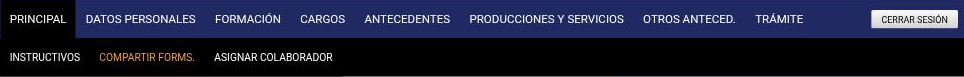

---
fuente:
  - "SIGEVA-UNC, pantalla principal del banco de datos y solapas"
  - "Estructura: Manual del Investigador, UBA (7.ª ed.), 3.1–3.2.1; Manual del Usuario del Banco de Datos, UNC (2011), Instrucciones generales de navegación"
verificado_contra: sistema real
fecha_verificacion: 2026-09-30
estado: verificado
---

# Navegación general

Acá vas a ver cómo está organizado el banco de datos y las dos maneras de llegar a cada sección.

## Las solapas

Con el rol **Usuario banco de datos de actividades de CyT**, la parte superior de la pantalla muestra dos barras:

- La **barra azul** tiene las solapas principales: **Principal**, **Datos personales**, **Formación**, **Cargos**, **Antecedentes**, **Producciones y servicios**, **Otros anteced.** y **Trámite**. A la derecha está el botón **Cerrar sesión**.
- La **barra negra**, debajo, cambia según la solapa elegida y muestra sus apartados.

| Solapa (barra azul) | Apartados (barra negra) | En esta guía |
|---|---|---|
| **Principal** | Instructivos · Compartir forms. · Asignar colaborador | Esta página, [Compartir e importar](../sincronizacion/index.md), [Roles](../primeros-pasos/roles.md#colaborador) |
| **Datos personales** | Identificación · Dirección residencial · Lugar de trabajo · Experticia en CyT | [Datos personales](datos-personales.md), [Experticia en CyT](experticia.md) |
| **Formación** | Formación académica · Formación complementaria | [Formación](formacion.md) |
| **Cargos** | Docencia · Cargos I+D · Cargos en gestión institucional · Otros cargos | [Cargos](cargos.md) |
| **Antecedentes** | Formación de recursos humanos · Financiamiento CyT · Extensión · Evaluación · Otras actividades CyT | [Antecedentes](antecedentes.md) |
| **Producciones y servicios** | Publicaciones · Des. tecnol., organizacionales y socio comunitarios · Prod. artística · Servicios · Prod. de bienes intensivos en conoc. | [Publicaciones](publicaciones.md), [Desarrollos, servicios y bienes](desarrollos-servicios.md), [Producción artística](produccion-artistica.md) |
| **Otros anteced.** | Redes, gestión editorial y eventos · Premios · Currículum | [Otros antecedentes](otros.md), [Currículum adjunto](adjunto-impresion.md) |
| **Trámite** | (sin apartados) | [Trámite](../proyectos-y-tramites/index.md) |

En varias solapas la barra negra termina con un ítem **Más ...**, que no se relevó.

## La pantalla principal

La solapa **Principal** muestra el índice completo de tu banco de datos: todas las secciones agrupadas como en las solapas, y dentro de cada una, la lista de tipos de registro. A la derecha de cada renglón hay una columna que indica:

- **Estado**, en las secciones que son un formulario único (por ejemplo, las de datos personales): dice **Con datos** cuando ya cargaste información.
- **Cant.**, en las secciones que son tablas: la cantidad de registros cargados.

Cada renglón es un enlace: al hacer clic vas directo a esa sección. Es la forma más rápida de ver qué te falta completar.

Al pie de la pantalla principal hay dos accesos más: **Compartir formularios** e **Imprimir currículum**.

!!! tip "Sugerencia de la SeICyT"
    Antes de una presentación, recorré la pantalla principal de arriba abajo y mirá los ceros: es la manera más simple de detectar secciones que nunca cargaste.

## Dos formas de llegar a una sección

1. **Desde las solapas:** elegí la solapa en la barra azul y después el apartado en la barra negra.
2. **Desde la pantalla principal:** hacé clic en el nombre del renglón.

En los dos casos llegás a la misma pantalla. Lo que encontrás ahí —una tabla de registros o un formulario único— se explica en [Tablas y formularios](mecanica.md).

## Instructivos

**Principal → Instructivos** reúne tres enlaces:

| Enlace | A dónde lleva |
|---|---|
| Manual del Banco de Datos de Actividades CyT | Un PDF del CONICET (versión 2 del manual) |
| Instructivo Navegación | Una página interna del sistema |
| Instructivo de sincronización | Un PDF del CONICET (guía de sincronización, versión 2) |

Es decir, el sistema de la UNC remite a documentación del CONICET, no al manual que la UNC publicó en 2011.

## Fuentes

- SIGEVA-UNC, solapas y pantalla principal, relevadas el 2026-09-30. Los destinos de los instructivos se identificaron por su dirección, sin abrir los documentos.
- Manual UBA (7.ª ed.), 3.2.1, y manual UNC (2011): organización de la explicación.
