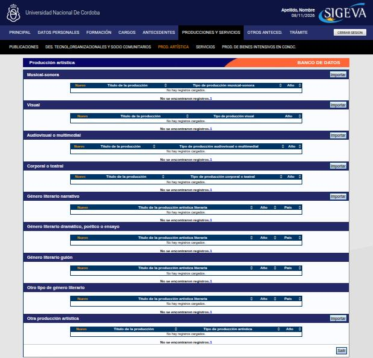

---
fuente:
  - "SIGEVA-UNC, sistema real (2026-11-08): lista de Producción artística y formularios Nuevo de Visual y Género literario narrativo"
  - "FAUD-UNC (2025), p. 5"
  - "Taller sobre SIGEVA, UNC, 2026-08-06 (diap. 15 y grabación) y 2026-08-13 (grabación)"
  - "Manual del Investigador, UBA (7.ª ed.), 3.10.3"
verificado_contra: ambos
fecha_verificacion: 2026-11-08
estado: verificado
---

# Producción artística

Está en **Producciones y servicios › Prod. artística**. Sirve para registrar obras: producciones musicales, visuales, audiovisuales, teatrales o literarias.

## Tipos

La pantalla tiene nueve tablas, cada una con su **Nuevo**:

- Musical-sonora
- Visual
- Audiovisual o multimedial
- Corporal o teatral
- Género literario narrativo
- Género literario dramático, poético o ensayo
- Género literario guion
- Otro tipo de género literario
- Otra producción artística

La pantalla **Principal** muestra las primeras ocho. **Otra producción artística** aparece solo dentro de esta pantalla.

## Qué piden los formularios

En las producciones **no literarias** (por ejemplo, Visual) se pide:

- tipo de producción (con la opción «otro»), título y año;
- si **obtuvo críticas en medios de comunicación**;
- la **cantidad de presentaciones**: presentación única o más de una;
- la **primera presentación** y la **presentación más importante**. Para cada una se indica el tipo de evento (concierto o recital, concurso, creación, exposición, festival, instalación, muestra, obra de teatro u otro) y si fue colectiva o individual.

En las producciones **literarias** (por ejemplo, Género literario narrativo) se pide:

- el **tipo de género** (en narrativo: cuento, novela, biografía u otro), título y año;
- si obtuvo críticas en medios;
- los **datos de publicación**: tipo de publicación (artículo de revista, libro o parte de libro), título, país, ISBN o ISSN, idioma y páginas.

!!! note "Pendiente de verificar"
    Los campos de los formularios Musical-sonora, Audiovisual, Corporal o teatral, los otros géneros literarios y Otra producción artística. Solo se abrieron Visual y Género literario narrativo.

## Qué va y qué no

- Va la **obra** como producción.
- La **muestra** o la presentación de una obra con fines de divulgación o de extensión va en Antecedentes › Extensión: comunicación pública o producción y/o divulgación artística o cultural (ver [Antecedentes](antecedentes.md#extension)).
- Una producción audiovisual de divulgación científica, como un podcast o un video, puede cargarse acá como audiovisual o en Extensión, según su finalidad. Elegí **un** lugar.

!!! tip "Sugerencia"
    Cargá la producción artística **pertinente a tu perfil académico**. Para quien investiga o enseña en artes, es central. Para otras áreas, una obra sin relación con la actividad académica no suma.
