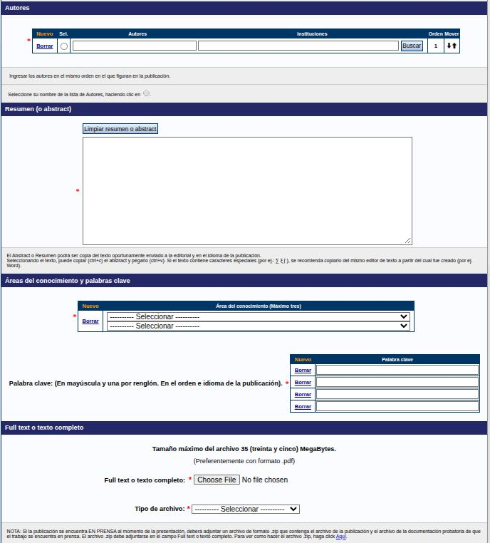

---
fuente:
  - "SIGEVA-UNC, sistema real (2026-11-08): Precarga de artículos y formularios Nuevo de Artículo, Libro, Parte de libro, Trabajo en evento publicado, Tesis, Demás producciones e Informe técnico"
  - "FCE-UNC, Barrera y Renny (2024), Instructivo para registrar publicaciones en SIGEVA (completo)"
  - "Biblioteca FCE-UNC, Pautas a tener en cuenta al cargar en SIGEVA"
  - "Biblioteca de la Facultad de Odontología, UNC, diap. 5–16"
  - "Manual del Investigador, UBA (7.ª ed.), 3.10.1"
  - "Taller sobre SIGEVA, UNC, 2026-08-06 (diap. 15–17 y grabación) y 2026-08-13 (diap. 3–4, grabación y demostración)"
  - "Guía Banco de Datos de Actividades CyT v4, CONICET (2017), Precarga por DOI/ISSN"
verificado_contra: ambos
fecha_verificacion: 2026-11-08
estado: verificado
---

# Publicaciones

Es la sección que más pesa en la mayoría de las evaluaciones y la que más datos pide. Está en **Producciones y servicios › Publicaciones** y tiene siete ítems:

- Artículos publicados en revistas
- Libros
- Partes de libros
- Trabajos en eventos C-T publicados
- Tesis
- Demás producciones C-T publicadas
- Informes técnicos

El sistema ordena la producción por **tipo de documento**, no por fecha ni por importancia. Antes de cargar, fijate en [¿Dónde cargo cada cosa?](donde-cargar.md#publicaciones-y-trabajos) qué tipo corresponde.

## Antes de cargar una publicación

Tené a mano:

- la publicación abierta, o su referencia completa;
- el archivo del **texto completo**, preferentemente en **PDF** y de **35 MB como máximo** (si pesa más, comprimilo);
- el título exacto, los autores en orden con su filiación, el resumen y las palabras clave;
- los identificadores: **DOI**, **ISSN** o e-ISSN de la revista, **ISBN** del libro.

!!! tip "Sugerencia: cómo escribir los datos"
    - **Título** igual al de la versión final, en mayúsculas y minúsculas, sin punto final. El subtítulo, después de dos puntos.
    - **Volumen** en números arábigos: «Año XXI» se carga como 21. Si la revista no indica volumen, dejá el campo vacío.
    - **URL**: la de la página de la revista o la editorial donde está el registro del documento.
    - **Resumen**: el de la publicación, en su idioma, sin agregados. Revisá que al pegarlo no se cuele código HTML.
    - **DOI y URL**: si existen, cargalos siempre.
    - El **archivo adjunto tiene que coincidir** con los datos que cargaste.

## Partes comunes a todos los formularios

Casi todos los ítems comparten estos bloques:

1. **Datos básicos**: título, idioma, editorial, país y ciudad, fecha o año, estado (**Publicado** o **En prensa**), referato, soporte (impreso y/o electrónico; si es electrónico, URL) y, según el tipo, ISSN, ISBN, volumen, número y páginas.
2. **Autores** con su filiación (ver [Autores](campos-comunes.md#autores)).
3. **Áreas del conocimiento** (hasta tres) y **palabras clave** (ver [Palabras clave](campos-comunes.md#palabras-clave)).
4. **Resumen** (*abstract*).
5. **Full text o texto completo**: el archivo, **obligatorio**.
6. **Derecho de exclusión (OPT-OUT)** (ver más abajo).
7. **Guardar**.

### Texto completo

- Si la publicación **está publicada**, adjuntá el **PDF**.
- Si está **en prensa**, el formulario pide un archivo **.zip** que contenga el texto y la **documentación probatoria** de que está en prensa (por ejemplo, la constancia de aceptación de la revista o la editorial). El .zip va en el mismo campo de texto completo, y el formulario tiene un enlace que explica cómo armarlo.
- Un trabajo **enviado pero todavía no evaluado** no se carga.

En **artículos**, además, hay que elegir el **tipo de archivo**: **Post print** o **Versión final**.

!!! danger "DECIDIR: ¿Post print o Versión final?"
    - **Qué muestra el sistema.** En el formulario de artículo, el campo obligatorio «Tipo de archivo» ofrece solo **Post print** y **Versión final**, sin explicar la diferencia.
    - **Qué dice cada fuente.** El instructivo de la FCE (Barrera y Renny, 2024) indica **Post print** para lo publicado y **Versión final** (la aceptada) para lo que está en prensa. Las pautas de la Biblioteca de la FCE piden subir la versión final y reservar la posprint para cuando hay acuerdos con terceros. La Biblioteca de Odontología pide la posprint aceptada.
    - **Qué hay que decidir.** Qué recomienda este manual, idealmente junto con el Repositorio Digital Universitario de la UNC, ya que el texto completo puede terminar ahí.

### Derecho de exclusión

El texto completo que cargás puede pasar al repositorio institucional (Ley 26.899 de repositorios y Res. MinCyT 753/16). En **Motivos de exclusión (OPT-OUT)** elegí un motivo **solo si corresponde**: **confidencialidad**, **en vías de obtener un derecho de propiedad industrial** o **acuerdos previos con terceros**. Si no corresponde, dejalo sin seleccionar.

## Artículos publicados en revistas

1. Presioná **Nuevo**. Se abre la **precarga**.
2. Ingresá el **DOI** del artículo o el **ISSN** de la revista y presioná **Precargar**.
    - Con el **DOI**, el sistema importa los datos del artículo desde Elsevier o Crossref. Si no lo encuentra ahí, busca el mismo artículo ya cargado en SIGEVA por algún coautor.
    - Con el **ISSN**, completa solo los datos de la revista y la editorial.
    - Podés corregir lo que se completó, pero al editarlo se pierde la carga estandarizada.
3. Si no tenés DOI ni ISSN, o preferís cargar a mano, presioná **Omitir**.
4. En **Datos básicos**, buscá la revista con **Buscar por ISSN / e-ISSN** o **Buscar por Nombre**. Queda en **Revista seleccionada** (obligatoria). **Limpiar** la borra.
5. Completá editorial, ciudad, título, idioma, volumen, tomo, número, páginas, fecha de publicación, URL, DOI, **referato** (con o sin) y **estado** (publicado o en prensa).
6. En **Autores**, cargá a todas las personas en orden. En este formulario podés reordenarlas con las flechas de **Mover** y marcar **tu propio nombre** en la columna **Sel.**
7. Seguí con resumen, áreas, palabras clave, texto completo (con su **tipo de archivo**) y derecho de exclusión. **Guardar**.

!!! note "Pendiente de verificar"
    Cómo se carga a mano una revista que no aparece en la búsqueda. Según el instructivo de la FCE (2024), al pie de la búsqueda hay un apartado para ingresarla con título e ISSN (formato `1234-5678`). No se abrió la pantalla de búsqueda de revistas.

!!! tip "Sugerencia"
    - Si la revista tiene el ISSN **en trámite**, omití la precarga y buscala o cargala por nombre.
    - Si el sistema rechaza un ISSN que copiaste bien, revisá el formato: la cantidad de caracteres y el guion.

## Libros

Datos básicos obligatorios: título del libro, **ISBN**, idioma, cantidad de páginas, estado (publicado o en prensa), si tuvo referato, país de edición, editorial, año de publicación y **tu rol** (autor, editor/compilador o revisor; podés marcar más de uno). Opcionales: cantidad de volúmenes o tomos, ciudad, soporte y URL (por ejemplo, la del repositorio). Luego, autores, áreas, palabras clave, resumen y texto completo.

En este formulario, la tabla de autores **no tiene** columnas para mover ni para marcarte.

- Los datos legales (editorial, edición, lugar, ISBN, licencia) suelen estar en la contraportada o en la página de créditos.
- Un libro de actas que **editaste o compilaste** va acá. Tu **ponencia** dentro de ese libro va en Trabajos en eventos C-T publicados.
- El material didáctico no va como libro (ver Demás producciones), salvo que tenga formato de libro con ISBN.

## Partes de libros

Además de los datos del libro (con **ISBN**), se pide:

- el **tipo de parte**: capítulo de libro; artículo de enciclopedia o anuario; entrada de diccionario, glosario o repertorio biográfico; prólogo o prefacio; introducción; epílogo o conclusión; índice analítico; nota al pie;
- el **título de la parte**;
- las **páginas**: la página final es obligatoria solo si está publicada.

Hay un bloque para **compiladores, editores u organizadores** del libro, que se cargan como los autores.

!!! warning "Las ponencias no van como capítulos"
    Aunque una ponencia se haya publicado en un libro, se carga en **Trabajos en eventos C-T publicados**.

## Trabajos en eventos C-T publicados

Son las ponencias que pasaron por un proceso de publicación: actas, libros o números de revista del evento.

- **Datos del trabajo**: tipo de trabajo (**artículo completo**, **artículo breve**, **resumen** u **otro**), título, idioma, tipo de publicación (**libro** o **revista**), título de la revista o del libro, país, ciudad, editorial y año.
- **Datos del evento**: nombre, tipo (conferencia, congreso, simposio, workshop, taller, jornada, exposición, feria, mesa redonda, seminario, encuentro, ronda de negocios u otro), alcance (**nacional** o **internacional**), país y fecha.

Las ponencias **no publicadas** van en [Otros antecedentes](otros.md). Tu participación en el evento (asistente, expositor/a, moderador/a) se carga aparte, en Otros antecedentes › Participación u organización de eventos. No es un duplicado: son dos cosas distintas.

## Tesis

Tu tesis de grado o de posgrado. Obligatorios: título de la tesis, **nivel educativo** (grado, especialización, maestría, doctorado o posdoctorado), título obtenido, fecha de defensa o aprobación, idioma y texto completo. Además hay bloques para la **institución**, el **director de tesis** y el **co-director**, y opcionales para soporte, URL (por ejemplo, la del Repositorio Digital Universitario), áreas y palabras clave.

!!! note "Pendiente de verificar"
    Según el instructivo de la FCE (2024), si la formación está cargada, la institución puede completarse sola, y el director se busca por apellido y se elige de un listado, que completa el nombre y el CUIL. No se comprobó en el sistema.

## Demás producciones C-T publicadas

Para publicaciones que no son artículos, libros, partes de libro, ponencias ni tesis. El **tipo de producción** puede ser:

- traducciones publicadas como artículos en revistas;
- traducciones publicadas como libros o partes de libros;
- **reseñas bibliográficas**;
- **material didáctico sistematizado**;
- **innovación pedagógica**;
- otro.

Obligatorios: tipo de producción, título, idioma, año, país y texto completo. **No se exige ISSN ni ISBN.**

!!! warning "Las reseñas no son artículos"
    Aunque se publiquen en una revista científica, las reseñas van acá.

## Informes técnicos

Son informes producidos para una **institución externa**, en el marco de un convenio o de un servicio (por ejemplo, un diagnóstico encargado por un organismo público). El formulario es de tipo **producción tecnológica**. Pide:

- tipo del informe o memoria;
- tipo y naturaleza de la producción tecnológica;
- disciplina y campo de aplicación;
- tu **porcentaje de participación** en la autoría;
- moneda y **monto percibido**;
- fechas;
- tipo de institución financiadora.

**No** van acá los informes finales de tus becas o proyectos, ni los de adscripciones o becas de extensión: se dan por supuestos en esas actividades.

## Si la publicación no tiene ISSN ni ISBN

!!! danger "DECIDIR: publicaciones sin ISSN ni ISBN"
    - **Qué muestra el sistema.** El ISBN es obligatorio en **Libros** y en **Partes de libros**. En **Artículos**, la revista se elige de un listado o se carga a mano. En **Demás producciones** no se pide ISSN ni ISBN.
    - **Qué circula.** La práctica de cargar un número ficticio (todos ceros o todos unos) y aclararlo en el archivo adjunto.
    - **Criterio propuesto, a confirmar.** No recomendarla: el CV tiene carácter de declaración jurada y el dato sería falso. En su lugar:
        1. Verificá si la publicación tiene ISSN o ISBN: revistas y editoriales casi siempre los tienen, a veces solo electrónicos.
        2. Si no tiene, fijate si corresponde **Demás producciones C-T publicadas**, donde no es obligatorio.
        3. Si el formulario que corresponde lo exige igual, consultá a soporte (`consultas@sigeva.unc.edu.ar`) o a la SeICyT.
