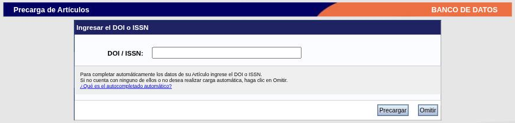
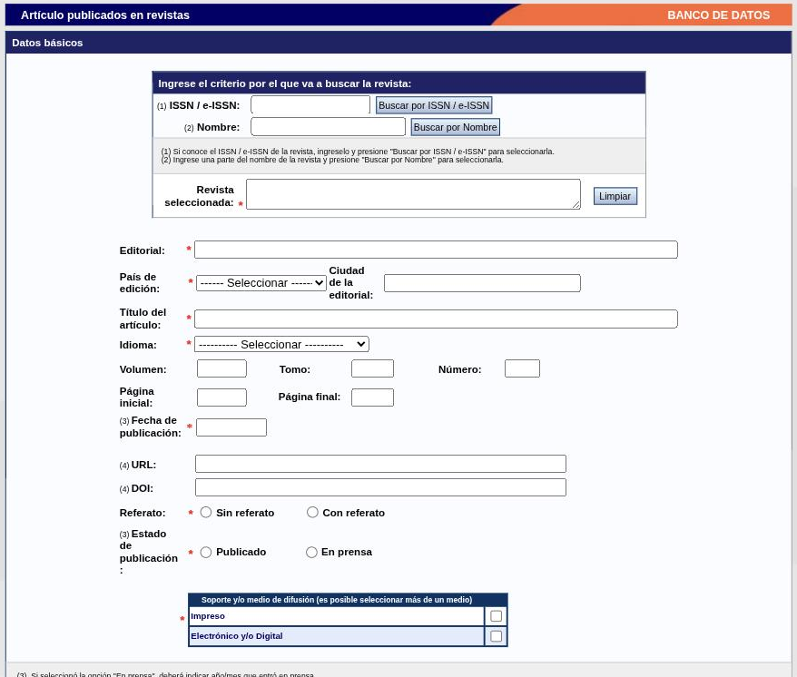
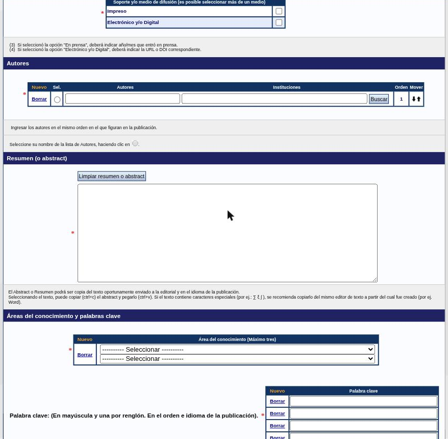
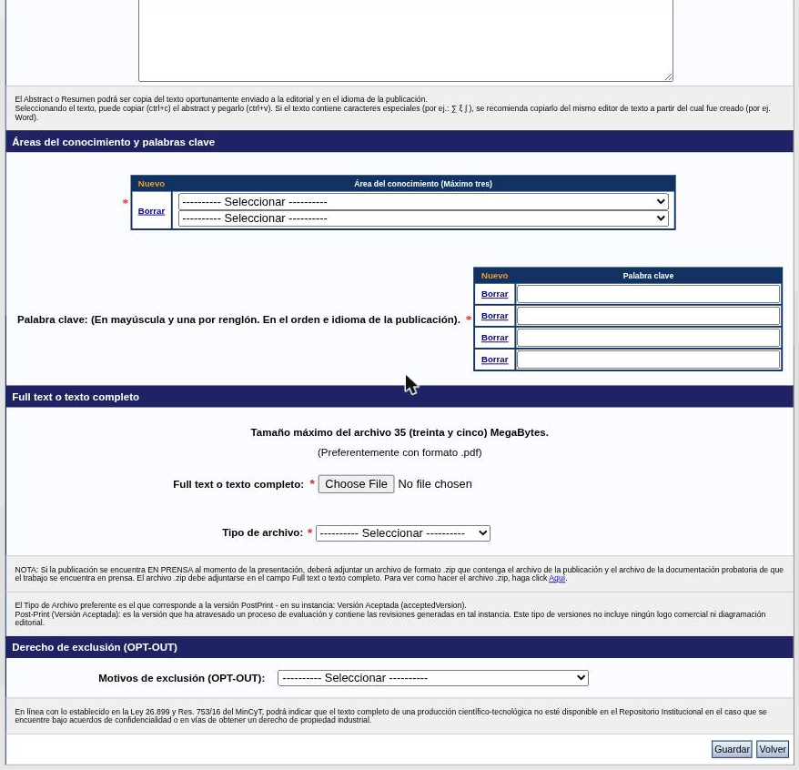

---
fuente:
  - "SIGEVA-UNC, Producciones y servicios → Publicaciones: precarga y formularios de alta de las siete tablas"
  - "Estructura: Manual del Investigador, UBA (7.ª ed.), 3.10.1; Manual del Usuario del Banco de Datos, UNC (2011), Producción científica"
  - "Guía Banco de Datos de Actividades CyT v4, CONICET (2017), precarga de artículos"
verificado_contra: sistema real
fecha_verificacion: 2026-09-30
estado: pendiente_verificar
---

# Producciones y servicios: publicaciones

**Producciones y servicios → Publicaciones** reúne siete tablas:

| Tabla | Para qué |
|---|---|
| Artículos publicados en revistas | Artículos en publicaciones periódicas |
| Libros | Libros como autor, editor/compilador o revisor |
| Partes de libros | Capítulos, prólogos, entradas de diccionario, etc. |
| Trabajos en eventos C-T publicados | Ponencias y resúmenes publicados en actas, libros o revistas |
| Tesis | Tus propias tesis y trabajos finales |
| Demás producciones C-T publicados | Traducciones, reseñas, material didáctico, otras |
| Informes técnicos | Informes y memorias técnicas |

Los trabajos presentados en eventos que **no** se publicaron van en [Otros antecedentes](otros.md#trabajos-en-eventos-c-t-no-publicados).

## Bloques que se repiten

Además de [autores, áreas del conocimiento y palabras clave](campos-comunes.md), los formularios de publicaciones comparten:

- **Idioma \*:** Español · Inglés · Portugués · Francés · Alemán · Italiano · Japonés · Chino · Ruso · Latín · Griego (moderno) · Otro.
- **Soporte y/o medio de difusión \*:** casillas *Impreso* y *Electrónico y/o Digital*. Si marcás el segundo, hay que indicar la **URL**.
- **Resumen (o abstract) \*:** en el idioma de la publicación. La ayuda recomienda copiarlo y pegarlo desde el editor de texto original si tiene caracteres especiales.
- **Full text o texto completo:** el archivo de la publicación, de hasta 35 MB, preferentemente en PDF.
- **Derecho de exclusión (OPT-OUT):** ver [más abajo](#texto-completo-y-repositorio-institucional).

## Artículos publicados en revistas

### La precarga

Al hacer clic en **Nuevo**, antes del formulario aparece la pantalla **Precarga de Artículos**:

Tenés dos caminos:

- Escribir el **DOI** o el **ISSN** y presionar **Precargar**.
- Presionar **Omitir** y cargar todo a mano.

Según explica la propia pantalla:

- Con el **DOI**, el sistema trae los metadatos del artículo desde servicios externos (menciona a Elsevier y a Crossref) y completa los campos del formulario. Si el DOI no está en esos servicios, intenta encontrar el mismo artículo ya cargado en SIGEVA por una persona coautora.
- Con el **ISSN**, completa solamente los datos de la revista y de la editorial.
- En los dos casos podés corregir lo precargado; si editás, se pierde la carga estandarizada que propone la precarga.

!!! note "Pendiente de verificar"
    No se ejecutó ninguna precarga. Falta comprobar qué campos completa en la práctica y cuánto hay que corregir.

!!! tip "Sugerencia de la SeICyT"
    Si el artículo tiene DOI, empezá siempre por la precarga: ahorra tiempo y reduce diferencias de escritura entre coautores. Después revisá campo por campo, sobre todo autores e instituciones.

### El formulario

**Revista y publicación**

| Campo | Opciones u observaciones |
|---|---|
| Revista seleccionada \* | Con el [buscador de revistas](campos-comunes.md#revistas), por ISSN o por nombre |
| Editorial \* | |
| País de edición \* · Ciudad de la editorial | |
| Título del artículo \* | |
| Idioma \* | |
| Volumen · Tomo · Número · Página inicial · Página final | Opcionales |
| Fecha de publicación \* | Si está en prensa, el año y mes en que entró en prensa |
| URL · DOI | Uno de los dos si el soporte es electrónico |
| Referato \* | Sin referato / Con referato |
| Estado de publicación \* | Publicado / En prensa |
| Soporte y/o medio de difusión \* | |

**Autores, resumen, áreas y palabras clave**

La tabla de autores es la variante completa: una fila por persona, con su institución (botón **Buscar**), el orden y las flechas para moverla. Tenés que marcar tu propio nombre en la columna **Sel.**

**Texto completo y exclusión**

- **Full text o texto completo \*:** el archivo del artículo.
- **Tipo de archivo \*:** *Post print* o *Versión final*. La pantalla indica como preferente el post-print en su versión aceptada: la que ya pasó la evaluación e incorpora sus correcciones, pero sin logo ni diagramación de la editorial.
- Si el artículo está **en prensa**, la nota pide un `.zip` con el trabajo y la constancia de que fue aceptado.

## Libros

| Campo | Opciones u observaciones |
|---|---|
| Título del libro \* | |
| ISBN \* | |
| Idioma \* | |
| Cantidad de volúmenes o tomos | Opcional |
| Cantidad de páginas \* | |
| Estado de publicación \* | Publicado / En prensa |
| Comité editorial/referato \* | No / Sí |
| País de edición \* · Ciudad de la editorial · Editorial \* | |
| Año de publicación \* | Si está en prensa, el año en que entró en prensa |
| Soporte y/o medio de difusión \* · URL | |
| Rol en la publicación \* | Autor · Editor/Compilador · Revisor |

Siguen **Autores \***, **Áreas del conocimiento y palabras clave \***, **Resumen \***, **Full text** (en este formulario no figura como obligatorio) y **OPT-OUT**.

## Partes de libros

| Campo | Opciones u observaciones |
|---|---|
| Tipo de parte de libro \* | Capítulo de libro · Artículo de enciclopedia o anuario · Entrada de diccionario, glosario o repertorio biográfico · Prólogo o prefacio · Introducción · Epílogo o conclusión · Índice analítico · Nota al pie |
| Título del libro \* · Título de la parte \* | |
| ISBN \* · Idioma \* | |
| Volumen · Tomo · Número | Opcionales |
| Cantidad de páginas de libro \* | |
| Página inicial \* · Página final \* | Obligatorias solo si está publicado |
| Estado de la publicación \* · Comité editorial/referato \* | |
| País de edición \* · Ciudad · Editorial \* · Año de publicación \* | |
| Soporte y/o medio de difusión \* · URL | |
| Rol en la publicación \* | Autor · Editor/Compilador · Revisor |

Tiene **dos tablas de personas**: **Autores \*** (de la parte) y **Compiladores, editores u organizadores del libro \***. Después, áreas y palabras clave \*, resumen \*, **Full text \*** y OPT-OUT.

!!! tip "Sugerencia de la SeICyT"
    Si compilaste un libro y además escribiste un capítulo, son dos registros: el libro en **Libros**, con rol «Editor/Compilador», y el capítulo en **Partes de libros**.

## Trabajos en eventos C-T publicados

**Datos del trabajo:** Tipo de trabajo \* (Artículo completo · Artículo breve · Resumen · Otro), Título \*, Idioma \*, Tipo de publicación \* (Libro / Revista), Título de la revista o libro \*, ISSN/ISBN, País de edición \*, Ciudad de la editorial \*, Editorial \*, Año de publicación \*, Soporte \* y URL.

**Datos del evento:** Nombre del evento \*, Tipo de evento \* (Conferencia · Congreso · Simposio · Workshop · Taller · Jornada · Exposición · Feria · Mesa redonda · Seminario · Encuentro · Ronda de negocios · Otro), Alcance geográfico \* (Nacional / Internacional), País \*, Ciudad, Fecha \* e Institución organizadora.

Siguen autores \*, áreas y palabras clave \*, resumen \*, **Full text \*** y OPT-OUT.

## Tesis

Para tus propias tesis. Las que dirigiste van en [Antecedentes → Tesistas](antecedentes.md#tesistas).

Título de la tesis \*, Nivel educativo \* (doctorado · maestría · especialización · grado · posdoctorado), institución \*, Título obtenido \*, Fecha de defensa/aprobación \*, Idioma \*, Soporte \*, URL, **Director de tesis \*** y **Co-Director de tesis**, áreas y palabras clave \*, resumen \*, **Full text \*** y OPT-OUT.

!!! tip "Sugerencia de la SeICyT"
    Si tu tesis está en el Repositorio Digital de la UNC, marcá el soporte electrónico y pegá esa dirección en **URL**.

## Demás tipos de producción C-T publicada

**Tipo de producción \***:

- Traducciones publicadas como artículos en revistas
- Traducciones publicadas como libros o partes de libros
- Reseñas bibliográficas
- Material didáctico sistematizado
- Innovación pedagógica
- Otro (con campo para especificar)

Después: Título \*, Idioma \*, Año de publicación \*, ISBN, ISSN, País \*, Ciudad, Cantidad de páginas, Soporte \*, URL, autores \*, áreas y palabras clave \*, resumen \*, **Full text \*** y OPT-OUT.

## Informes técnicos

Tipo del informe o memoria \*, características de la producción tecnológica referida \*, Tipo \* y Naturaleza \* de la producción tecnológica, Soporte \*, autores \*, Disciplina \* (lista de 21), páginas, Porcentaje de participación en la autoría \*, Moneda \* y Monto percibido \*, Fecha inicio \* y Fecha finalización \*, contacto si es confidencial, destinatario, Tipo de institución financiadora \*, Campo de aplicación \*, archivo del informe y OPT-OUT.

## Texto completo y repositorio institucional

Todos los formularios de publicaciones terminan con el bloque **Derecho de exclusión (OPT-OUT)**. Tiene una lista **Motivos de exclusión** con tres valores: *Confidencialidad*, *En vías de obtener un derecho de propiedad industrial* y *Acuerdos previos con terceros*.

La pantalla explica que, en línea con la Ley 26.899 y la Resolución 753/16 del MinCyT, ahí podés indicar que el texto completo de una producción **no esté disponible en el Repositorio Institucional** cuando está bajo acuerdos de confidencialidad o en vías de obtener un derecho de propiedad industrial.

Dicho de otro modo: el archivo que subís como texto completo puede quedar disponible en acceso abierto, salvo que declares un motivo de exclusión.

!!! note "Pendiente de verificar"
    No se comprobó cómo opera esto en la UNC: si los archivos pasan efectivamente a un repositorio institucional, a cuál y con qué plazos. Conviene consultarlo antes de subir versiones editoriales.

!!! tip "Sugerencia de la SeICyT"
    Antes de subir un PDF, revisá qué versión te permite difundir la editorial. Si firmaste una cesión que impide el acceso abierto, usá el motivo «Acuerdos previos con terceros».

## Fuentes

- SIGEVA-UNC, precarga y formularios de alta de **Publicaciones**, relevados el 2026-09-30 (vacíos, sin guardar).
- Manual UBA (7.ª ed.), 3.10.1, y manual UNC (2011), «Producción científica»: cobertura y orden.
- Guía CONICET v4 (2017): antecedente de la precarga por DOI/ISSN.
