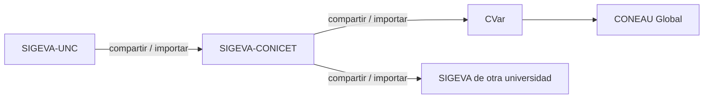

---
fuente:
  - "SIGEVA-UNC, sistema real (2026-11-08): pantallas de ingreso y de roles, Compartir formularios y Convocatorias vigentes"
  - "Manual del Investigador, UBA (7.ª ed.), 1 y 3.1"
  - "FAUD-UNC (2025), Instructivo de carga, introducción"
  - "Taller sobre SIGEVA, UNC, 2026-08-06 (diap. 2 y grabación) y 2026-08-13 (diap. 13 y grabación)"
  - "FCM-UNC (2022), Instructivo para generar Ficha Docente"
verificado_contra: ambos
fecha_verificacion: 2026-11-08
estado: verificado
---

# Qué es SIGEVA y cómo se relaciona con CONICET, CVar y CONEAU

Al terminar esta página vas a saber para qué sirve SIGEVA-UNC, en qué se diferencia de otros sistemas parecidos y por qué conviene tenerlo al día.

## Qué es

SIGEVA (**Sistema Integral de Gestión y Evaluación**) es una aplicación web desarrollada por el CONICET y usada por distintas universidades. Cada universidad tiene su propia **instalación**, con su propia dirección, sus usuarios y sus datos. La de la UNC es <https://sigeva.unc.edu.ar>.

En la UNC, SIGEVA cumple dos funciones, que corresponden a dos roles (ver [Roles](roles.md)):

- **Banco de datos.** Es tu currículum académico estructurado: datos personales, formación, cargos, antecedentes, producciones y otros antecedentes. Lo podés actualizar en cualquier momento del año, haya o no convocatorias abiertas.
- **Gestión de trámites.** Por SIGEVA se canalizan convocatorias de la universidad, como concursos docentes, evaluaciones docentes, informes (por ejemplo, de becas o de actividad docente) y convocatorias de becas y proyectos. Cuando te presentás, el sistema toma los datos de tu banco de datos.

## SIGEVA-UNC no es SIGEVA-CONICET

Son sistemas distintos. Cada uno pide su propio usuario y contraseña, y los datos **no pasan solos** de uno al otro. Lo mismo ocurre con CVar (el registro de CV del Ministerio de Ciencia) y con CONEAU Global.

Desde SIGEVA-UNC, el único sistema con el que se pueden compartir datos es **SIGEVA-CONICET**. A los demás se llega en cadena, en ese orden. El proceso, y lo que todavía no se verificó en los otros sistemas, se explica en [Sincronizar datos](../sincronizacion/index.md).

!!! tip "Sugerencia"
    Una de las consultas más frecuentes al soporte es la de quien ingresa a un sistema esperando ver los datos que cargó en otro. Antes de empezar, fijate en qué sistema pide la convocatoria que hagas el trámite.

## Por qué conviene tenerlo al día

- Cada antecedente que cargás hoy se reutiliza en presentaciones futuras sin volver a escribirlo.
- Las convocatorias toman la trayectoria directamente del banco, tal como está en el momento en que te presentás (ver [Proyectos y trámites](../proyectos-y-tramites/index.md)).
- La universidad usa esta información para sus propias evaluaciones institucionales.

!!! tip "Sugerencia"
    Tratalo como un registro permanente y no como un formulario de convocatoria. Si no podés cargar cada novedad en el momento, anotala y reservá un rato fijo (por ejemplo, una vez por mes) para pasarla al sistema.
