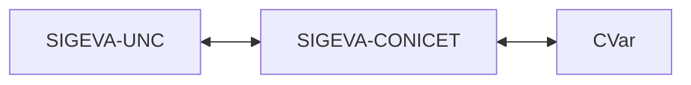

---
fuente:
  - "Manual del Usuario del Banco de Datos, UNC (2011), Introducción"
  - "Manual del Investigador, UBA (7.ª ed.), 1"
  - "CONICET, Sincronización de datos del CV, Guía Usuario v2 (2015)"
  - "CONICET, Instructivo para la sincronización Universidad–CONICET–CVar, v1.0 (2013)"
  - "FCM-UNC, Instructivo para generar Ficha Docente (2022)"
verificado_contra: ambos
fecha_verificacion: 2026-09-30
estado: pendiente_verificar
---

# Qué es SIGEVA y cómo se relaciona con CONICET y CVar

En esta página vas a ver para qué sirve SIGEVA-UNC y cómo se conecta con los otros sistemas donde también se te pide el currículum.

## Qué es

El Sistema Integral de Gestión y Evaluación (SIGEVA) es una aplicación web desarrollada por el CONICET y cedida a las universidades. La Universidad Nacional de Córdoba tiene su propia instalación en <https://sigeva.unc.edu.ar>. El pie de cada pantalla muestra la versión en uso (13.2.16.2 al 30 de septiembre de 2026).

SIGEVA tiene dos grandes usos:

1. **Banco de datos de actividades de ciencia y tecnología.** Es tu currículum cargado en formularios: datos personales, formación, cargos, antecedentes, producciones y otros antecedentes. Lo podés actualizar en cualquier momento, haya o no convocatorias abiertas.
2. **Presentaciones.** Cuando te postulás a una convocatoria o te sumás a un proyecto, el sistema toma los datos que ya tenés en el banco, sin que tengas que cargarlos de nuevo.

Esta guía se ocupa del primero. De las presentaciones solo cubre, por ahora, cómo [incorporarte a un trámite](../proyectos-y-tramites/index.md) con un código.

## SIGEVA-UNC, SIGEVA-CONICET y CVar

Cada institución que usa SIGEVA tiene su propia base de datos: lo que cargás en SIGEVA-UNC no aparece solo en SIGEVA-CONICET ni en CVar (el registro nacional de currículums). Para no tipear todo varias veces, existe una herramienta de **compartir e importar** formularios entre instalaciones.

En SIGEVA-UNC, la pantalla **Compartir formularios** ofrece un único destino: **CONICET**. La guía de sincronización del CONICET explica el motivo: para pasar datos entre dos instituciones que no son el CONICET hay que usar SIGEVA-CONICET como paso intermedio.

!!! note "Pendiente de verificar"
    El recorrido completo hasta CVar surge de los instructivos del CONICET (2013 y 2015) y de un instructivo de la Facultad de Ciencias Médicas de la UNC (2022). En SIGEVA-UNC se comprobó la pantalla de compartir, pero no se ejecutó ninguna sincronización.

El paso a paso está en [Compartir e importar datos](../sincronizacion/index.md).

## Para qué te sirve tener el banco de datos al día

- Las convocatorias que se gestionan por SIGEVA toman tu CV del banco en el momento en que te presentás o te incorporás a un trámite.
- Podés obtener tu currículum en PDF o Word desde [Imprimir CV](../cv/adjunto-impresion.md), completo o filtrado por secciones y fechas.
- Lo que cargás en una instalación lo podés llevar a las otras.

!!! tip "Sugerencia de la SeICyT"
    Elegí un sistema como «principal», mantené ese al día y sincronizá hacia los demás. Si cargás un poco en cada uno, después es difícil saber cuál tiene la versión correcta de cada registro.

## Fuentes

- Manual UNC (2011), Introducción; manual UBA (7.ª ed.), capítulo 1: descripción general del sistema.
- Guías de sincronización del CONICET (2013 y 2015) e instructivo de la FCM-UNC (2022): relación entre instalaciones y CVar.
- SIGEVA-UNC, pantallas **Principal** y **Compartir formularios**, relevadas el 2026-09-30.
