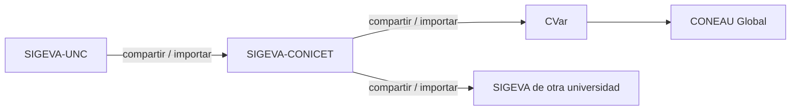

---
fuente:
  - "Manual del Investigador, UBA (7.ª ed.), 1 y 3.1"
  - "FAUD-UNC (2025), Instructivo de carga, introducción"
  - "Taller sobre SIGEVA, UNC, 2026-08-06 (diap. 2 y grabación) y 2026-08-13 (diap. 13 y grabación)"
  - "FCM-UNC (2022), Instructivo para generar Ficha Docente"
verificado_contra: manual
fecha_verificacion: 
estado: pendiente_verificar
---

# Qué es SIGEVA y cómo se relaciona con CONICET, CVar y CONEAU

Al terminar esta página vas a saber para qué sirve SIGEVA-UNC, en qué se diferencia de otros sistemas parecidos y por qué conviene tenerlo al día.

## Qué es

SIGEVA (Sistema Integral de Gestión y Evaluación) es una aplicación web que desarrolló el CONICET y que cedió a distintas universidades. Cada universidad tiene su propia **instalación**, con su propia dirección, sus usuarios y sus datos. La de la UNC es <https://sigeva.unc.edu.ar>.

En la UNC, SIGEVA cumple dos funciones:

- **Banco de datos.** Es tu currículum académico estructurado: formación, cargos, antecedentes, producción y otros antecedentes. Lo podés actualizar en cualquier momento del año, haya o no convocatorias abiertas.
- **Gestión de trámites.** Por SIGEVA se canalizan convocatorias de la universidad, como becas, proyectos de investigación, informes y, en algunas unidades académicas, concursos docentes. Cuando te presentás, el sistema toma los datos de tu banco de datos.

## SIGEVA-UNC no es SIGEVA-CONICET

Son sistemas distintos. Cada uno pide su propio usuario y contraseña, y los datos **no pasan solos** de uno al otro. Lo mismo ocurre con CVar (el registro de CV del Ministerio de Ciencia) y con CONEAU Global.

Los datos se pueden pasar de un sistema al siguiente, en ese orden, con la herramienta de compartir e importar. El proceso se explica en [Sincronizar datos](../sincronizacion/index.md).

!!! info "Criterio de otras áreas de la UNC"
    Los talleres de agosto de 2026 señalaron que una de las consultas más frecuentes al soporte es la de quien ingresa a un sistema esperando ver los datos que cargó en otro. Antes de empezar, fijate en qué sistema pide la convocatoria que hagas el trámite.

## Por qué conviene tenerlo al día

- Cada antecedente que cargás hoy se reutiliza en presentaciones futuras sin volver a escribirlo.
- Muchas convocatorias toman los datos directamente del banco, y en algunas lo que no está cargado no se considera (ver [Proyectos y trámites](../proyectos-y-tramites/index.md)).
- La universidad usa esta información para sus propias evaluaciones institucionales.

!!! tip "Sugerencia de la SeICyT"
    Tratalo como un registro permanente y no como un formulario de convocatoria. Si no podés cargar cada novedad en el momento, anotala y reservá un rato fijo (por ejemplo, una vez por mes) para pasarla al sistema.

## Fuentes

- Manual del Investigador, UBA (7.ª ed.), secciones 1 y 3.1.
- FAUD-UNC (2025), introducción.
- Talleres sobre SIGEVA, UNC: 6/8/2026 (diapositiva 2 y grabación) y 13/8/2026 (diapositiva 13 y grabación).
- FCM-UNC (2022), cadena SIGEVA-UNC → SIGEVA-CONICET → CVar → CONEAU Global.
