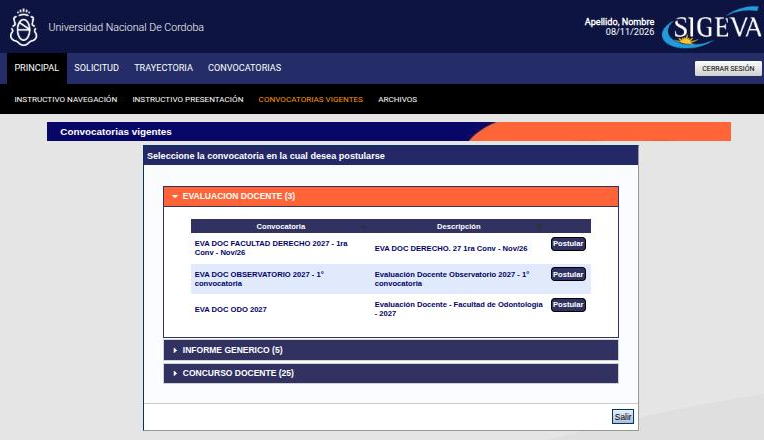
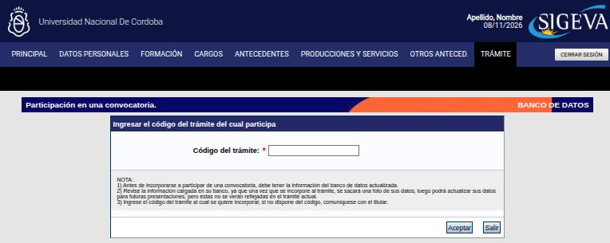

---
fuente:
  - "SIGEVA-UNC, sistema real (2026-11-08): solapa Trámite del banco de datos; rol Usuario presentación/solicitud (Principal de un trámite y Convocatorias vigentes)"
  - "Manual del Investigador, UBA (7.ª ed.), 3.14, 4.1–4.3.1, 4.3.5 y 5"
  - "UNC, Instructivo para creación de usuario y postulación en SIGEVA (concursos docentes, 2022)"
  - "CONICET, SIGEVA Módulo Evaluación Docente (2012)"
  - "Taller sobre SIGEVA, UNC, 2026-08-06 (grabación) y 2026-08-13 (diap. 7, grabación y demostración)"
verificado_contra: ambos
fecha_verificacion: 2026-11-08
estado: pendiente_verificar
---

# Proyectos y trámites

Cómo usar el banco de datos para presentarte a una convocatoria o sumarte a un proyecto, y qué cuidar antes de enviar.

!!! note "Alcance de esta versión"
    Esta guía no cubre todavía la postulación completa de un proyecto como director/a (carátula, presupuesto, integrantes). Para eso, seguí las bases y el instructivo de cada convocatoria.

## La regla: la «foto» del banco de datos

Cuando te incorporás a un trámite, **el sistema saca una «foto» de tu banco de datos en ese momento**. Así lo advierte la propia pantalla de **Trámite**: después podés actualizar tus datos para futuras presentaciones, pero esos cambios **no se reflejan** en el trámite actual. Esa foto es lo que ve quien evalúa.

!!! example "Ejemplo"
    Te asociás a un proyecto el 1 de marzo. El 10 de marzo te aceptan un artículo y lo cargás. El proyecto sigue mostrando tu banco del 1 de marzo, sin el artículo.

Por eso, **antes de presentarte**:

- [ ] Actualizá el banco de datos.
- [ ] Revisá el **lugar de trabajo** según lo que pidan las bases (ver [Datos personales](../cv/datos-personales.md#que-lugar-de-trabajo-poner)).
- [ ] Revisá la **experticia** y las palabras clave para esa convocatoria.
- [ ] Imprimí tu CV y controlá que no haya duplicados ni caracteres raros.
- [ ] Revisá si las bases piden **antecedentes de un período** determinado, por ejemplo los últimos años en una evaluación docente.

## Postularte a una convocatoria

Se hace con el rol **Usuario presentación/solicitud**. Su menú superior tiene **Principal**, **Solicitud**, **Trayectoria**, **Convocatorias** y **Cerrar sesión**. En la barra negra están **Instructivo navegación**, **Instructivo presentación**, **Convocatorias vigentes** y **Archivos**.

1. Ingresá con el rol **Usuario presentación/solicitud**.
2. En la barra negra, entrá a **Convocatorias vigentes**. Las convocatorias abiertas aparecen agrupadas por tipo (por ejemplo, evaluación docente, informes o concursos docentes); hacé clic en un grupo para desplegarlo.
3. Presioná **Postular** en la que corresponda.
4. Completá lo que pida la convocatoria (ver abajo) y enviá la presentación.

### La pantalla de un trámite

Una vez que te postulaste, la **Principal** del rol muestra el trámite elegido (si tenés varios, se cambia desde la lista de trámites) con estas partes:

- **Formularios a completar**, con la **fecha límite de presentación**. Cada formulario tiene un **estado**: **Ok** si tiene datos o **Sin Datos**.
    - **Solicitud**: lo propio de la convocatoria. En un concurso docente, por ejemplo: identificación, residencial, datos académicos, lugar de trabajo propuesto y recusación.
    - **Trayectoria**: los antecedentes, tomados del banco de datos (formación, cargos, financiamientos, formación de RR. HH., evaluación, extensión, otras actividades CyT, experticia, producciones, redes y eventos, premios y producción artística).
- **Archivos adjuntos**: los que pidan las bases (en un concurso, por ejemplo, la nota de solicitud de inscripción, el título y el CV nominal), cada uno con su estado.
- **Presentación**: el PDF de la presentación, con las opciones de imprimir los formularios para presentar en la UNC o recibir la presentación por correo. Según la pantalla, el trámite se imprime **después** de presionar **Enviar Presentación**, y antes hay que haber registrado y revisado toda la información.
- **Seguimiento**: el estado actual y las etapas (**Presentación**, **Gestión y Control** y **Resolución**), con su estado y fecha.

!!! tip "Revisá los estados antes de enviar"
    Un formulario en **Sin Datos** no siempre es un error (por ejemplo, si no tenés producción artística), pero sí es una señal para revisar que no te falte nada que pidan las bases.

!!! warning "Una vez enviada no se corrige"
    El instructivo de concursos de la UNC (2022) advierte que la presentación enviada no se puede modificar y que tiene carácter de declaración jurada. No se verificó en el sistema, porque requiere enviar una presentación.

Según la convocatoria, después puede hacer falta **imprimir** la presentación y entregarla en el área que corresponda (concursos, secretaría académica).

## Concursos docentes

Depende de la unidad académica y del tipo de llamado (ver [Roles](../primeros-pasos/roles.md#concursos-docentes)). En algunas se inscribe uno por SIGEVA y en otras se entrega el CV impreso desde SIGEVA. Cuando la inscripción es por SIGEVA, el concurso aparece en **Convocatorias vigentes**, en el grupo de concursos docentes, y se completa como cualquier trámite: datos académicos, lugar de trabajo propuesto, recusación y archivos adjuntos, y se envía con **Enviar Presentación**.

!!! danger "DECIDIR: ¿cuenta lo que no está en el banco de datos?"
    - **Qué dice cada fuente.** Según el taller sobre SIGEVA del 6/8/2026, en los concursos que se tramitan por SIGEVA lo que no está cargado en el banco no se considera, porque es la declaración jurada de antecedentes. En el del 13/8/2026 se aclaró que algunas comisiones usan también el CV adjunto para contrastar.
    - **Qué muestra el sistema.** Nada al respecto: depende del reglamento de cada concurso o convocatoria.
    - **Criterio propuesto, a confirmar.** **Cargá todo lo pertinente en el banco** y no confíes en el CV adjunto.

## Evaluación docente e informes

En **Convocatorias vigentes** hay grupos de **evaluación docente** y de **informes** (informes docentes y planes de trabajo, informes de avance y finales de becas, renovación de interinos), abiertos por distintas unidades académicas. Se tramitan igual que cualquier convocatoria: el banco de datos aporta la trayectoria (y al presentar se toma la «foto») y la convocatoria pide sus propios datos y adjuntos.

!!! note "Pendiente de verificar"
    Los formularios propios de una evaluación docente (según el CONICET, datos académicos como cargo, materia, legajo y resolución de designación, y adjuntos como el plan de trabajo y el informe). No se abrió ninguno, porque requiere postularse.

## Sumarte a un proyecto como integrante

Si la directora o el director de un proyecto te incluye en su presentación, te va a pasar un **código del trámite**.

1. Ingresá con el rol **Usuario banco de datos de actividades de CyT** y revisá que tu banco esté actualizado.
2. En el menú superior, entrá a **Trámite**. Se abre **Participación en una convocatoria**.
3. Escribí el **Código del trámite** y presioná **Aceptar**. **Salir** vuelve sin incorporarte.

Si no tenés el código, pedíselo a quien es titular del trámite.

!!! note "Pendiente de verificar"
    Qué pasa después de **Aceptar** y qué datos mínimos exige el sistema. Según el manual de la UBA, como mínimo hay que tener cargados datos personales, lugar de trabajo, formación académica y el CV adjunto. No se probó porque incorporarse a un trámite tiene efectos.

## Trámites de la FFyH por SIGEVA

La FFyH ya usó SIGEVA-UNC para **concursos docentes** y para **informes de avance de doctorado**. Al 8/11/2026 no tenía convocatorias abiertas en **Convocatorias vigentes**.

!!! note "Pendiente de relevar"
    Lista a completar con la SeICyT: convocatorias de becas y proyectos, informes y concursos que la Facultad tramita hoy por SIGEVA-UNC, con el rol y los pasos de cada uno.

## Fuentes de lo no verificado

- Manual del Investigador, UBA (7.ª ed.): 3.14 (proyectos y trámites) y 5 (otros integrantes): datos mínimos para sumarse a un trámite.
- UNC, instructivo de creación de usuario y postulación para concursos docentes (2022).
- CONICET, SIGEVA Módulo Evaluación Docente (2012).
- Taller sobre SIGEVA, UNC, 6/8/2026: grabación (concursos, declaración jurada).
- Taller sobre SIGEVA, UNC, 13/8/2026: grabación (CV adjunto en concursos).
