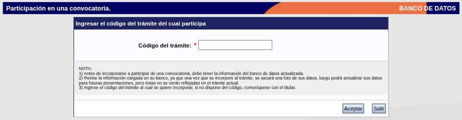

---
fuente:
  - "SIGEVA-UNC, solapa Trámite"
  - "Manual del Investigador, UBA (7.ª ed.), 3.14 y 5"
verificado_contra: ambos
fecha_verificacion: 2026-10-01
estado: pendiente_verificar
---

# Trámite

La solapa **Trámite** sirve para incorporarte a una presentación que otra persona inició —por ejemplo, sumarte como integrante al proyecto que presenta su director o directora—. Se hace con el rol de banco de datos y con un **código** que te pasa quien es titular del trámite.

La postulación propia a una convocatoria (becas, proyectos como director, concursos) se hace con otro rol y queda para una próxima versión de esta guía.

## Antes de empezar

- Pedile el **código del trámite** a su titular.
- **Actualizá tu banco de datos.** Es el paso más importante; el motivo está en el apartado siguiente.

## La «foto» de tus datos

La pantalla lo dice en sus notas: cuando te incorporás a un trámite, el sistema **saca una foto de tus datos** para ese trámite. Después podés seguir actualizando tu banco para presentaciones futuras, pero esos cambios **no se reflejan en el trámite al que ya te incorporaste**.

Un ejemplo. El lunes te incorporás a un proyecto. El martes cargás un artículo que te habías olvidado. Quien evalúe ese proyecto va a ver tu currículum del lunes, sin el artículo.

!!! tip "Sugerencia de la SeICyT"
    Antes de ingresar el código:

    1. Recorré la [pantalla principal](../cv/navegacion.md#la-pantalla-principal) y completá lo que falte.
    2. Revisá especialmente [cargos](../cv/cargos.md), [formación](../cv/formacion.md) y [publicaciones](../cv/publicaciones.md) de los últimos años.
    3. Generá el [PDF de tu CV](../cv/adjunto-impresion.md#imprimir-el-cv) y leelo: lo que veas ahí es lo que va a quedar en la foto.

## Paso a paso

1. Hacé clic en la solapa **Trámite**. Se abre la pantalla **Participación en una convocatoria**.

    

2. En **Código del trámite \***, escribí el código que te dieron.
3. Presioná **Aceptar**. **Salir** vuelve a la pantalla principal sin hacer nada.

Las tres notas de la pantalla indican, en resumen: tener el banco actualizado antes de incorporarse; revisar lo cargado, porque se toma una foto de los datos; y pedir el código al titular si no lo tenés.

!!! note "Pendiente de verificar"
    No se ingresó ningún código. El manual de la UBA describe que, después de aceptar, el sistema pide confirmar la asociación mostrando el nombre de quien dirige el proyecto, para que verifiques que es el correcto.

## Si necesitás actualizar datos después de incorporarte

El manual de la UBA indica que hay que pedirle a quien dirige el proyecto que te **desvincule** y volver a incorporarte con el banco ya actualizado, para que el sistema tome una foto nueva.

!!! note "Pendiente de verificar"
    Ese procedimiento no se comprobó en SIGEVA-UNC, y puede no estar disponible una vez cerrada la convocatoria.

## Datos mínimos

El manual de la UBA señala que, para asociarse a un proyecto, hay que tener cargados como mínimo los datos personales, el lugar de trabajo, la formación académica y el currículum en archivo adjunto.

!!! note "Pendiente de verificar"
    Los requisitos mínimos de SIGEVA-UNC pueden ser otros y variar según la convocatoria.

## Fuentes

- SIGEVA-UNC, solapa **Trámite**, relevada el 2026-09-30 y capturada el 2026-10-01.
- Manual UBA (7.ª ed.), 3.14 y capítulo 5: confirmación de la asociación, desvinculación y datos mínimos.
