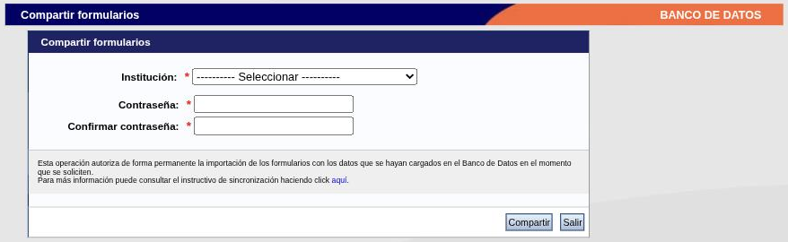
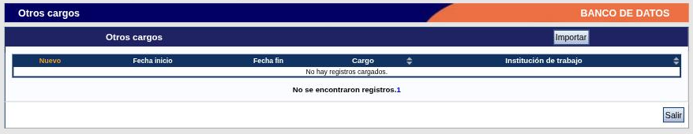

---
fuente:
  - "SIGEVA-UNC, Principal → Compartir forms. y botón Importar de las tablas"
  - "CONICET, Sincronización de datos del CV, Guía Usuario v2 (2015)"
  - "CONICET, Instructivo para la sincronización Universidad–CONICET–CVar, v1.0 (2013)"
  - "Manual del Investigador, UBA (7.ª ed.), 3.3; Manual del Usuario del Banco de Datos, UNC (2011), Instrucciones para compartir/importar datos"
verificado_contra: ambos
fecha_verificacion: 2026-09-30
estado: pendiente_verificar
---

# Compartir e importar datos

Si ya cargaste tu currículum en una instalación de SIGEVA, no hace falta tipearlo otra vez en las demás. Acá vas a ver cómo pasar los datos de un sistema a otro.

!!! warning "Qué está verificado y qué no"
    En SIGEVA-UNC se relevó la pantalla **Compartir formularios** y se constató que cada tabla tiene su botón **Importar**. **No se ejecutó ninguna de las dos operaciones.** El procedimiento completo proviene de la guía de sincronización del CONICET (2015), que es además el documento al que remite el propio sistema.

## La idea general

La sincronización tiene dos etapas, siempre en este orden:

1. **Compartir**, en el sistema de **origen** (el que tiene los datos al día). Se hace una vez y vale para todos los formularios.
2. **Importar**, en el sistema de **destino**. Se hace tabla por tabla.

No se puede importar lo que antes no se compartió. Y solo podés hacerlo vos sobre tu propio currículum, o una persona que hayas designado como [colaboradora](../primeros-pasos/roles.md#colaborador): no existe una migración en bloque de varios currículums.

Desde SIGEVA-UNC el único destino disponible es el **CONICET**. La guía del CONICET lo explica: entre dos instituciones que no son el CONICET hay que pasar por SIGEVA-CONICET.

| Querés llevar tus datos… | Recorrido |
|---|---|
| De SIGEVA-UNC a SIGEVA-CONICET | Compartir en la UNC → importar en CONICET |
| De SIGEVA-CONICET a SIGEVA-UNC | Compartir en CONICET → importar en la UNC |
| De SIGEVA-UNC a CVar | Compartir en la UNC → importar en CONICET → compartir en CONICET → importar en CVar |
| De CVar a SIGEVA-UNC | El mismo recorrido, en sentido inverso |

## Paso 1: compartir (en el sistema de origen)

En SIGEVA-UNC:

1. Ingresá con el rol **Usuario banco de datos de actividades de CyT**.
2. Andá a **Principal → Compartir forms.**, o al enlace **Compartir formularios** al pie de la pantalla principal.

    

3. En **Institución \***, elegí **CONICET** (es la única opción).
4. Escribí una **Contraseña \*** y repetila en **Confirmar contraseña \***.
5. Presioná **Compartir**.

Sobre la contraseña, la guía del CONICET aclara que **no es la de ingreso**: es una clave que inventás solo para esta operación y que el sistema de destino te va a pedir al importar. Anotala.

La pantalla advierte que esta operación **autoriza de forma permanente** la importación de los formularios, con los datos que estén cargados en el banco en el momento en que se soliciten. Es decir: no fija una copia; lo que agregues después también podrá importarse.

!!! note "Diferencias con los manuales anteriores"
    Los manuales de la UBA y de la UNC (2011) describen una pantalla con un rango de años y casillas para elegir qué formularios compartir, y un botón «Dejar de compartir». La pantalla actual de SIGEVA-UNC solo pide institución y contraseña. No se comprobó cómo se revoca hoy la autorización.

## Paso 2: importar (en el sistema de destino)

Según la guía del CONICET:

1. Ingresá al sistema de destino con el rol de banco de datos.
2. Entrá al apartado que querés actualizar y ubicá la tabla.
3. Presioná el botón **Importar** de esa tabla.
4. Elegí la **institución** desde la que compartiste y escribí la **contraseña** que definiste al compartir.
5. Confirmá. Repetí en cada tabla que quieras traer.

En SIGEVA-UNC el botón **Importar** está en el encabezado de cada tabla, a la derecha del título:

Qué pasa con lo que ya tenías cargado, según la misma guía:

- Los registros importados **se agregan** a los existentes.
- Si un registro es igual a uno que ya está, **no se duplica**.
- Si el mismo registro fue modificado en uno de los dos sistemas, queda **el último modificado**.

!!! note "Pendiente de verificar"
    No se abrió la pantalla de importación de SIGEVA-UNC ni se comprobó en la práctica el criterio de duplicados.

## Qué no viaja

- **Datos personales.** El manual de la UBA indica que Identificación, Dirección residencial y Lugar de trabajo no se comparten: hay que cargarlos en cada sistema.
- **Archivos adjuntos en CVar.** La guía del CONICET advierte que CVar no admite archivos adjuntos. Si cargaste primero en CVar, los textos completos hay que subirlos después en el SIGEVA de destino.

!!! note "Pendiente de verificar"
    El manual de la UNC de 2011 lista solo ocho secciones habilitadas para compartir. El sistema cambió mucho desde entonces y no se comprobó cuáles viajan hoy; en particular, falta confirmar si lo hace [Experticia en CyT](../cv/experticia.md).

## Recorrido completo de la UNC a CVar

1. En **SIGEVA-UNC**: compartí con CONICET (paso 1).
2. En **SIGEVA-CONICET**: ingresá con el rol de banco de datos e importá tabla por tabla, eligiendo como institución la UNC y usando la contraseña del paso anterior.
3. En **SIGEVA-CONICET**: compartí con CVar, con una contraseña (puede ser otra).
4. En **CVar**: ingresá con el rol de currículum e importá en cada formulario, eligiendo CONICET y esa contraseña.

La guía del CONICET señala que, si no tenés el rol de banco de datos en SIGEVA-CONICET, hay que obtenerlo antes; el trámite se hace en el sitio del CONICET.

!!! tip "Sugerencia de la SeICyT"
    - Antes de importar, generá un [PDF de tu CV](../cv/adjunto-impresion.md#imprimir-el-cv) en el sistema de destino. Si algo sale mal, tenés con qué comparar.
    - Empezá por una tabla chica (por ejemplo, Premios) para ver cómo se comporta, y recién después importá publicaciones.
    - Después de importar, revisá instituciones y autores: son los datos que más cambian de un sistema a otro.
    - Definí cuál es tu sistema principal y sincronizá siempre en el mismo sentido.

## Problemas frecuentes

- **El sistema de destino no muestra nada para importar.** Verificá que hayas compartido primero en el origen y que la institución elegida al importar sea la correcta.
- **La contraseña no coincide.** Es la que definiste al compartir, no la de ingreso. Si la perdiste, volvé a compartir con una nueva.

## Fuentes

- SIGEVA-UNC, pantalla **Compartir formularios** y tablas, relevadas el 2026-09-30, sin ejecutar la operación.
- Guía de sincronización del CONICET v2 (2015) e instructivo Universidad–CONICET–CVar (2013): procedimiento, contraseña, criterio de duplicados, recorrido por CONICET y limitación de CVar.
- Manual UBA (7.ª ed.), 3.3, y manual UNC (2011): versión anterior de la pantalla y secciones que no se comparten.
