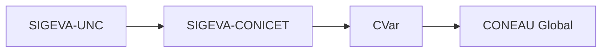

---
fuente:
  - "Taller sobre SIGEVA, UNC, 2026-08-06 (grabación) y 2026-08-13 (diap. 13, grabación y demostración)"
  - "CONICET, Sincronización de datos del CV, Guía Usuario v2 (2015)"
  - "CONICET, Instructivo para la Sincronización de Datos Universidad–CONICET–CVAR v1.0 (2013)"
  - "FCM-UNC (2022), Instructivo para generar Ficha Docente"
  - "Manual del Investigador, UBA (7.ª ed.), 3.3"
  - "Manual del Usuario del Banco de Datos, UNC (2011), Instrucciones para compartir/importar datos"
verificado_contra: manual
fecha_verificacion: 
estado: pendiente_verificar
---

# Sincronizar datos con SIGEVA-CONICET, CVar y CONEAU Global

Al terminar esta página vas a poder pasar los datos de tu CV de SIGEVA-UNC a otros sistemas sin volver a cargarlos.

!!! warning "No es automático ni instantáneo"
    Hay que hacerlo **en cada sistema y en cada ítem del CV**. Lleva tiempo, y después conviene revisar qué pasó y qué quedó duplicado.

## El recorrido

Los sistemas se encadenan siempre en este orden:

- Para llegar a CVar o a CONEAU Global (por ejemplo, para una categorización o una ficha docente), primero pasás de SIGEVA-UNC a SIGEVA-CONICET, después de SIGEVA-CONICET a CVar, y CONEAU Global toma los datos de CVar.
- Entre **dos universidades** (por ejemplo, de SIGEVA-UNC al SIGEVA de otra universidad), también se pasa por SIGEVA-CONICET: desde SIGEVA-UNC el único destino ofrecido es CONICET.
- **Cada sistema tiene su propio usuario y contraseña.** Si nunca entraste a alguno, primero creá tu cuenta ahí.

!!! info "Criterio de otras áreas de la UNC"
    Para la ficha docente de CONEAU, la FCM indica tildar «Tengo una ficha creada en CVar» al crear la cuenta de CONEAU Global (FCM-UNC, 2022).

## Paso 1. Compartir, en el sistema de origen

Se hace **una sola vez** por cada destino.

1. En SIGEVA-UNC, con el rol de banco de datos, entrá a **Principal › Compartir formularios**.
2. Elegí la institución de destino (desde SIGEVA-UNC, CONICET).
3. Elegí qué formularios compartir. Según el manual de la UBA se puede indicar también un rango de años.
4. Escribí y repetí una **contraseña de sincronización** y presioná **Compartir**.

!!! tip "La contraseña de sincronización"
    Es solo para esta operación: **no** es tu contraseña de ingreso a ningún sistema. Elegí una simple y anotala, porque la vas a escribir en cada ítem que importes. Podés usar la misma en todas las plataformas.

Según el manual de la UBA, mientras el compartir esté activo, lo que agregues o modifiques queda disponible para importar. Para cortarlo, está el botón **Dejar de compartir**.

## Paso 2. Importar, en el sistema de destino

Se hace **en cada ítem** que quieras traer.

1. Entrá al sistema de destino (por ejemplo, SIGEVA-CONICET) con su propio usuario.
2. Andá al ítem que querés actualizar (por ejemplo, Formación académica o Artículos).
3. Presioná **Importar**.
4. Elegí la institución de origen (UNC), escribí la contraseña de sincronización y presioná **Importar**.
5. Repetí en cada ítem.

Después, para seguir a CVar, compartí desde SIGEVA-CONICET hacia CVar y repetí el paso 2 en CVar.

## Después de importar: revisar

- **Compará las cantidades.** La columna **Cant.** de la pantalla Principal del origen y del destino te deja ver si pasó todo. Si en el destino hay más registros que en el origen, probablemente haya duplicados.
- **Editá en destino.** En el sistema de destino podés corregir, borrar duplicados o arreglar caracteres que se hayan importado mal.
- **Lo importado y lo cargado a mano se ven igual.** El sistema no los distingue.

!!! question "Las fuentes no coinciden: ¿duplica o no duplica?"
    La guía de sincronización de CONICET (2015) dice que lo importado se agrega **sin duplicar** registros iguales y que, si un registro cambió, queda el último modificado. En el taller del 13/8/2026 se explicó que lo que cambió mucho puede quedar **duplicado** (el registro viejo y el nuevo), y que si actualizaste mucho tu CV puede convenir **borrar los registros en destino y volver a importar**. Antes de borrar, imprimí o guardá tu CV del destino.

## Qué no se sincroniza

!!! note "Pendiente de verificar"
    Según el manual de la UBA, no se comparten identificación, dirección residencial ni lugar de trabajo. El manual de la UNC (2011) habilitaba solo ocho secciones y no incluía formación académica ni carrera de investigador, pero el taller del 13/8/2026 mostró la importación de formación académica. Según CONICET, CVar no admite archivos adjuntos. Hay que verificar qué secciones admite hoy SIGEVA-UNC.

## Si algo falla

- **No tenés las claves de algún sistema**: recuperalas en ese sistema antes de empezar.
- **CONEAU Global no te deja entrar** con un usuario recién creado o cambiado: esperá 48 horas y, si sigue, escribí a su soporte.
- **Otra persona puede sincronizar por vos**: según CONICET, un colaborador designado también puede hacerlo (ver [Roles](../primeros-pasos/roles.md)).

## Fuentes

- Taller sobre SIGEVA, UNC, 6/8/2026: grabación (orden de los sistemas).
- Taller sobre SIGEVA, UNC, 13/8/2026: diapositiva 13, grabación y demostración en pantalla.
- CONICET, Sincronización de datos del CV, Guía Usuario v2 (2015).
- CONICET, Instructivo para la Sincronización de Datos Universidad–CONICET–CVAR, v1.0 (2013).
- FCM-UNC (2022), ficha docente CONEAU.
- Manual del Investigador, UBA (7.ª ed.), 3.3.
- Manual del Usuario del Banco de Datos, UNC (2011): compartir e importar datos.
