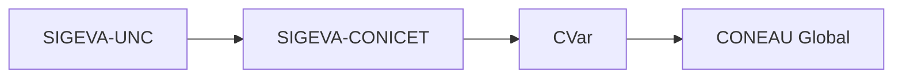
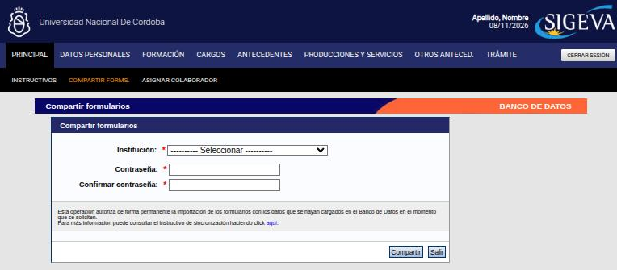

---
fuente:
  - "SIGEVA-UNC, sistema real (2026-11-08): Compartir formularios, pantalla Importar y botones Importar de cada pantalla del banco de datos"
  - "Taller sobre SIGEVA, UNC, 2026-08-06 (grabación) y 2026-08-13 (diap. 13, grabación y demostración)"
  - "CONICET, Sincronización de datos del CV, Guía Usuario v2 (2015)"
  - "CONICET, Instructivo para la Sincronización de Datos Universidad–CONICET–CVAR v1.0 (2013)"
  - "FCM-UNC (2022), Instructivo para generar Ficha Docente"
  - "Manual del Investigador, UBA (7.ª ed.), 3.3"
  - "Manual del Usuario del Banco de Datos, UNC (2011), Instrucciones para compartir/importar datos"
verificado_contra: ambos
fecha_verificacion: 2026-11-08
estado: verificado
---

# Sincronizar datos con SIGEVA-CONICET, CVar y CONEAU Global

Al terminar esta página vas a poder pasar los datos de tu CV de SIGEVA-UNC a otros sistemas sin volver a cargarlos.

!!! warning "No es automático ni instantáneo"
    Hay que hacerlo **en cada sistema y en cada ítem del CV**. Lleva tiempo, y después conviene revisar qué pasó y qué quedó duplicado.

## El recorrido

Desde SIGEVA-UNC, el único destino posible es **CONICET**: es la única institución que ofrecen las pantallas de compartir e importar. Los demás sistemas se alcanzan en cadena:

- Para llegar a CVar o a CONEAU Global (por ejemplo, para una categorización o una ficha docente), primero pasás de SIGEVA-UNC a SIGEVA-CONICET, después de SIGEVA-CONICET a CVar, y CONEAU Global toma los datos de CVar.
- Para pasar datos a otra universidad, también se pasa por SIGEVA-CONICET.
- **Cada sistema tiene su propio usuario y contraseña.** Si nunca entraste a alguno, primero creá tu cuenta ahí.

!!! note "Fuera de SIGEVA-UNC: según las fuentes, sin verificar"
    Los pasos dentro de SIGEVA-CONICET, CVar y CONEAU Global no se verificaron en esos sistemas. Provienen de los talleres sobre SIGEVA de la UNC (6 y 13/8/2026) y de las guías de sincronización de CONICET (2013 y 2015). Para la ficha docente de CONEAU, la FCM indica tildar «Tengo una ficha creada en CVar» al crear la cuenta de CONEAU Global (FCM-UNC, 2022).

## Paso 1. Compartir, en SIGEVA-UNC

Se hace **una sola vez**.

1. En la Principal del banco de datos, en la barra negra, entrá a **Compartir forms.** (también está al pie de la Principal, como **Compartir formularios**).
2. En **Institución**, elegí **CONICET**.
3. Escribí una **contraseña de sincronización** en **Contraseña** y repetila en **Confirmar contraseña**.
4. Presioná **Compartir**. **Salir** vuelve sin compartir.

No se eligen formularios ni períodos: según la leyenda de la pantalla, la operación **autoriza de forma permanente** la importación de los formularios, con los datos que haya en el banco **en el momento en que se importen**. Por eso, lo que agregues o corrijas después también queda disponible.

!!! tip "La contraseña de sincronización"
    Es solo para esta operación: **no** es tu contraseña de ingreso a ningún sistema. Elegí una simple y anotala, porque la vas a escribir en cada ítem que importes.

!!! note "Pendiente de verificar"
    Cómo se revoca la autorización. Según el manual de la UBA hay un botón **Dejar de compartir**, pero no aparece en la pantalla de SIGEVA-UNC, que habla de una autorización «permanente». Puede que aparezca solo después de haber compartido.

## Paso 2. Importar, en el sistema de destino

Se hace **en cada ítem** que quieras traer.

1. Entrá al sistema de destino (por ejemplo, SIGEVA-CONICET) con su propio usuario.
2. Andá al ítem que querés actualizar (por ejemplo, Formación académica o Artículos).
3. Presioná **Importar**, arriba a la derecha de la tabla.
4. Elegí la institución de origen, escribí la contraseña de sincronización y presioná **Importar**.
5. Repetí en cada ítem.

En SIGEVA-UNC, la pantalla **Importar** pide exactamente eso: **Institución** (CONICET), **Contraseña** y los botones **Importar** y **Volver**. Sirve para traer a SIGEVA-UNC lo que tengas cargado en SIGEVA-CONICET.

Después, para seguir a CVar, compartí desde SIGEVA-CONICET hacia CVar y repetí el paso 2 en CVar.

## Qué se puede importar en SIGEVA-UNC

El botón **Importar** no está en todos lados:

| Se puede importar | No se puede importar |
|---|---|
| Formación académica (un solo botón para todos los niveles) y cada ítem de formación complementaria | **Datos personales**: identificación, dirección residencial, lugar de trabajo y experticia en CyT |
| Todos los ítems de Cargos | En Evaluación, todo salvo «Evaluación de personal CyT y jurado de tesis y/o premios» |
| Todos los ítems de Formación de recursos humanos, Financiamiento CyT, Extensión y Otras actividades CyT | En Producción artística: Género literario dramático, poético o ensayo; Género literario guion; Otro tipo de género literario |
| Evaluación de personal CyT y jurado de tesis y/o premios | |
| Todos los ítems de Publicaciones, Servicios y Bienes intensivos en conocimiento; Desarrollos (un solo botón para la pantalla) | |
| Producción artística: musical-sonora, visual, audiovisual, corporal o teatral, género literario narrativo y otra producción artística | |
| Todos los ítems de Redes, gestión editorial y eventos; Premios; Curriculum vitae adjunto | |

Lo que no se puede importar hay que cargarlo a mano en cada sistema.

## Después de importar: revisar

- **Compará las cantidades.** La columna **Cant.** de la pantalla Principal del origen y del destino te deja ver si pasó todo. Si en el destino hay más registros que en el origen, probablemente haya duplicados.
- **Editá en destino.** En el sistema de destino podés corregir, borrar duplicados o arreglar caracteres que se hayan importado mal.

!!! danger "DECIDIR: ¿la importación duplica registros?"
    - **Qué dice cada fuente.** La guía de sincronización de CONICET (2015) dice que lo importado se agrega **sin duplicar** registros iguales y que, si un registro cambió, queda el último modificado. En el taller sobre SIGEVA del 13/8/2026 se explicó que lo que cambió mucho puede quedar **duplicado** (el registro viejo y el nuevo), y que si actualizaste mucho tu CV puede convenir **borrar los registros en destino y volver a importar**.
    - **Qué muestra el sistema.** Las pantallas de SIGEVA-UNC no dicen nada al respecto. No se probó porque importar modifica datos.
    - **Qué hay que decidir.** Qué recomienda el manual. Si se aconseja borrar y reimportar, hay que advertir que antes se imprima o guarde el CV del destino.

## Si algo falla

- **No tenés las claves de algún sistema**: recuperalas en ese sistema antes de empezar.
- **CONEAU Global no te deja entrar** con un usuario recién creado o cambiado: según los talleres sobre SIGEVA de 2026, hay que esperar 48 horas y, si sigue, escribir a su soporte.
- **Otra persona puede ayudarte con la carga**: desde **Asignar colaborador** podés darle a alguien el rol de colaborador de tu banco de datos (ver [Roles](../primeros-pasos/roles.md)).

## Fuentes de lo no verificado

- Taller sobre SIGEVA, UNC, 6/8/2026 y 13/8/2026: recorrido entre sistemas, duplicados, CONEAU Global.
- CONICET, Sincronización de datos del CV, Guía Usuario v2 (2015), y CONICET, Instructivo para la Sincronización de Datos Universidad–CONICET–CVAR, v1.0 (2013).
- FCM-UNC (2022), ficha docente CONEAU.
- Manual del Investigador, UBA (7.ª ed.), 3.3: «Dejar de compartir».
